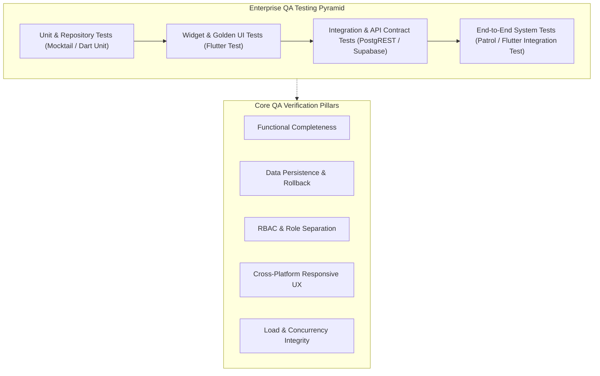
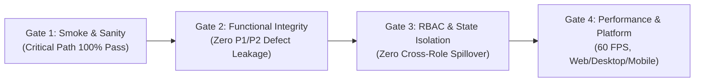
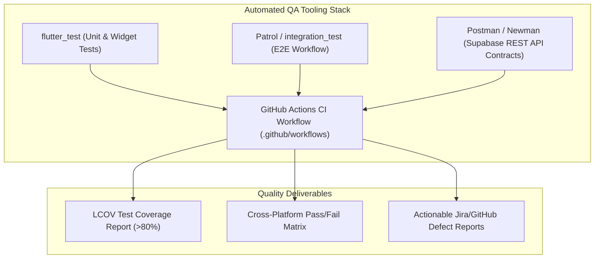
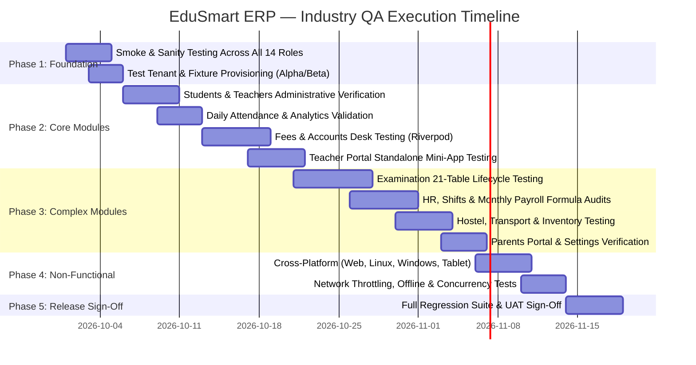

# EduSmart School ERP — Enterprise Quality Assurance (QA) Master Roadmap

> **Document Version:** 1.0.0 — Enterprise Standard  
> **Lead Role:** Principal QA Architect / Test Lead  
> **Target Scope:** 12 Feature Modules, Administrative Shell, Standalone Teacher Portal, 14 User Personas, 104 Database Tables  
> **Testing Objective:** Full-scope verification of functional integrity, data accuracy, cross-platform stability, state management boundaries, and performance under real-world school operating conditions.

---

## Table of Contents

1. [Executive Summary & Testing Philosophy](#1-executive-summary--testing-philosophy)
2. [Quality Assurance Framework & Quality Gates (DoD)](#2-quality-assurance-framework--quality-gates-dod)
3. [Test Environment, Fixtures & Test Data Architecture](#3-test-environment-fixtures--test-data-architecture)
4. [Module-by-Module In-Depth Test Plans (All 12 Modules + Shell)](#4-module-by-module-in-depth-test-plans)
   - [4.1 Authentication, Role Resolution & Shell Navigation](#41-authentication-role-resolution--shell-navigation)
   - [4.2 Institutional Overview Dashboard](#42-institutional-overview-dashboard)
   - [4.3 Students Module (Admissions, Directory & TC)](#43-students-module)
   - [4.4 Teachers Module (Administrative Roster)](#44-teachers-module)
   - [4.5 Teacher Portal (Standalone Classroom Mini-App)](#45-teacher-portal)
   - [4.6 Daily Attendance & Analytics Module](#46-daily-attendance--analytics-module)
   - [4.7 Fees & Accounts Management Module (Riverpod Scoped)](#47-fees--accounts-management-module)
   - [4.8 Examination & Grading Lifecycle Module (21 Tables)](#48-examination--grading-lifecycle-module)
   - [4.9 Transport & Fleet Management Module](#49-transport--fleet-management-module)
   - [4.10 Hostel Hub Module (Riverpod Scoped)](#410-hostel-hub-module)
   - [4.11 HR & Monthly Payroll Module](#411-hr--monthly-payroll-module)
   - [4.12 Inventory & Asset Supplies Module](#412-inventory--asset-supplies-module)
   - [4.13 Parents & Student Portal (Multi-Child Shell)](#413-parents--student-portal)
   - [4.14 System Settings & Configuration Module](#414-system-settings--configuration-module)
5. [Cross-Cutting Non-Functional Testing Dimensions](#5-cross-cutting-non-functional-testing-dimensions)
   - [5.1 Multi-Platform & Responsive Rendering (<1100px vs >=1100px)](#51-multi-platform--responsive-rendering)
   - [5.2 State Coexistence & Memory Leak Testing (Provider + Riverpod)](#52-state-coexistence--memory-leak-testing)
   - [5.3 Network Resiliency, Offline Fallback & Latency Simulation](#53-network-resiliency-offline-fallback--latency-simulation)
   - [5.4 Concurrency, Double-Click & Race Condition Testing](#54-concurrency-double-click--race-condition-testing)
6. [Automated Testing Strategy & Tooling Stack](#6-automated-testing-strategy--tooling-stack)
7. [Defect Severity Classification, SLA & Bug Lifecycle](#7-defect-severity-classification-sla--bug-lifecycle)
8. [Phased QA Execution Schedule & Milestones](#8-phased-qa-execution-schedule--milestones)

---

## 1. Executive Summary & Testing Philosophy

EduSmart School ERP is a multi-tenant, cloud-connected Flutter application interfacing directly with Supabase via PostgREST and WebSockets. Testing an enterprise application of this nature requires more than basic manual UI verification; it requires a structured, multi-dimensional Quality Assurance framework mirroring enterprise software testing practices.

### Core Principles
1. **Zero Silent Failures**: Every network call, Supabase mutation, and business validation must fail visibly with user-friendly alerts, never crashing silently or leaving spinners hanging indefinitely.
2. **Optimistic UI with Rollback Verification**: On user actions (e.g., student deletion, fee waiver, attendance toggle), UI updates immediately, but must rollback to previous state if the Supabase write fails.
3. **Multi-Tenant Scoping Validation**: Ensure all queries return strictly scoped datasets belonging to the authenticated user's `institution_id`.
4. **Cross-Role Hermetic Isolation**: Ensure strict separation between the administrative shell and the standalone Teacher Portal.

---

## 2. Quality Assurance Framework & Quality Gates (DoD)

To ensure that each module meets enterprise release criteria, it must pass four strict Quality Gates:

### Definition of Done (DoD) for Each Module:
- [ ] **100% Core Workflow Execution**: All CRUD operations, filters, searches, and exports execute cleanly.
- [ ] **Data Persistence Confirmed**: Verified by direct PostgreSQL inspection in Supabase that modified records reflect correct column types, foreign keys, and timestamps.
- [ ] **Form Validation Rigor**: Boundary value inputs (empty fields, special characters, max length, negative numbers, future dates where prohibited) handled gracefully with descriptive field errors.
- [ ] **Zero Unhandled Exceptions**: No Flutter red-screen crash, uncaught Dart `Future` error, or unhandled PostgREST exceptions in console logs.
- [ ] **Memory & State Sanitation**: Switching between modules 50+ times must not produce memory bloat or leaked Riverpod/Provider subscriptions.
- [ ] **Cross-Platform Responsive Verification**: Verified on Web (Chrome/Firefox), Desktop (Linux/Windows), and narrow viewports (<1100px) with no layout overflows.

---

## 3. Test Environment, Fixtures & Test Data Architecture

Industry-standard testing requires reproducible test environments with isolated fixture datasets.

### 3.1 Test Tenant Provisioning
Create two distinct institutions in Supabase to test multi-tenant data boundaries:
1. **Tenant Alpha**: `institution_id = '00000000-0000-0000-0000-000000000001'` (Primary Test School)
2. **Tenant Beta**: `institution_id = '00000000-0000-0000-0000-000000000002'` (Secondary Isolation School)

### 3.2 Standardized Persona Test Accounts
Each of the 14 defined roles must have pre-provisioned credentials in `auth.users` and `public.profiles`:

| Role ID | Persona | Login ID | Email Format | Primary Test Verification |
|---|---|---|---|---|
| `PRC001` | Principal | `PRC001` | `prc001@edusmart.local` | Full 12-section visibility + Approvals action active |
| `VPR001` | Vice Principal | `VPR001` | `vpr001@edusmart.local` | Full 12-section visibility + Approvals tile locked |
| `STA001` | Students Admin | `STA001` | `sta001@edusmart.local` | Students module only; all other sections hidden |
| `TEA001` | Teachers Admin | `TEA001` | `tea001@edusmart.local` | Teachers module only |
| `ATD001` | Attendance Admin | `ATD001` | `atd001@edusmart.local` | Attendance module only |
| `FEE001` | Fees Admin | `FEE001` | `fee001@edusmart.local` | Fees module only (Riverpod scope) |
| `EXM001` | Exam Admin | `EXM001` | `exm001@edusmart.local` | Examination module only |
| `TRP001` | Transport Admin | `TRP001` | `trp001@edusmart.local` | Transport module only |
| `HRA001` | HR Admin | `HRA001` | `hra001@edusmart.local` | HR & Payroll module only |
| `HST001` | Hostel Admin | `HST001` | `hst001@edusmart.local` | Hostel module only (Riverpod scope) |
| `PTI001` | PTI (Sports/Store) | `PTI001` | `pti001@edusmart.local` | Inventory module only |
| `STU001` | Student / Parent | `STU001` | `stu001@edusmart.local` | Parent & Student portal only |
| `SET001` | Settings Admin | `SET001` | `set001@edusmart.local` | Settings module only |
| `TCH001` | Class Teacher | `TCH001` | `tch001@edusmart.local` | Standalone full-screen Teacher Portal; zero admin shell |

---

## 4. Module-by-Module In-Depth Test Plans

---

### 4.1 Authentication, Role Resolution & Shell Navigation
- **Primary Source Files**: [`lib/main.dart`](file:///home/user/Documents/git_repos/Nivida-projects/school-erp-testing/School_CRM_Final_ERP_backend_completed%20%281%29/School_CRM_Final_ERP/merged/lib/main.dart), [`lib/login/`](file:///home/user/Documents/git_repos/Nivida-projects/school-erp-testing/School_CRM_Final_ERP_backend_completed%20%281%29/School_CRM_Final_ERP/merged/lib/login/), [`lib/screens/dashboard_screen.dart`](file:///home/user/Documents/git_repos/Nivida-projects/school-erp-testing/School_CRM_Final_ERP_backend_completed%20%281%29/School_CRM_Final_ERP/merged/lib/screens/dashboard_screen.dart), [`lib/widgets/sidebar.dart`](file:///home/user/Documents/git_repos/Nivida-projects/school-erp-testing/School_CRM_Final_ERP_backend_completed%20%281%29/School_CRM_Final_ERP/merged/lib/widgets/sidebar.dart).
- **Test Scenarios**:
  1. **Case-Insensitive Login Translation**: Input `prc001`, `PRC001`, or `  prc001  `. Validate that string trimming and uppercasing generates `prc001@edusmart.local`.
  2. **Invalid Credentials Handling**: Enter wrong password. Validate that `_resolveRole` returns `null` and displays a non-crashing floating error SnackBar.
  3. **Role Lookup Absence**: Sign in with an account that exists in `auth.users` but has no corresponding row in `public.profiles`. Verify graceful failure.
  4. **Dynamic Sidebar Filter**: Log in as `STA001` (Students Admin) and verify sidebar renders **only** the Students module. Confirm no URL or button manipulation allows navigating to Fees or Settings.
  5. **Principal vs. Vice-Principal Approvals Lock**:
     - Log in as `PRC001` -> Click Approvals -> Verify `_ApprovalsDialog` opens with pending leaves, waivers, and papers.
     - Log in as `VPR001` -> Verify padlock icon is displayed -> Click Approvals -> Verify dialog is blocked and floating SnackBar warns: *"Approvals are locked for Vice Principal — only the Principal can approve."*
  6. **Clean Logout Lifecycle**: Trigger logout from sidebar or teacher portal. Verify session is wiped from memory, Supabase token invalidated, and UI returns cleanly to the login screen with inputs cleared.

---

### 4.2 Institutional Overview Dashboard
- **Primary Source Files**: [`lib/screens/dashboard_screen.dart`](file:///home/user/Documents/git_repos/Nivida-projects/school-erp-testing/School_CRM_Final_ERP_backend_completed%20%281%29/School_CRM_Final_ERP/merged/lib/screens/dashboard_screen.dart), [`lib/data/dashboard_repository.dart`](file:///home/user/Documents/git_repos/Nivida-projects/school-erp-testing/School_CRM_Final_ERP_backend_completed%20%281%29/School_CRM_Final_ERP/merged/lib/data/dashboard_repository.dart), [`lib/widgets/`](file:///home/user/Documents/git_repos/Nivida-projects/school-erp-testing/School_CRM_Final_ERP_backend_completed%20%281%29/School_CRM_Final_ERP/merged/lib/widgets/).
- **Test Scenarios**:
  1. **KPI Card Mathematical Accuracy**:
     - Compare `totalStudents` counter against `SELECT count(*) FROM students WHERE institution_id = X`.
     - Compare `totalTeachers` against designation keywords (`professor`, `teacher`, `hod`, `lecturer`).
     - Compare `todayAttendancePercent` against today's `attendance_records` formula: `(present / total) * 100`.
  2. **Fee Summary Donut & Bar Charts**:
     - Verify `feeCollected`, `feePending`, and `feeOverdue` sums against `student_fees`.
     - Confirm that inserting a new transaction in `fee_transactions` updates monthly collection upon dashboard reload.
  3. **Admission Trends Graph**: Validate that monthly bars in `AdmissionChartCard` accurately reflect monthly counts from the `admissions` table for the current session.
  4. **Recent Activities Audit Stream**: Verify feed renders latest confirmed payments from `payments` table with formatted currencies, dates, and student identifiers.

---

### 4.3 Students Module
- **Primary Source Files**: [`lib/modules/students/`](file:///home/user/Documents/git_repos/Nivida-projects/school-erp-testing/School_CRM_Final_ERP_backend_completed%20%281%29/School_CRM_Final_ERP/merged/lib/modules/students/).
- **Database Tables**: `students`, `admissions`, `tc_requests`.
- **Test Scenarios**:
  1. **Add Student Workflow**: Submit new student form with full demographics (enrollment number, course, section, date of birth, guardian phone). Verify row creation in Supabase with correct `institution_id`.
  2. **Duplicate Enrollment Number Check**: Attempt to register a student with an already assigned enrollment/admission number. Verify UI presents duplicate conflict validation.
  3. **Edit & Optimistic State Update**: Modify student contact phone and section. Confirm instant UI update and database update.
  4. **At-Risk Calculation**: Verify logic flagging students whose attendance is below 75% or whose average exam grade is failing.
  5. **Transfer Certificate (TC) Issuance**: Initiate a TC request; approve it; verify status changes to `Issued` in `tc_requests` and student's status updates from `Active` to `Transferred`.
  6. **Multi-Filter & Search**: Test search by name substring, filter by Class (1–12), filter by Section (A, B, C), and filter by Status.

---

### 4.4 Teachers Module (Administrative Roster)
- **Primary Source Files**: [`lib/modules/teachers/`](file:///home/user/Documents/git_repos/Nivida-projects/school-erp-testing/School_CRM_Final_ERP_backend_completed%20%281%29/School_CRM_Final_ERP/merged/lib/modules/teachers/).
- **Database Tables**: `teachers`.
- **Test Scenarios**:
  1. **CRUD Persistence Verification**:
     - Add Teacher: Submit `TeacherFormDialog`. Verify new UUID, valid `emp_id`, and `institution_id` in Supabase `teachers` table.
     - Edit Teacher: Update email and phone. Verify Supabase record changes accordingly.
     - Delete Teacher: Execute delete action. Verify optimistic removal from UI and check `DELETE FROM teachers WHERE id = ...` in Supabase.
  2. **Rollback on Network Failure**: Simulate network disconnection during Delete -> Verify teacher reappears in the list with error SnackBar displayed.
  3. **Department Aggregation**: Verify that `DepartmentChartCard` dynamically computes counts (Science, Humanities, Mathematics, Arts) matching `teachers.department`.
  4. **Birthday Notification**: Check that teachers whose date of birth matches the current day/month appear in `BirthdayCard`.

---

### 4.5 Teacher Portal (Standalone Classroom Mini-App)
- **Primary Source Files**: [`lib/modules/teacher_portal/`](file:///home/user/Documents/git_repos/Nivida-projects/school-erp-testing/School_CRM_Final_ERP_backend_completed%20%281%29/School_CRM_Final_ERP/merged/lib/modules/teacher_portal/).
- **Database Tables**: `assignments`, `homework`, `homework_submissions`, `attendance`, `class_timetable`, `assessment_records`, `payslips`, `staff_leave_requests`, `tp_exams`, `tp_lesson_plans`, `tp_notifications`, `tp_ptm_slots`, `tp_resources`, `tp_syllabus_chapters`, `tp_todos`.
- **Test Scenarios**:
  1. **Class Attendance Marking**: Teacher selects Class 10-A -> marks 28 Present, 2 Absent -> clicks Save. Verify records insert/update in `public.attendance`.
  2. **Homework & Assignment Pipeline**: Create a homework assignment with due date. Verify entry in `homework`. Log submission for a student -> verify status transitions from `Pending` to `Submitted` in `homework_submissions`.
  3. **Syllabus Tracker Progress**: Increment completed topics from 3 to 4 in a chapter with 5 total topics. Verify percentage recalculates from 60% to 80% and persists to `tp_syllabus_chapters`.
  4. **PTM Slot Booking**: Add meeting slot -> assign student and parent -> verify persistence to `tp_ptm_slots`.
  5. **Staff Leave Application**: Teacher submits casual leave for 2 days -> verify status is `pending` in `staff_leave_requests`. Log in as Principal (`PRC001`) -> verify request appears in Approvals dialog -> approve -> verify Teacher Portal displays status as `approved`.
  6. **To-Do List Checkbox Toggle**: Toggle task completion -> verify `tp_todos.done` updates without refreshing the entire screen.

---

### 4.6 Daily Attendance & Analytics Module
- **Primary Source Files**: [`lib/modules/attendance/`](file:///home/user/Documents/git_repos/Nivida-projects/school-erp-testing/School_CRM_Final_ERP_backend_completed%20%281%29/School_CRM_Final_ERP/merged/lib/modules/attendance/).
- **Database Tables**: `attendance_records`, `sections`, `students`.
- **Test Scenarios**:
  1. **Batch Actions Integrity**: Click "Mark All Present" -> verify all toggles switch to Present. Click "Mark All Absent" -> verify toggles switch. Save -> verify all rows in `attendance_records` update.
  2. **Section Dropdown Synchronization**: Change class dropdown from "Class 10" to "Class 6" -> verify section dropdown updates dynamically (`fetchSectionOptions()`) and student list refreshes with Class 6 students.
  3. **Duplicate Daily Entry Prevention**: Attempt to submit attendance for the same section and date twice. Verify the system updates existing records rather than creating orphan duplicates.
  4. **Export Functionality**: Trigger CSV/Excel export -> verify downloaded file contains correct date, roll numbers, student names, and status codes.

---

### 4.7 Fees & Accounts Management Module (Riverpod Scoped)
- **Primary Source Files**: [`lib/modules/fees/`](file:///home/user/Documents/git_repos/Nivida-projects/school-erp-testing/School_CRM_Final_ERP_backend_completed%20%281%29/School_CRM_Final_ERP/merged/lib/modules/fees/).
- **Database Tables**: `fee_structures`, `fee_transactions`, `fee_payments`, `fee_waivers`, `student_fees`, `installments`, `expenses`, `income_entries`.
- **Test Scenarios**:
  1. **Fee Collection Flow**: Search student -> select Installment 2 -> select payment mode (Cash/UPI/Cheque) -> input amount -> submit. Verify transaction record in `fee_transactions`, payment in `fee_payments`, and installment balance decrements.
  2. **Fee Waiver Lifecycle**: Submit 20% waiver request for economically weaker student -> verify row created in `fee_waivers` with status `pending`. Log in as Principal -> approve waiver -> verify student's due amount in `student_fees` is adjusted by the waiver amount.
  3. **Day Closing Cash Balancing**: Run Day Closing routine -> verify collected cash matches sum of cash mode transactions for the day. Confirm closing record locks past transactions against editing.
  4. **Expense Ledger Logging**: Add campus maintenance expense -> verify insertion in `expenses` with vendor name, category, and approval note.

---

### 4.8 Examination & Grading Lifecycle Module (21 Tables)
- **Primary Source Files**: [`lib/modules/examination/`](file:///home/user/Documents/git_repos/Nivida-projects/school-erp-testing/School_CRM_Final_ERP_backend_completed%20%281%29/School_CRM_Final_ERP/merged/lib/modules/examination/).
- **Database Tables**: 21 tables (`exams`, `exam_subject_schedule`, `question_bank_items`, `question_papers`, `exam_rooms`, `exam_seat_assignments`, `exam_invigilators`, `exam_invigilator_duties`, `exam_answer_books`, `exam_evaluations`, `exam_marks_corrections`, `exam_malpractice_incidents`, `exam_results`, `exam_result_subjects`, `exam_revaluation_requests`, `exam_certificates`, etc.).
- **Test Scenarios**:
  1. **Exam Scheduling & Room Seating Allocation**: Create Term 1 Exam -> configure subject date sheet -> auto-allocate 120 students across 4 exam rooms (capacity 30 each). Verify zero room over-allocation and unique seat codes in `exam_seat_assignments`.
  2. **Question Paper Generator**: Select Subject -> select difficulty distribution (40% Easy, 40% Medium, 20% Hard) -> auto-generate Set A and Set B. Verify question count, total marks, and insertion into `question_papers`.
  3. **Anonymous Barcoded Answer Books**: Generate answer books -> verify student roll numbers are mapped to cryptographic anonymous IDs (`anon_id`) in `exam_answer_books`. Verify evaluation screen conceals student identity.
  4. **Marks Entry, Moderation & Result Compilation**: Enter question-wise marks in `exam_evaluations` -> calculate total -> apply 2-mark moderation -> trigger result compilation. Verify `exam_results` generates correct percentage, pass/fail status, and student class rank.
  5. **Malpractice Logging**: Log cheating incident in Room 204 -> record seat code and confiscated material -> verify audit entry in `exam_malpractice_incidents` and flag on student's result.
  6. **PDF Generation & Print Testing**: Export Student Report Card / Hall Ticket with QR code -> verify PDF builds without rendering exceptions and printable document formats properly.

---

### 4.9 Transport & Fleet Management Module
- **Primary Source Files**: [`lib/modules/transport/`](file:///home/user/Documents/git_repos/Nivida-projects/school-erp-testing/School_CRM_Final_ERP_backend_completed%20%281%29/School_CRM_Final_ERP/merged/lib/modules/transport/).
- **Database Tables**: `routes`, `drivers`, `vehicles`, `trips`, `student_transport`, `transport_attendance`, `transport_fee_payments`, `transport_messages`.
- **Test Scenarios**:
  1. **Vehicle & Driver Allocation**: Add school bus (Vehicle No, Seating Capacity: 42) -> assign driver with license expiry date. Verify persistence in `vehicles` and `drivers`.
  2. **Route Stop Sequence**: Create Route #14 with 6 stops -> assign 35 students to pickup points. Verify `student_transport` linkages.
  3. **Daily Boarding Roll Call**: Mark student boarding attendance on morning trip -> verify record in `transport_attendance`.
  4. **Static Dropdown Gap Audit**: Verify and validate the known gap documented in `BACKEND_STATUS.md` regarding static lists in `mock_data.dart`. Verify that main KPIs and data tables load live Supabase data, while documenting dropdown behavior until schema-wired.

---

### 4.10 Hostel Hub Module (Riverpod Scoped)
- **Primary Source Files**: [`lib/modules/hostel/`](file:///home/user/Documents/git_repos/Nivida-projects/school-erp-testing/School_CRM_Final_ERP_backend_completed%20%281%29/School_CRM_Final_ERP/merged/lib/modules/hostel/).
- **Database Tables**: `hostel_blocks`, `rooms`, `hostel_students`, `hostel_attendance`, `hostel_complaints`, `hostel_fees`, `hostel_leave_requests`, `hostel_maintenance_requests`, `hostel_notices`, `hostel_staff`, `hostel_visitors`.
- **Test Scenarios**:
  1. **Room Allocation & Bed Capacity Enforcers**: Room 102 has capacity of 3 beds. Allocate 3 students -> verify room status changes to `Occupied`. Attempt to allocate a 4th student -> verify system blocks assignment with capacity error.
  2. **Night Roll Call Attendance**: Mark hostel roll call at 9:00 PM -> verify records saved in `hostel_attendance`.
  3. **Visitor Log Entry & Exit**: Log parent visit with check-in time -> close visit with check-out timestamp -> verify `hostel_visitors` duration calculation.
  4. **Hostel Out-Pass / Leave Request**: Student applies for weekend home visit -> warden approves -> verify status transitions from `Pending` to `Approved` in `hostel_leave_requests`.

---

### 4.11 HR & Monthly Payroll Module
- **Primary Source Files**: [`lib/modules/hr_payroll/`](file:///home/user/Documents/git_repos/Nivida-projects/school-erp-testing/School_CRM_Final_ERP_backend_completed%20%281%29/School_CRM_Final_ERP/merged/lib/modules/hr_payroll/).
- **Database Tables**: `hr_departments`, `hr_designations`, `hr_employees`, `hr_attendance`, `hr_leaves`, `hr_shifts`, `hr_salary_structures`, `hr_payroll_records`, `hr_allowance_deductions`, `hr_loans`, `hr_tax_records`, `hr_appraisals`, `hr_jobs`, `hr_candidates`, `hr_interviews`, `hr_offers`.
- **Test Scenarios**:
  1. **Employee Onboarding**: Create teaching/admin employee with department, designation, bank account, and shift. Verify record in `hr_employees`.
  2. **Salary Structure Formula Verification**:
     - Configure: Basic = 50,000; HRA = 40% (20,000); Special Allowance = 10,000; PF = 12% of Basic (6,000); TDS = 5,000.
     - Validate Net Pay formula: `Gross (80,000) - Deductions (11,000) = 69,000`. Verify `hr_salary_structures` calculation.
  3. **Monthly Payroll Run Execution**: Execute August 2026 payroll run across all active employees. Verify generation of unique `hr_payroll_records` rows per employee with exact deductions and payslip IDs.
  4. **Tax Record Filing (`hr_tax_records`)**: Submit annual tax declaration -> verify migration table handles insert and update with proper RLS scoping.
  5. **Recruitment Pipeline**: Post job opening -> move candidate from `Applied` -> `Interview Scheduled` -> `Offered` -> verify candidate status in `hr_candidates` and `hr_offers`.

---

### 4.12 Inventory & Asset Supplies Module
- **Primary Source Files**: [`lib/modules/inventory/`](file:///home/user/Documents/git_repos/Nivida-projects/school-erp-testing/School_CRM_Final_ERP_backend_completed%20%281%29/School_CRM_Final_ERP/merged/lib/modules/inventory/).
- **Database Tables**: `inventory_items`, `stock_movements`.
- **Test Scenarios**:
  1. **Stock Movement Balance Tracking**: Item "Exam Answer Booklets" starts with 500 units.
     - Execute Stock-Out of 120 units -> verify balance updates to 380.
     - Verify movement audit row in `stock_movements` with direction `out`, quantity `120`, and timestamp.
  2. **Reorder Level Alert**: Set reorder threshold to 50 units. Deplete stock to 45 units -> verify item displays "Low Stock" indicator badge in dashboard.
  3. **CSV/Excel Asset Audit Export**: Click export -> verify generated spreadsheet lists item codes, categories, unit prices, and quantities matching database values.

---

### 4.13 Parents & Student Portal (Multi-Child Shell)
- **Primary Source Files**: [`lib/modules/parents/`](file:///home/user/Documents/git_repos/Nivida-projects/school-erp-testing/School_CRM_Final_ERP_backend_completed%20%281%29/School_CRM_Final_ERP/merged/lib/modules/parents/).
- **Database Tables**: `parent_student_links`, `parent_teacher_threads`, `parent_teacher_messages`, `library_books`, `students`, `attendance_records`, `results`, `fee_payments`.
- **Test Scenarios**:
  1. **Multi-Child Switcher**: Parent account linked to Child A (Class 5) and Child B (Class 10). Toggle child selector -> verify dashboard, grades, and attendance switch instantly to the selected child without session logout.
  2. **Two-Way Parent-Teacher Chat**: Parent sends message regarding math performance -> verify entry in `parent_teacher_messages`. Log in as Teacher -> verify message appears in inbox -> send reply -> verify instant delivery to Parent portal.
  3. **Library Book Due Date Alert**: Check issued library books -> verify overdue books are highlighted with return dates and calculated fine amounts.

---

### 4.14 System Settings & Configuration Module
- **Primary Source Files**: [`lib/modules/settings/`](file:///home/user/Documents/git_repos/Nivida-projects/school-erp-testing/School_CRM_Final_ERP_backend_completed%20%281%29/School_CRM_Final_ERP/merged/lib/modules/settings/).
- **Database Tables**: `school_settings`, `academic_sessions`.
- **Test Scenarios**:
  1. **School Profile Update**: Change institution name or upload new logo URL -> save -> verify settings persist in `school_settings` and update header across all screens.
  2. **Active Academic Session Switch**: Change current session from "2025-26" to "2026-27". Verify `is_current` boolean flag updates in `academic_sessions` and date pickers restrict entries to active session range.
  3. **Theme & Feature Toggles**: Toggle Dark Mode and SMS Notification flags -> verify settings persist across app reloads via `settings_service.dart`.

---

## 5. Cross-Cutting Non-Functional Testing Dimensions

### 5.1 Multi-Platform & Responsive Rendering
- **Breakpoints**: Test layout dynamically at `<1100px` (stacked single-column layout) and `>=1100px` (multi-column flex row layout via `_ResponsiveRow`).
- **Platform Verification**:
  - Web: Google Chrome (Chromium V8), Mozilla Firefox, Apple Safari.
  - Desktop: Linux (GTK x64), Windows (Win32 / C++ Runner), macOS.
  - Mobile/Tablet: Chrome mobile emulation (iPad Air 820x1180, Galaxy Tab 800x1280, Phone 390x844).
- **Validation**: Ensure zero yellow-and-black striped layout overflow bars (`A RenderFlex overflowed by ... pixels`).

### 5.2 State Coexistence & Memory Leak Testing
- **Provider + Riverpod Isolation**: Verify that navigating in and out of Riverpod-scoped modules (Fees, Hostel) into Provider-scoped modules (Students, Parents, Dashboard) causes no framework exceptions or duplicate provider assertions.
- **Memory Profile Audit**: Run `flutter run --profile` and monitor Dart DevTools Memory profiler. Execute 100 screen transitions -> verify heap size stabilizes and disposed controllers release image caches and stream controllers.

### 5.3 Network Resiliency, Offline Fallback & Latency Simulation
- **Throttling Profiles**: Test under simulated Slow 3G (400ms RTT, 400kbps) and High Latency (1500ms). Verify loading skeletons and progress spinners render until data arrives.
- **Offline Disconnection**: Cut internet connectivity during form submission -> verify error SnackBar displays actionable retry message rather than unhandled Dart exceptions.
- **Automatic Reconnection**: Re-enable network -> verify Supabase client auto-re-establishes WebSocket connection and refreshes realtime feeds.

### 5.4 Concurrency, Double-Click & Race Condition Testing
- **Rapid Double-Clicking**: Rapidly double-tap the "Pay Fee" or "Delete Teacher" button. Verify buttons disable on first tap (`isSaving` / `isLoading` guards) and prevent duplicate database mutations.
- **Simultaneous Counter Bookings**: Simulate two clerks trying to book Room 101 or assigning Exam Seat B-12 at the same second. Verify database constraints reject conflicting writes gracefully.

---

## 6. Automated Testing Strategy & Tooling Stack

### Automation Tooling Stack:
1. **Unit & Logic Tests**: Dart `test` + `mocktail` for testing repositories, math formulas (payroll, fees, attendance %, exam moderation).
2. **Widget & Golden UI Tests**: Flutter `WidgetTester` to verify responsive rendering, sidebar collapse states, and dialog form validations.
3. **End-to-End Automation**: `integration_test` / `patrol` for automated end-to-end user journeys (Login -> Select Role -> Mark Attendance -> Pay Fee -> Logout).
4. **Supabase API Contract Suite**: Postman / Newman test collections exercising all 104 PostgREST table endpoints with valid and invalid JWT tokens.
5. **CI/CD Integration**: Automated test execution on every pull request via GitHub Actions runners.

---

## 7. Defect Severity Classification, SLA & Bug Lifecycle

Every defect found during QA testing must be logged with strict severity classification:

| Severity | Criteria | Example in EduSmart ERP | Target Resolution SLA |
|---|---|---|---|
| **P0 — Blocker** | System crashes, data corruption, auth bypass, multi-tenant data leak. | Vice Principal able to execute Approvals; login crash; student data visible across schools. | < 4 Hours |
| **P1 — Critical** | Major feature broken with no workaround; calculations incorrect. | Fee collection fails to persist; exam results rank incorrectly computed; payroll formula wrong. | < 24 Hours |
| **P2 — Major** | Feature partially broken, but workaround exists; filtering/export issues. | CSV export missing header; student profile image fails to upload; search case-sensitivity bug. | < 3 Days |
| **P3 — Minor / Trivial** | Visual UI misalignment, typographical error, minor responsive quirk. | 2px padding inconsistency; missing tooltip; color contrast variance. | Next Sprint |

---

## 8. Phased QA Execution Schedule & Milestones

### Deliverable Milestones
- **Milestone 1 (Week 1)**: Core Auth & RBAC Sanity Sign-Off.
- **Milestone 2 (Week 3)**: Academic, Attendance & Fee Counter Sign-Off.
- **Milestone 3 (Week 5)**: Exam Lifecycle, HR Payroll & Hostel Hub Sign-Off.
- **Milestone 4 (Week 6)**: Cross-Platform, Network Resilience & Final UAT Sign-Off.

---
*Maintained under `QA&VAPT/QA/QA_roadmap.md`. All test executions must follow the repository working rules defined in `rules.md` and log outcomes in `WORK_LOG_AND_RATIONALE.md`.*
