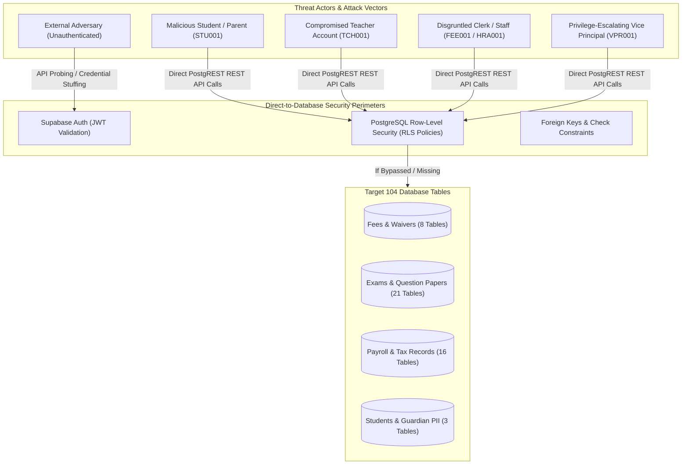
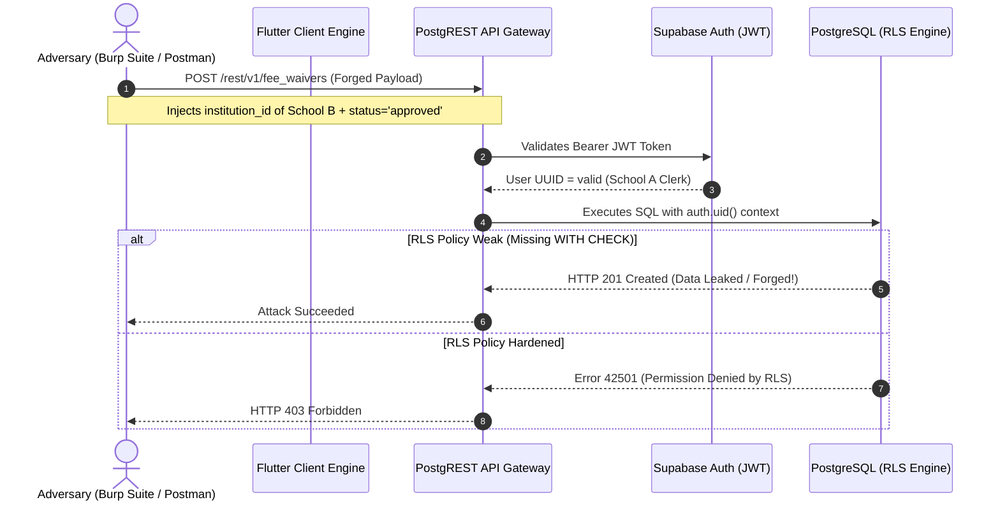
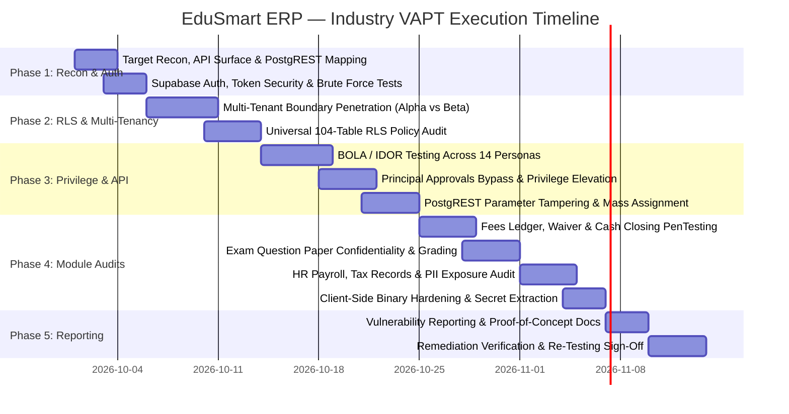

# EduSmart School ERP — Enterprise VAPT (Vulnerability Assessment & Penetration Testing) Master Roadmap

> **Document Version:** 1.0.0 — Enterprise Standard  
> **Lead Role:** Principal Security Architect / Senior Penetration Tester (OSCP / CISSP / CEH)  
> **Testing Scope:** Multi-Tenant Supabase Backend (104 PostgreSQL Tables, PostgREST API, Supabase Auth), Flutter Client Shell & Mini-Apps, 14 RBAC User Roles, API Network Vectors  
> **Security Standards & Compliance:** OWASP Top 10 (2021), OWASP API Security Top 10 (2023), ISO/IEC 27001, FERPA / GDPR / DPDP (Digital Personal Data Protection Act)

---

## Table of Contents

1. [Executive Summary & Threat Landscape](#1-executive-summary--threat-landscape)
2. [VAPT Scope, Methodology & Testing Framework](#2-vapt-scope-methodology--testing-framework)
3. [Attacker Models, Threat Actors & Persona Mapping](#3-attacker-models-threat-actors--persona-mapping)
4. [Target Architecture & Penetration Attack Vectors](#4-target-architecture--penetration-attack-vectors)
5. [In-Depth Security Audit & Penetration Test Plans](#5-in-depth-security-audit--penetration-test-plans)
   - [5.1 Multi-Tenant Data Isolation & Row-Level Security (RLS) Penetration](#51-multi-tenant-data-isolation--row-level-security-rls-penetration)
   - [5.2 Broken Object Level Authorization (BOLA / IDOR) & Privilege Escalation](#52-broken-object-level-authorization-bola--idor--privilege-escalation)
   - [5.3 Authentication, JWT Token Hijacking & Session Security](#53-authentication-jwt-token-hijacking--session-security)
   - [5.4 PostgREST API Tampering, Filter Injection & Mass Assignment](#54-postgrest-api-tampering-filter-injection--mass-assignment)
   - [5.5 Financial Ledger & Counter Manipulation (Fees Module)](#55-financial-ledger--counter-manipulation-fees-module)
   - [5.6 Examination Integrity & Question Paper Leakage Tests](#56-examination-integrity--question-paper-leakage-tests)
   - [5.7 Student & Employee PII Data Exposure Audits](#57-student--employee-pii-data-exposure-audits)
   - [5.8 Client-Side Flutter Binary & Storage Security](#58-client-side-flutter-binary--storage-security)
   - [5.9 Business Logic Flaws & Approvals Bypass](#59-business-logic-flaws--approvals-bypass)
6. [Automated & Manual VAPT Tooling Stack](#6-automated--manual-vapt-tooling-stack)
7. [Vulnerability Severity Matrix (CVSS v3.1) & Remediation SLAs](#7-vulnerability-severity-matrix-cvss-v31--remediation-slas)
8. [Phased VAPT Execution Schedule & Sign-Off Criteria](#8-phased-vapt-execution-schedule--sign-off-criteria)

---

## 1. Executive Summary & Threat Landscape

EduSmart School ERP manages critical institutional assets:
- **Minors' PII**: Student demographic records, addresses, guardian phone numbers, and attendance logs.
- **Financial Balances**: Fee collection receipts, cash closing logs, fee waiver discounts, and employee payroll structures.
- **Academic Confidentiality**: Examination question papers, question banks, anonymous answer book decryptions, and final student grades.
- **Organizational Governance**: Approvals for fee waivers, leave applications, and question paper releases reserved strictly for the Principal.

Because EduSmart utilizes a **Direct-to-Database architecture** (Flutter client talking directly to Supabase via PostgREST and WebSockets with no intermediate custom application server), **Row-Level Security (RLS) is the only security perimeter protecting data**. If a single RLS policy is missing, misconfigured, or permits unrestricted `USING (true)` or `CHECK (true)`, the database is exposed to unauthorized read/write access.



---

## 2. VAPT Scope, Methodology & Testing Framework

This roadmap adheres to the **OWASP Web Security Testing Guide (WSTG v4.2)**, **OWASP API Security Top 10 (2023)**, and **NIST SP 800-115** technical testing guidelines.

### 2.1 Testing Methodologies
1. **Black-Box Testing**: Testing without architectural knowledge or credentials to assess external attack surface and open API exposure.
2. **Grey-Box Testing**: Testing with valid credentials across all 14 roles to identify horizontal/vertical privilege escalation and broken object-level authorization (BOLA).
3. **White-Box Testing**: Auditing the Flutter Dart source code, SQL migrations (`sql/`), and PostgreSQL RLS policies for logic flaws, weak constraints, and hardcoded secrets.

---

## 3. Attacker Models, Threat Actors & Persona Mapping

Penetration testing must simulate realistic threat actors with distinct motivations and access levels:

| Threat Actor | Access Level | Motive / Objective | Primary Attack Target |
|---|---|---|---|
| **External Attacker** | Zero (Public Internet) | Data theft, ransomware, credential stuffing, DDoS | Supabase Auth API, `.env` exposure, unauthenticated endpoints |
| **Student / Parent** (`STU001`) | Low (Parent Portal) | Modify grades, forge fee receipts, view upcoming exam papers | `results`, `fee_payments`, `question_papers`, `attendance_records` |
| **Class Teacher** (`TCH001`) | Medium (Teacher Portal) | View colleague payslips, modify locked attendance, leak exam papers | `payslips`, `hr_salary_structures`, `tp_exams`, `question_bank_items` |
| **Fee / Admin Clerk** (`FEE001`, `STA001`) | Elevated Module Access | Skim cash collections, self-issue waivers, tamper with student records | `fee_transactions`, `fee_waivers`, `day_closing`, `students` |
| **Vice Principal** (`VPR001`) | High Admin Oversight | Bypass Approvals lock to approve question papers or leaves | `approvals_service.dart`, `staff_leave_requests`, `question_papers` |
| **Tenant Cross-Contaminator** | School A User | Access School B's financial, student, or staff records | Any query manipulating `institution_id` |

---

## 4. Target Architecture & Penetration Attack Vectors



---

## 5. In-Depth Security Audit & Penetration Test Plans

---

### 5.1 Multi-Tenant Data Isolation & Row-Level Security (RLS) Penetration
- **Objective**: Verify that no authenticated user from **Tenant Alpha** can view, modify, or delete any record belonging to **Tenant Beta**.
- **Test Scenarios**:
  1. **Tenant ID Swapping in PostgREST Query**:
     - Extract valid JWT token for Tenant Alpha admin (`institution_id = '00000000-0000-0000-0000-000000000001'`).
     - Send request: `GET /rest/v1/students?institution_id=eq.00000000-0000-0000-0000-000000000002`.
     - *Expected Result*: PostgREST returns `HTTP 200 []` (empty array) because RLS filter `institution_id = (SELECT institution_id FROM profiles WHERE id = auth.uid())` intercepts and denies cross-tenant reads.
  2. **Cross-Tenant Mutation Injection**:
     - Attempt: `POST /rest/v1/fee_transactions` with payload body containing Tenant Beta's `institution_id` and student UUID.
     - *Expected Result*: Database rejects with `42501 (new row violates row-level security policy for table "fee_transactions")`.
  3. **Universal RLS Audit Across All 104 Tables**:
     - Execute audit query in PostgreSQL:
       ```sql
       SELECT tablename, rowsecurity FROM pg_tables WHERE schemaname = 'public' AND rowsecurity = false;
       ```
     - *Expected Result*: **0 tables returned**. Every table must have RLS explicitly enabled (`ALTER TABLE ... ENABLE ROW LEVEL SECURITY`).
  4. **Teacher Portal Extras Isolation Test**:
     - In [`sql/teacher_portal_dashboard_extras_migration.sql`](file:///home/user/Documents/git_repos/Nivida-projects/school-erp-testing/School_CRM_Final_ERP_backend_completed%20%281%29/School_CRM_Final_ERP/merged/sql/teacher_portal_dashboard_extras_migration.sql), note the comment:
       `-- policy: for all using (auth.role() = 'authenticated')`
     - *Penetration Vector*: If `tp_exams` or `tp_resources` are scoped only to `authenticated` without `institution_id` filtering, can Teacher A from School 1 read exam schedules from School 2?
     - *Verification & Hardening*: Flag this architectural finding as a **High Vulnerability** and test cross-tenant query behavior.

---

### 5.2 Broken Object Level Authorization (BOLA / IDOR) & Privilege Escalation
- **Objective**: Prevent horizontal and vertical unauthorized access to objects via parameter tampering.
- **Test Scenarios**:
  1. **Student Accessing Other Students' Report Cards / Fee Receipts**:
     - Log in as Student 1 (`id = STU_UUID_1`). Intercept request:
       `GET /rest/v1/results?student_id=eq.STU_UUID_2`.
     - *Expected Result*: Denied by RLS (`student_id = auth.uid()` or linked through `parent_student_links`).
  2. **Teacher Accessing Peer Payslips**:
     - Log in as Teacher 1 (`TCH001`). Intercept request:
       `GET /rest/v1/payslips?staff_name=eq.Senior_Professor`.
     - *Expected Result*: Database returns only the logged-in teacher's payslip records.
  3. **Vice Principal Approvals Bypass**:
     - In [`lib/screens/dashboard_screen.dart`](file:///home/user/Documents/git_repos/Nivida-projects/school-erp-testing/School_CRM_Final_ERP_backend_completed%20%281%29/School_CRM_Final_ERP/merged/lib/screens/dashboard_screen.dart), Vice Principal has `approvalsLocked: true` in the Flutter UI.
     - *Penetration Vector*: Intercept the network traffic and bypass the Flutter UI by sending a direct API request to Supabase:
       `PATCH /rest/v1/question_papers?id=eq.PAPER_UUID` with body `{"approved": true, "status": "approved"}` using Vice Principal's JWT.
     - *Expected Result*: If the database permits this write, the security control is purely client-side (**Critical Defect**). A PostgreSQL RLS policy or trigger must enforce that only users with `profiles.role = 'principal'` can update `approved` columns.

---

### 5.3 Authentication, JWT Token Hijacking & Session Security
- **Objective**: Audit Supabase Auth flow, token lifetimes, and session invalidation.
- **Test Scenarios**:
  1. **Brute Force & Credential Stuffing**:
     - Send 100 rapid failed login requests to `/auth/v1/token?grant_type=password` using `PRC001`.
     - *Expected Result*: Supabase Auth rate limiting (HTTP 429 Too Many Requests) activates.
  2. **JWT Secret Strength & Algorithm Confusion**:
     - Inspect the JWT header. Verify signature algorithm is `HS256` or `RS256`.
     - Attempt algorithm substitution attack (`alg: "none"`). Verify token is rejected.
  3. **Session Invalidation on Logout**:
     - Copy active JWT token. Click "Logout" in Flutter app.
     - Attempt to execute `GET /rest/v1/students` using the copied JWT token.
     - *Expected Result*: Verify whether Supabase access token remains valid until expiry (standard JWT behavior) or if refresh token rotation invalidates the active session. Document remediation with short token TTLs.
  4. **Domain Hijacking on Login ID Mapping**:
     - `_resolveRole` maps IDs to `{id}@edusmart.local`.
     - *Penetration Vector*: Attempt to register an arbitrary email domain or manipulate case handling to collide with pre-existing account identifiers.

---

### 5.4 PostgREST API Tampering, Filter Injection & Mass Assignment
- **Objective**: Audit input sanitization and parameter abuse across Supabase PostgREST endpoints.
- **Test Scenarios**:
  1. **SQL Injection via PostgREST Filters**:
     - PostgREST converts URL filters to parameterized SQL. Test injection payloads in URL query parameters:
       `GET /rest/v1/students?full_name=eq.John';DROP%20TABLE%20students;--`
       `GET /rest/v1/students?select=*,id(select%20*%20from%20pg_shadow)`
     - *Expected Result*: Input sanitized and treated as literal string; database syntax errors suppressed.
  2. **Mass Assignment / Attribute Overwrite**:
     - Submit `PATCH /rest/v1/students?id=eq.MY_ID` with payload:
       `{"full_name": "Updated Name", "is_admin": true, "role": "principal"}`.
     - *Expected Result*: RLS or table schema forbids updating privileged columns on `students` or `profiles`.
  3. **Excessive Data Exposure in Projections (`select=*`)**:
     - Test if querying `/rest/v1/hr_employees?select=*` exposes sensitive fields (bank account numbers, PAN/Aadhaar IDs, salary history) to unauthorized staff roles.

---

### 5.5 Financial Ledger & Counter Manipulation (Fees Module)
- **Objective**: Test transaction atomicity, ledger integrity, and financial tampering vectors.
- **Test Scenarios**:
  1. **Negative Payment Amount Injection**:
     - Submit fee transaction with negative amount:
       `POST /rest/v1/fee_transactions` with `{"total_amount": -5000}`.
     - *Expected Result*: PostgreSQL CHECK constraint (`total_amount > 0`) or RLS rejects the transaction.
  2. **Self-Approved Fee Waivers**:
     - Log in as Clerk (`FEE001`). Submit waiver request with `status = 'approved'` and `resolved_by = auth.uid()`.
     - *Expected Result*: Mutation rejected; status must default to `'pending'` and resolve only under Principal role authority.
  3. **Day Closing Tampering**:
     - Attempt to modify transactions from a past date that has already been closed and audited in `day_closing_records`.
     - *Expected Result*: Database trigger or RLS locks closed ledger entries against modification or deletion.

---

### 5.6 Examination Integrity & Question Paper Leakage Tests
- **Objective**: Audit security controls surrounding confidential examination data.
- **Test Scenarios**:
  1. **Premature Question Paper Retrieval**:
     - Log in as Teacher (`TCH001`) or Student (`STU001`). Query `question_papers` where `approved = false` or exam date is in the future.
     - *Expected Result*: PostgREST returns empty set. Only users with role `exam_admin` or `principal` can view unreleased papers.
  2. **Deanonymization of Barcoded Answer Books**:
     - Query `/rest/v1/exam_answer_books?select=anon_id,student_id`.
     - *Expected Result*: RLS policy must mask `student_id` during evaluation stages until results moderation is officially completed (`identity_revealed = false`).
  3. **Unauthorized Marks Modification (Grade Tampering)**:
     - Student or unauthorized teacher attempts `PATCH /rest/v1/exam_evaluations` or `/rest/v1/exam_results`.
     - *Expected Result*: Denied. Only assigned examiners recorded in `exam_invigilators` or `exam_admin` can submit marks.

---

### 5.7 Student & Employee PII Data Exposure Audits
- **Objective**: Ensure compliance with student privacy regulations (FERPA / GDPR / DPDP).
- **Test Scenarios**:
  1. **Unauthenticated Directory Harvesting**:
     - Send unauthenticated `GET /rest/v1/students` and `GET /rest/v1/teachers` with `apikey: ANON_KEY`.
     - *Expected Result*: HTTP 401 Unauthorized or HTTP 200 `[]` (if public access is disabled).
  2. **Parent Viewing Other Children's Demographics**:
     - Modify `student_id` in Parent portal API calls. Verify that parent cannot view other students' addresses, blood groups, or guardian phone numbers.
  3. **HR Tax Record Leakage (`hr_tax_records`)**:
     - Audit [`sql/hr_tax_records_migration.sql`](file:///home/user/Documents/git_repos/Nivida-projects/school-erp-testing/School_CRM_Final_ERP_backend_completed%20%281%29/School_CRM_Final_ERP/merged/sql/hr_tax_records_migration.sql). Verify that non-HR employees cannot query tax filings or annual income records of peers.

---

### 5.8 Client-Side Flutter Binary & Storage Security
- **Objective**: Assess client-side binary hardening, reverse engineering, and sensitive data persistence.
- **Test Scenarios**:
  1. **Hardcoded Secrets & `.env` Leakage**:
     - Decompile / unpack Flutter web assets and Android APK (`apktool` / strings search).
     - Check if service role key (`SUPABASE_SERVICE_ROLE_KEY`), database passwords, or private signing keys are bundled.
     - *Acceptance Rule*: Only `SUPABASE_URL` and `SUPABASE_ANON_KEY` are permissible in client builds. Service role key must **never** be included.
  2. **Insecure Local Storage & Token Persistence**:
     - Inspect `shared_preferences` / browser `localStorage` / SQLite caches.
     - Verify auth tokens are encrypted or stored securely (`flutter_secure_storage` on mobile / HttpOnly cookies on web).
  3. **Console Log Sensitive Data Leakage**:
     - Monitor `debugPrint` logs in production release builds.
     - Check [`lib/data/dashboard_repository.dart`](file:///home/user/Documents/git_repos/Nivida-projects/school-erp-testing/School_CRM_Final_ERP_backend_completed%20%281%29/School_CRM_Final_ERP/merged/lib/data/dashboard_repository.dart):
       `debugPrint('DASHBOARD DEBUG: current userId = $userId');`
     - *VAPT Remediation*: Ensure all debug print statements containing user IDs, institution IDs, and query errors are stripped or disabled in release mode.

---

### 5.9 Business Logic Flaws & Approvals Bypass
- **Objective**: Identify logic flaws allowing users to bypass institutional governance.
- **Test Scenarios**:
  1. **Transfer Certificate (TC) Self-Issuance**:
     - Student submits TC request in `tc_requests` with `status = 'approved'` directly in the creation payload.
     - *Expected Result*: Database triggers or column defaults enforce `status = 'pending'`.
  2. **Simultaneous Concurrency on Single-Seat Booking**:
     - Issue two concurrent HTTP requests from different accounts to book the same Hostel Bed or Transport Seat at the exact millisecond.
     - *Expected Result*: Database transaction isolation and unique constraints reject the second booking with conflict error.

---

## 6. Automated & Manual VAPT Tooling Stack

```mermaid
flowchart LR
    subgraph Recon["Recon & Interception"]
        Burp["Burp Suite Professional (HTTP Proxy)"]
        Postman["Postman / Newman (API Harness)"]
        OWASPZAP["OWASP ZAP (Automated Scanner)"]
    end

    subgraph StaticAudit["Static Code & Secret Audit"]
        Gitleaks["Gitleaks / Trufflehog (Secret Detection)"]
        Semgrep["Semgrep (Dart & SQL SAST)"]
        SupabaseCLI["Supabase CLI (db diff & rls lint)"]
    end

    subgraph Exploitation["API & Database PenTesting"]
        SQLMap["SQLMap (Injection Validation)"]
        JwtTool["jwt_tool (Token Tampering)"]
        CustomScripts["Python Requests (BOLA / Race Tests)"]
    end

    Recon --> StaticAudit --> Exploitation
```



### Tool Inventory & Usage:
1. **Burp Suite Professional**: Intercepting and manipulating PostgREST requests, testing BOLA, tampering JWT payloads, and bypassing client UI constraints.
2. **Postman / Newman**: Automated security regression collections executing positive and negative authorization tests across all 104 tables.
3. **jwt_tool**: Testing JWT signature forging, algorithm switching, and token expiration enforcement.
4. **Semgrep & Gitleaks**: Static analysis of Dart code and Git history to detect exposed credentials, SQL injection patterns, and debug leaks.
5. **Supabase CLI (`supabase db lint`)**: Automated database linter checking for tables with RLS disabled, permissive policies, or unindexed foreign keys.
6. **Python (`requests` + `asyncio`)**: Custom multi-threaded scripts for testing race conditions, double-spend fee payments, and seat over-allocation.

---

## 7. Vulnerability Severity Matrix (CVSS v3.1) & Remediation SLAs

All discovered vulnerabilities must be scored using the **Common Vulnerability Scoring System (CVSS v3.1)**:

| Severity | CVSS v3.1 Range | Definition in EduSmart ERP | Example | Target Remediation SLA |
|---|---|---|---|---|
| **Critical** | 9.0 – 10.0 | Direct unauthorized access to multi-tenant data, arbitrary RLS bypass, service key leak. | School A user accessing School B database; Vice Principal approving papers via direct API; unauthenticated student PII dump. | **< 24 Hours** |
| **High** | 7.0 – 8.9 | Broken authorization on sensitive module, horizontal privilege escalation, fee ledger tampering. | Teacher viewing peer salary slips; student modifying exam marks; negative fee payment accepted. | **< 3 Days** |
| **Medium** | 4.0 – 6.9 | Sensitive data exposure in logs, missing rate limiting, CSRF, insecure token storage. | User IDs logged in console; lack of brute force protection on login; verbose database errors exposed in API responses. | **< 7 Days** |
| **Low** | 0.1 – 3.9 | Informational disclosures, clickjacking without sensitive actions, minor configuration quirks. | Server banner disclosure; lack of security headers (`X-Frame-Options`); minor UI timing discrepancy. | **Next Release** |

---

## 8. Phased VAPT Execution Schedule & Sign-Off Criteria



### VAPT Sign-Off Deliverables:
1. **Executive Summary Report**: High-level risk score, business impact analysis, and compliance readiness (FERPA/GDPR).
2. **Technical Penetration Testing Report**: Detailed vulnerability descriptions, CVSS v3.1 scores, step-by-step Proof-of-Concept (PoC) reproductions, affected endpoints/tables, and code-level remediation guidance.
3. **Remediation Verification Matrix**: Re-test verification confirming that all Critical and High findings have been resolved before production deployment.

---
*Maintained under `QA&VAPT/VAPT/VAPT_roadmap.md`. All security assessments must strictly adhere to the repository working rules in `rules.md` and document findings in `WORK_LOG_AND_RATIONALE.md`.*
