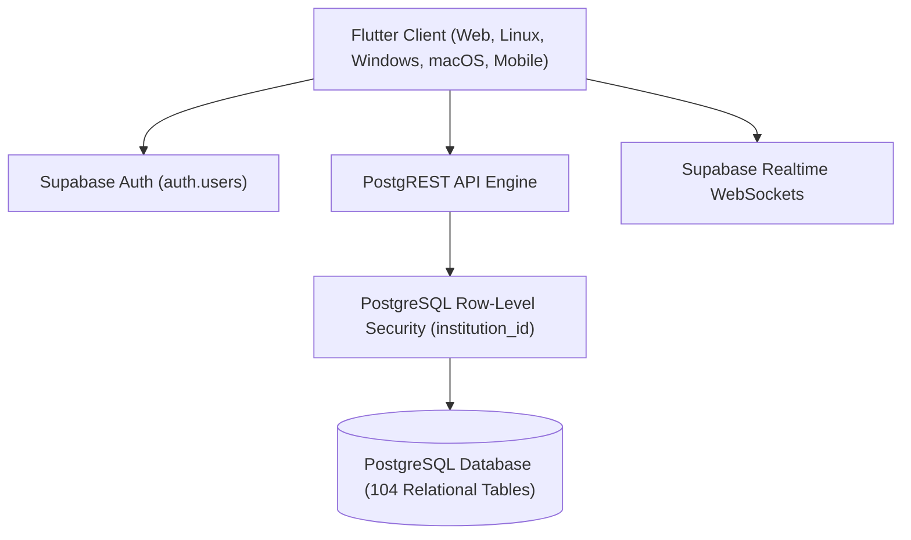

# EduSmart School ERP — Multi-Platform Client & Direct-to-Database Architecture

EduSmart School ERP is an enterprise-grade school management software suite built with **Flutter (Multi-Platform: Web, Desktop, Mobile)** and powered by a direct-to-database **Supabase BaaS (PostgreSQL, Supabase Auth, Row-Level Security, Storage)** backend.

---

## 1. System Architecture



- **Serverless BaaS**: The application eliminates intermediate Node/Java/Python API servers. Flutter repositories interface directly with Supabase via PostgREST and WebSockets.
- **Strict Multi-Tenancy**: Every school operates under its own `institution_id`. Row-Level Security (RLS) dynamically filters every query and mutation based on `profiles.institution_id`.
- **Hybrid State Management**:
  - `package:provider`: Powers root navigation, `DashboardRepository`, `StudentRepository`, `AppStateProvider` (Parents), and `HrPayrollApp`.
  - `package:flutter_riverpod`: Scoped cleanly to the **Fees** and **Hostel** modules via dedicated `ProviderScope` wrappers.
  - Custom Store: Centralized `AppStore` for the **Examination** module.
- **Dual Application Shell**:
  1. **Global Admin Shell**: Role-filtered navigation sidebar driving 12 management modules for School Leadership and Staff.
  2. **Standalone Teacher Portal**: An isolated, full-screen mobile-optimized mini-app for everyday classroom attendance, homework, syllabus tracking, and grading.

---

## 2. Feature Modules (12 Modules)

1. **Dashboard & Analytics**: Real-time KPI summary (Students, Teachers, Attendance %, Fee collections), admission charts, and quick-action hubs.
2. **Students**: Admissions pipeline, student registry, at-risk alerts, and Transfer Certificate (TC) issuance.
3. **Teachers (Admin)**: Staff registry, department assignments, birthday alerts, and CRUD management.
4. **Teacher Portal**: Class-level daily roll call, homework assignments, syllabus progress tracking, and PTM slots.
5. **Daily Attendance**: Class/section roll call with batch actions, daily deduplication, and exportable analytics.
6. **Fees & Accounts**: Counter fee collection, multi-tier installment plans, scholarship waivers, and daily cash closing.
7. **Examination Suite**: Blueprint question papers, anonymous barcoded answer books, double evaluation, moderation, and hall tickets.
8. **Transport & Fleet**: Bus routes, driver contact registry, vehicle maintenance logs, and student route allocation.
9. **Hostel Hub**: Building blocks, room bed allocation, hostel roll call, mess menu, and visitor registry.
10. **HR & Payroll**: Employee onboarding, biometric shifts, statutory salary structures (PF, ESI, TDS), and monthly payroll batch runs.
11. **Inventory & Supplies**: Stationery and lab supplies catalog, stock-in/out ledgers, and low-inventory alerts.
12. **Parents & Student Portal**: Multi-child switcher, academic report cards, fee receipts, library book tracking, and parent-teacher chat.

---

## 3. Database Schema & Data Tool

- **104 Tables**: Fully defined relational schema across all 12 modules.
- **Data Tool (Export & Import)**: Accessible from the dashboard header for full database backup and restore via multi-sheet Excel (`.xlsx`):
  - Strict foreign-key topological order across 89 tables in `lib/data/erp_backup_tables.dart`.
  - Strips auto-incrementing identity columns (`teachers`) to prevent PostgreSQL error `428C9`.
  - Handles non-standard unique keys via conflict key overrides (`fee_transactions` -> `receipt_no`, `hr_salary_structures` -> `employee_id`).
  - Automatically reloads the repository and restarts the application shell upon import.

---

## 4. Getting Started & Configuration

### Prerequisites
- Flutter SDK `^3.12.2` (Dart `^3.12.2`)
- Active Supabase instance with PostgreSQL

### Environment Setup
Create a `.env` file in the root of `merged/`:
```env
SUPABASE_URL=https://your-project-id.supabase.co
SUPABASE_ANON_KEY=eyJhbGciOiJIUzI1NiIsInR5cCI6IkpXVCJ9...
```

### Installation & Run
```bash
# Get dependencies
flutter pub get

# Static analysis
flutter analyze

# Launch on Chrome
flutter run -d chrome

# Launch on Desktop (Linux / Windows)
flutter run -d linux

# Run unit & widget tests
flutter test
```

---

## 5. Documentation Links

- Comprehensive Architecture & System Guide: [`project_overview.md`](file:///home/user/Documents/git_repos/Nivida-projects/school-erp-testing/project_overview.md)
- Complete 104 Database Tables Schema: [`SCHEMA_ALL_104_TABLES.md`](file:///home/user/Documents/git_repos/Nivida-projects/school-erp-testing/SCHEMA_ALL_104_TABLES.md)
- Backend Completion & Audit Status: [`BACKEND_STATUS.md`](file:///home/user/Documents/git_repos/Nivida-projects/school-erp-testing/School_CRM_Final_ERP_backend_completed%20%281%29/School_CRM_Final_ERP/merged/BACKEND_STATUS.md)
- Role Credentials & Authentication Matrix: [`LOGIN_CREDENTIALS.md`](file:///home/user/Documents/git_repos/Nivida-projects/school-erp-testing/School_CRM_Final_ERP_backend_completed%20%281%29/School_CRM_Final_ERP/merged/LOGIN_CREDENTIALS.md)
- Master QA Roadmap: [`QA&VAPT/QA/QA_roadmap.md`](file:///home/user/Documents/git_repos/Nivida-projects/school-erp-testing/QA&VAPT/QA/QA_roadmap.md)
- Master VAPT Security Roadmap: [`QA&VAPT/VAPT/VAPT_roadmap.md`](file:///home/user/Documents/git_repos/Nivida-projects/school-erp-testing/QA&VAPT/VAPT/VAPT_roadmap.md)
