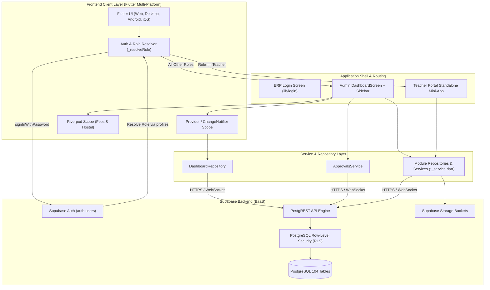
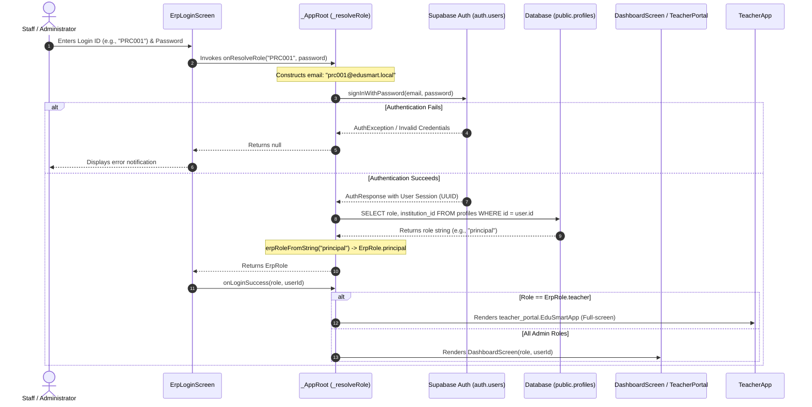

# EduSmart School ERP — Comprehensive Project Overview & Architecture Guide

> **Document Version:** 1.0.0  
> **Target Audience:** Developers, Tech Leads, QA Engineers, IT Administrators, and Product Stakeholders  
> **Scope:** Full repository audit, file inventory, architectural mapping, module breakdowns, database schema, and operational guides.

---

## Table of Contents

1. [Executive Summary](#1-executive-summary)
2. [High-Level System Architecture](#2-high-level-system-architecture)
3. [Repository Structure: "What Is Where"](#3-repository-structure-what-is-where)
   - [Root Directory Documentation & Reference Assets](#31-root-directory-documentation--reference-assets)
   - [Flutter Application Directory (`School_CRM_Final_ERP_backend_completed (1)/School_CRM_Final_ERP/merged`)](#32-flutter-application-directory)
4. [Authentication & Role-Based Access Control (RBAC)](#4-authentication--role-based-access-control-rbac)
   - [Auth Workflow & Supabase Mapping](#41-auth-workflow--supabase-mapping)
   - [Role Credentials & Permissions Matrix](#42-role-credentials--permissions-matrix)
   - [Principal vs. Vice-Principal Approvals Lock](#43-principal-vs-vice-principal-approvals-lock)
5. [Core Application Lifecycle & Navigation Shell](#5-core-application-lifecycle--navigation-shell)
   - [Application Bootstrap (`main.dart`)](#51-application-bootstrap-maindart)
   - [Global Admin Shell (`dashboard_screen.dart` & `sidebar.dart`)](#52-global-admin-shell)
   - [Isolated Teacher Portal Routing](#53-isolated-teacher-portal-routing)
6. [In-Depth Module-by-Module Breakdown](#6-in-depth-module-by-module-breakdown)
   - [Module 1: Dashboard & Analytics](#61-dashboard--analytics)
   - [Module 2: Students](#62-students)
   - [Module 3: Teachers (Administrative)](#63-teachers-administrative)
   - [Module 4: Teacher Portal (Self-Contained Mini-App)](#64-teacher-portal-self-contained-mini-app)
   - [Module 5: Attendance](#65-attendance)
   - [Module 6: Fees & Accounts](#66-fees--accounts)
   - [Module 7: Examination](#67-examination)
   - [Module 8: Transport](#68-transport)
   - [Module 9: Hostel Hub](#69-hostel-hub)
   - [Module 10: HR & Payroll](#610-hr--payroll)
   - [Module 11: Inventory](#611-inventory)
   - [Module 12: Parents & Student Portal](#612-parents--student-portal)
   - [Module 13: System Settings](#613-system-settings)
7. [Data Layer, State Management & Shared Services](#7-data-layer-state-management--shared-services)
   - [State Management Strategy (Provider + Riverpod coexistence)](#71-state-management-strategy)
   - [Dashboard Repository (`dashboard_repository.dart`)](#72-dashboard-repository)
   - [Approvals Service (`approvals_service.dart`)](#73-approvals-service)
   - [Backup & Export Service (`erp_backup_service.dart`)](#74-backup--export-service)
8. [Database Schema & Multi-Tenancy Architecture](#8-database-schema--multi-tenancy-architecture)
   - [Multi-Tenancy Scoping via `institution_id`](#81-multi-tenancy-scoping-via-institution_id)
   - [104 Database Tables Overview by Domain](#82-104-database-tables-overview-by-domain)
   - [SQL Migrations (`sql/`)](#83-sql-migrations)
9. [Backend Status, Verification & Known Gaps](#9-backend-status-verification--known-gaps)
10. [Setup, Environment Configuration & Build Guide](#10-setup-environment-configuration--build-guide)

---

## 1. Executive Summary

**EduSmart School ERP** (also referred to as **School CRM — Final ERP**) is an enterprise-grade, multi-tenant school management software suite. Built with **Flutter (Dart)** for the client application and backed directly by **Supabase (PostgreSQL, Supabase Auth, Row-Level Security, Storage)**, it serves all stakeholders in an educational institution: Principals, Vice Principals, Module Administrators, Teachers, Staff, Parents, and Students.

### Core Highlights
- **100% Serverless Backend**: Does not rely on a standalone Node/Java/Python backend web server. All CRUD operations, joins, aggregations, and data constraints are performed directly between the Flutter client and Supabase via `supabase_flutter` and PostgREST.
- **Strict Multi-Tenancy**: Data isolation across different educational institutions is maintained via the `institution_id` column present in tables and secured through PostgreSQL Row-Level Security (RLS) policies tied to `profiles.institution_id`.
- **Hybrid Architecture (Merged Codebase)**: The system merges 12 previously separate ERP modules into a unified desktop/tablet/web client shell with unified sign-in, while maintaining modularity, self-contained routers, and specialized state scopes (e.g. Flutter Riverpod for Fees and Hostel; Provider for Students, Parents, HR, and Dashboard).
- **Dual Experience Shell**:
  1. **Administrative Shell**: A collapsible, role-filtered navigation sidebar driving 12 management panes for School Leadership and administrative clerks.
  2. **Dedicated Teacher Portal**: An isolated, full-screen portal designed specifically for class teachers, providing daily classroom, grading, and syllabus tools without cluttering the administrative interface.

---

## 2. High-Level System Architecture



---

## 3. Repository Structure: "What Is Where"

The repository root houses master architectural playbooks, database flowcharts, credentials documentation, and the complete source code of the application.

```
/school-erp-testing
├── EduSmart_ERP_Backend_Roadmap.pdf               # Original backend transition plan (Hindi/English)
├── EduSmart_ERP_Backend_Roadmap_EN.pdf            # English backend implementation blueprint
├── EduSmart_ERP_Complete_Advanced_Playbook (1).docx# Master playbook (Tech Guide + User Manual)
├── School_CRM_ERP_Schema_Flowchart_Document (1).docx# 104-table schema & module flowcharts
├── School erp Flow document.pdf                   # Visual workflow diagrams
├── ID Password.pdf                                # Administrative credentials reference sheet
├── Password supabase.pdf                          # Supabase user provisioning manual
├── project_overview.md                            # Complete in-depth project documentation
└── School_CRM_Final_ERP_backend_completed (1)/
    └── School_CRM_Final_ERP/
        └── merged/                                # Primary Flutter Source Codebase
            ├── pubspec.yaml                       # Dependencies, assets & package metadata
            ├── analysis_options.yaml              # Dart analyzer & linter configuration
            ├── .env                               # Supabase URL & Anon Key environment file
            ├── README.md                          # Project readme
            ├── BACKEND_STATUS.md                  # Comprehensive backend audit & status report
            ├── LOGIN_CREDENTIALS.md               # Live login flow & credentials documentation
            ├── sql/                               # SQL migrations for Supabase
            │   ├── hr_tax_records_migration.sql
            │   └── teacher_portal_dashboard_extras_migration.sql
            ├── lib/                               # Application Dart Code
            │   ├── main.dart                      # Bootstrap & top-level routing
            │   ├── restart_widget.dart            # Widget tree restart helper
            │   ├── theme/                         # Central design system & color palette
            │   ├── screens/                       # Shell screens (dashboard_screen.dart)
            │   ├── widgets/                       # Shared dashboard & navigation widgets
            │   ├── login/                         # Login UI, animated background, role models
            │   ├── data/                          # Shared repositories, approvals & backups
            │   └── modules/                       # 12 Independent ERP Feature Modules
            ├── android/                           # Android native configuration & Gradle scripts
            ├── ios/                               # iOS native project & Xcode workspace
            ├── web/                               # Web build host files (index.html, manifest)
            ├── windows/                           # Windows C++ desktop runner
            ├── linux/                             # Linux GTK desktop runner
            └── macos/                             # macOS desktop runner
```

### 3.1 Root Directory Documentation & Reference Assets

- **[`EduSmart_ERP_Complete_Advanced_Playbook (1).docx`](file:///home/user/Documents/git_repos/Nivida-projects/school-erp-testing/EduSmart_ERP_Complete_Advanced_Playbook%20%281%29.docx)**:
  A 38KB, 37,000-word master document split into two parts:
  - **Part A (Advanced Technical Playbook)**: Architecture, data model entity overview, prerequisites, Supabase backend setup, full RLS policy templates, environment strategies (Dev/Staging/Prod), CI/CD GitHub Actions, testing checklists, security best practices, and disaster recovery.
  - **Part B (Complete Non-Technical User Manual)**: Step-by-step UI guides for school staff covering every screen across all 12 modules.
- **[`School_CRM_ERP_Schema_Flowchart_Document (1).docx`](file:///home/user/Documents/git_repos/Nivida-projects/school-erp-testing/School_CRM_ERP_Schema_Flowchart_Document%20%281%29.docx)**:
  Contains exhaustive documentation for all **104 database tables** in Supabase, along with module-wise process flowcharts and domain-wise Entity-Relationship (ER) diagrams.
- **[`EduSmart_ERP_Backend_Roadmap_EN.pdf`](file:///home/user/Documents/git_repos/Nivida-projects/school-erp-testing/EduSmart_ERP_Backend_Roadmap_EN.pdf)** & **[`EduSmart_ERP_Backend_Roadmap.pdf`](file:///home/user/Documents/git_repos/Nivida-projects/school-erp-testing/EduSmart_ERP_Backend_Roadmap.pdf)**:
  Architectural roadmaps documenting how legacy frontend mock data was mapped to live PostgreSQL schemas.
- **[`ID Password.pdf`](file:///home/user/Documents/git_repos/Nivida-projects/school-erp-testing/ID%20Password.pdf)** & **[`Password supabase.pdf`](file:///home/user/Documents/git_repos/Nivida-projects/school-erp-testing/Password%20supabase.pdf)**:
  Account setup manuals detailing default demo accounts, logins, and passwords to provision in `auth.users` and `public.profiles`.

### 3.2 Flutter Application Directory

Located in `School_CRM_Final_ERP_backend_completed (1)/School_CRM_Final_ERP/merged/`:
- **[`pubspec.yaml`](file:///home/user/Documents/git_repos/Nivida-projects/school-erp-testing/School_CRM_Final_ERP_backend_completed%20%281%29/School_CRM_Final_ERP/merged/pubspec.yaml)**: Declares all dependencies (`supabase_flutter`, `provider`, `flutter_riverpod`, `go_router`, `fl_chart`, `data_table_2`, `pdf`, `printing`, `excel`, `crypto`, `flutter_dotenv`).
- **[`.env`](file:///home/user/Documents/git_repos/Nivida-projects/school-erp-testing/School_CRM_Final_ERP_backend_completed%20%281%29/School_CRM_Final_ERP/merged/.env)**: Stores live Supabase endpoint credentials (`SUPABASE_URL` and `SUPABASE_ANON_KEY`).
- **[`BACKEND_STATUS.md`](file:///home/user/Documents/git_repos/Nivida-projects/school-erp-testing/School_CRM_Final_ERP_backend_completed%20%281%29/School_CRM_Final_ERP/merged/BACKEND_STATUS.md)**: Details the August 2026 backend audit across all 378 Dart files.
- **[`LOGIN_CREDENTIALS.md`](file:///home/user/Documents/git_repos/Nivida-projects/school-erp-testing/School_CRM_Final_ERP_backend_completed%20%281%29/School_CRM_Final_ERP/merged/LOGIN_CREDENTIALS.md)**: Documents role resolution and credential verification.

---

## 4. Authentication & Role-Based Access Control (RBAC)

### 4.1 Auth Workflow & Supabase Mapping

The application uses **Supabase Auth** with email and password behind the scenes, but presents a simplified **Login ID + Password** interface to school staff.



### 4.2 Role Credentials & Permissions Matrix

All role definitions and access permissions are defined centrally in [`lib/login/models/erp_role.dart`](file:///home/user/Documents/git_repos/Nivida-projects/school-erp-testing/School_CRM_Final_ERP_backend_completed%20%281%29/School_CRM_Final_ERP/merged/lib/login/models/erp_role.dart).

| Role Enum | Role Title | Login ID | Email Representation | Visible Sidebar Sections | Can Approve? |
|---|---|---|---|---|---|
| `principal` | Principal | `PRC001` | `prc001@edusmart.local` | **All Sections (0–11)** | **Yes (Unlocked)** |
| `vicePrincipal` | Vice Principal | `VPR001` | `vpr001@edusmart.local` | **All Sections (0–11)** | **No (Locked)** |
| `studentsAdmin` | Students Admin | `STA001` | `sta001@edusmart.local` | Students (1) | No |
| `teachersAdmin` | Teachers Admin | `TEA001` | `tea001@edusmart.local` | Teachers (2) | No |
| `studentParent` | Student / Parent | `STU001` | `stu001@edusmart.local` | Parent & Student (3) | No |
| `attendanceAdmin` | Attendance Admin | `ATD001` | `atd001@edusmart.local` | Attendance (4) | No |
| `feesAdmin` | Fees Admin | `FEE001` | `fee001@edusmart.local` | Fees (5) | No |
| `examAdmin` | Exam Admin | `EXM001` | `exm001@edusmart.local` | Examinations (6) | No |
| `transportAdmin` | Transport Admin | `TRP001` | `trp001@edusmart.local` | Transport (7) | No |
| `hostelAdmin` | Hostel Admin | `HST001` | `hst001@edusmart.local` | Hostel (8) | No |
| `hrAdmin` | HR Admin | `HRA001` | `hra001@edusmart.local` | HR & Payroll (9) | No |
| `pti` | PTI (Physical Training / Store) | `PTI001` | `pti001@edusmart.local` | Inventory (10) | No |
| `settingsAdmin` | Settings Admin | `SET001` | `set001@edusmart.local` | Settings (11) | No |
| `teacher` | Class Teacher | `TCH001` | `tch001@edusmart.local` | **Dedicated Standalone App** | N/A |

### 4.3 Principal vs. Vice-Principal Approvals Lock

Both the Principal and Vice Principal have visibility over all 12 modules. However, administrative governance enforces a strict separation:
- The **Principal** can review and approve leave requests, fee waivers, and examination question paper releases.
- For the **Vice Principal**, the Approvals tile displays a padlock icon (`approvalsLocked: true`). Tapping it triggers a floating warning snackbar: *"Approvals are locked for Vice Principal — only the Principal can approve."*

---

## 5. Core Application Lifecycle & Navigation Shell

### 5.1 Application Bootstrap (`main.dart`)
File: [`lib/main.dart`](file:///home/user/Documents/git_repos/Nivida-projects/school-erp-testing/School_CRM_Final_ERP_backend_completed%20%281%29/School_CRM_Final_ERP/merged/lib/main.dart)

1. Loads environment variables from `.env` using `flutter_dotenv`.
2. Initializes the Supabase client (`url` and `anonKey`).
3. Instantiates `EduSmartApp` with custom Material 3 theming.
4. Manages the active session state (`_role` and `_userId`) in `_AppRoot`.
5. When `_role == null`, displays [`ErpLoginScreen`](file:///home/user/Documents/git_repos/Nivida-projects/school-erp-testing/School_CRM_Final_ERP_backend_completed%20%281%29/School_CRM_Final_ERP/merged/lib/login/erp_login_screen.dart).
6. When `_role == ErpRole.teacher`, bypasses the admin shell and mounts `teacher_portal.EduSmartApp`.
7. For all other roles, wraps [`DashboardScreen`](file:///home/user/Documents/git_repos/Nivida-projects/school-erp-testing/School_CRM_Final_ERP_backend_completed%20%281%29/School_CRM_Final_ERP/merged/lib/screens/dashboard_screen.dart) in [`RestartWidget`](file:///home/user/Documents/git_repos/Nivida-projects/school-erp-testing/School_CRM_Final_ERP_backend_completed%20%281%29/School_CRM_Final_ERP/merged/lib/restart_widget.dart).

### 5.2 Global Admin Shell
Files: [`lib/screens/dashboard_screen.dart`](file:///home/user/Documents/git_repos/Nivida-projects/school-erp-testing/School_CRM_Final_ERP_backend_completed%20%281%29/School_CRM_Final_ERP/merged/lib/screens/dashboard_screen.dart) & [`lib/widgets/sidebar.dart`](file:///home/user/Documents/git_repos/Nivida-projects/school-erp-testing/School_CRM_Final_ERP_backend_completed%20%281%29/School_CRM_Final_ERP/merged/lib/widgets/sidebar.dart)

- **Collapsible Sidebar**: Adapts dynamically between expanded mode (icons + labels + approvals button) and compact icon-only mode.
- **Dynamic Content Swapping**: `_buildContent(context, realIndex)` routes navigation indices:
  - `0`: Institutional Overview Dashboard
  - `1`: Students Module
  - `2`: Teachers Module
  - `3`: Parents & Student Shell
  - `4`: Attendance Module
  - `5`: Fees & Accounts (Riverpod-scoped)
  - `6`: Examination Suite
  - `7`: Transport Module
  - `8`: Hostel Hub (Riverpod-scoped)
  - `9`: HR & Payroll Module
  - `10`: Inventory Module
  - `11`: Settings Module

### 5.3 Isolated Teacher Portal Routing
File: [`lib/modules/teacher_portal/main.dart`](file:///home/user/Documents/git_repos/Nivida-projects/school-erp-testing/School_CRM_Final_ERP_backend_completed%20%281%29/School_CRM_Final_ERP/merged/lib/modules/teacher_portal/main.dart)

The Teacher Portal is designed as a standalone mini-application. It is deliberately decoupled from the admin sidebar to prevent teachers from viewing administrative menus, and to ensure administrative users do not see classroom-level personal widgets. It possesses its own internal navigation, bottom navigation bar, and state scopes.

---

## 6. In-Depth Module-by-Module Breakdown

```
lib/modules/
├── attendance/      # Daily class attendance marking & analytics
├── examination/     # Exam schedules, question papers, seating & results
├── fees/            # Fee heads, collection counter, waivers & cash closing
├── hostel/          # Block/room occupancy, mess, complaints & visitors
├── hr_payroll/      # Employees, shifts, leaves, appraisals & payroll
├── inventory/       # Stock tracking, movements & stationery supplies
├── parents/         # Parent communication, student grades & attendance
├── settings/        # System configuration & academic calendar setup
├── students/        # Admissions, student registry & TC requests
├── teacher_portal/  # Standalone teacher app (assignments, exams, PTMs)
├── teachers/        # Administrative roster & department assignments
└── transport/       # Fleet vehicles, drivers, routes & live tracking
```

---

### 6.1 Dashboard & Analytics
- **Path**: [`lib/screens/dashboard_screen.dart`](file:///home/user/Documents/git_repos/Nivida-projects/school-erp-testing/School_CRM_Final_ERP_backend_completed%20%281%29/School_CRM_Final_ERP/merged/lib/screens/dashboard_screen.dart) and [`lib/widgets/`](file:///home/user/Documents/git_repos/Nivida-projects/school-erp-testing/School_CRM_Final_ERP_backend_completed%20%281%29/School_CRM_Final_ERP/merged/lib/widgets/)
- **State & Data**: [`DashboardRepository`](file:///home/user/Documents/git_repos/Nivida-projects/school-erp-testing/School_CRM_Final_ERP_backend_completed%20%281%29/School_CRM_Final_ERP/merged/lib/data/dashboard_repository.dart)
- **Primary Widgets**:
  - `StatCardsRow`: Displays 4 KPI cards: Total Students, Total Teachers, Total Registered Users, Today's Attendance %.
  - `FeeCollectionCard`: Donut visualizer summarizing Collected vs. Pending vs. Overdue amounts.
  - `AdmissionChartCard`: Bar chart of monthly student admissions over the academic session.
  - `QuickAccessHubCard`: Instant navigation triggers for common actions (New Admission, Record Fee, Mark Attendance, Generate Payslip).
  - `UpcomingEventsCard`: Real-time calendar events from `school_events`.
  - `AttendanceHeatmapCard`: Daily attendance density view across classes.
  - `RecentActivitiesCard`: Real-time audit stream of fee payments and transactions.
  - `FeeDueAlertsCard`: Overdue fee balances with direct action triggers.
- **Supabase Tables**: `students`, `employees`, `profiles`, `attendance_records`, `fee_transactions`, `student_fees`, `school_events`, `admissions`.

---

### 6.2 Students
- **Path**: [`lib/modules/students/`](file:///home/user/Documents/git_repos/Nivida-projects/school-erp-testing/School_CRM_Final_ERP_backend_completed%20%281%29/School_CRM_Final_ERP/merged/lib/modules/students/)
- **Core Files**:
  - Service: `data/student_repository.dart`
  - Models: `models/student.dart`
  - Screens: `screens/students_dashboard_screen.dart`, `screens/add_edit_student_screen.dart`, `screens/student_profile_screen.dart`
- **Capabilities**:
  - Searchable student directory with filtering by class, section, and academic status.
  - Complete student profiles: contact information, parent/guardian links, blood group, admission numbers.
  - Admissions pipeline processing.
  - At-Risk Student indicator (combining attendance trends and exam performance).
  - Transfer Certificate (TC) request management and issuance.
- **Supabase Tables**: `students`, `admissions`, `tc_requests`.

---

### 6.3 Teachers (Administrative)
- **Path**: [`lib/modules/teachers/`](file:///home/user/Documents/git_repos/Nivida-projects/school-erp-testing/School_CRM_Final_ERP_backend_completed%20%281%29/School_CRM_Final_ERP/merged/lib/modules/teachers/)
- **Core Files**:
  - Models: `models/teacher.dart`
  - Screens: `screens/teachers_dashboard_screen.dart`
  - Widgets: `widgets/teacher_form_dialog.dart`, `widgets/teacher_list_panel.dart`, `widgets/department_chart_card.dart`, `widgets/birthday_card.dart`
- **Capabilities**:
  - Institution-wide teacher directory with search, filter, and department breakdown.
  - Add, edit, and delete staff with real-time Supabase persistence.
  - Staff birthday alerts and upcoming work anniversaries.
- **Supabase Tables**: `teachers`.

---

### 6.4 Teacher Portal (Self-Contained Mini-App)
- **Path**: [`lib/modules/teacher_portal/`](file:///home/user/Documents/git_repos/Nivida-projects/school-erp-testing/School_CRM_Final_ERP_backend_completed%20%281%29/School_CRM_Final_ERP/merged/lib/modules/teacher_portal/)
- **Core Files**:
  - Entry: `main.dart`
  - Models: `models/dashboard_models.dart`
  - Screens: `screens/dashboard_screen.dart`, `screens/attendance_screen.dart`, `screens/assignments_screen.dart`, `screens/homework_screen.dart`, `screens/timetable_screen.dart`, `screens/syllabus_tracker_screen.dart`, `screens/ptm_scheduler_screen.dart`, `screens/leave_request_screen.dart`, `screens/payslips_screen.dart`, `screens/messages_screen.dart`
- **Capabilities**:
  - Dedicated mobile-friendly shell for everyday classroom tasks.
  - In-class attendance marking by section.
  - Homework and assignment creation with submission status tracking.
  - Subject-by-subject syllabus completion tracker (completed vs total topics).
  - Parent-Teacher Meeting (PTM) slot booking.
  - Teacher payslip downloads and leave applications.
  - Personal to-do list and study materials resource sharing.
- **Supabase Tables**: `assignments`, `homework`, `homework_submissions`, `attendance`, `class_timetable`, `assessment_records`, `payslips`, `staff_leave_requests`, `staff_messages`, `notices`, `tp_exams`, `tp_lesson_plans`, `tp_notifications`, `tp_ptm_slots`, `tp_resources`, `tp_syllabus_chapters`, `tp_todos`.

---

### 6.5 Attendance
- **Path**: [`lib/modules/attendance/`](file:///home/user/Documents/git_repos/Nivida-projects/school-erp-testing/School_CRM_Final_ERP_backend_completed%20%281%29/School_CRM_Final_ERP/merged/lib/modules/attendance/)
- **Core Files**:
  - Repository: `data/attendance_repository.dart`
  - Models: `models/attendance_record.dart`
  - Screens: `screens/attendance_dashboard_screen.dart`
  - Widgets: `widgets/attendance_table.dart`, `widgets/filter_bar.dart`, `widgets/analytics_card.dart`, `widgets/distribution_card.dart`, `widgets/export_dialog.dart`
- **Capabilities**:
  - Daily roll call entry with quick batch operations (Mark All Present, Mark All Absent).
  - Date, class, and section filters with dynamic option population.
  - Attendance analytics (Present %, Absent %, Leave %, Late %).
  - Attendance report export (CSV/Excel).
- **Supabase Tables**: `attendance_records`, `sections`, `students`.

---

### 6.6 Fees & Accounts
- **Path**: [`lib/modules/fees/`](file:///home/user/Documents/git_repos/Nivida-projects/school-erp-testing/School_CRM_Final_ERP_backend_completed%20%281%29/School_CRM_Final_ERP/merged/lib/modules/fees/)
- **Architecture**: Powered by **Flutter Riverpod** (`core/state/app_providers.dart`) and **DataTable2**.
- **Core Files**:
  - Router: `app_router.dart`
  - Models: `core/models/models.dart`
  - Screens: `features/dashboard/dashboard_screen.dart`, `features/collect/collect_screen.dart`, `features/structure/structure_screen.dart`, `features/installments/installments_screen.dart`, `features/waivers/waivers_screen.dart`, `features/expenses/expenses_screen.dart`, `features/closing/closing_screen.dart`, `features/reports/reports_screen.dart`
- **Capabilities**:
  - Counter fee collection: Cash, UPI, Cheque, Net Banking with auto-receipt generation.
  - Class-wise fee structure configuration with customizable heads (Tuition, Library, Transport, Lab).
  - Student fee installments, penalty rules, and discount/waiver requests.
  - Day closing accounting (cash register balancing and counter handover).
  - School income and expense ledgers.
- **Supabase Tables**: `fee_structures`, `fee_transactions`, `fee_payments`, `fee_waivers`, `student_fees`, `installments`, `expenses`, `income_entries`.

---

### 6.7 Examination
- **Path**: [`lib/modules/examination/`](file:///home/user/Documents/git_repos/Nivida-projects/school-erp-testing/School_CRM_Final_ERP_backend_completed%20%281%29/School_CRM_Final_ERP/merged/lib/modules/examination/)
- **Architecture**: Self-contained mini-app using `go_router` and `AppStore` state management.
- **Core Files**:
  - Entry: `main.dart`
  - Routing: `routing/app_routes.dart`
  - Store: `state/app_store.dart`
  - Screens: `screens/dashboard_screen.dart`, `screens/exam_management_screen.dart`, `screens/calendar_screen.dart`, `screens/paper_screens.dart`, `screens/seating_hall_screens.dart`, `screens/barcode_center_screen.dart`, `screens/evaluation_screen.dart`, `screens/moderation_screen.dart`, `screens/results_screens.dart`, `screens/malpractice_screen.dart`, `screens/revaluation_screen.dart`, `screens/analytics_screen.dart`
  - Services: `services/pdf_service.dart`, `services/security_services.dart`
- **Capabilities**:
  - Complete exam lifecycle: term setup, timetable, room allocation, and invigilator duties.
  - Question bank with Bloom's taxonomy tagging and automated question paper generator.
  - Hall ticket generation with printable QR codes.
  - Barcoded anonymous answer books to ensure unbiased grading.
  - Double evaluation, marks moderation, and grade normalization.
  - Malpractice/unfair means incident logging with disciplinary audit trail.
  - Student revaluation workflows and final result card compilation.
- **Supabase Tables**: 21 tables (`exams`, `exam_subject_schedule`, `question_bank_items`, `question_papers`, `exam_rooms`, `exam_seat_assignments`, `exam_invigilators`, `exam_invigilator_duties`, `exam_answer_books`, `exam_evaluations`, `exam_marks_corrections`, `exam_malpractice_incidents`, `exam_results`, `exam_result_subjects`, `exam_revaluation_requests`, `exam_certificates`, `exam_audit_log`, `exam_book_custody_events`, `exam_notifications`, `exam_eligibility`, `results`).

---

### 6.8 Transport
- **Path**: [`lib/modules/transport/`](file:///home/user/Documents/git_repos/Nivida-projects/school-erp-testing/School_CRM_Final_ERP_backend_completed%20%281%29/School_CRM_Final_ERP/merged/lib/modules/transport/)
- **Core Files**:
  - Service: `data/transport_service.dart`
  - Models: `models/dashboard_models.dart`
  - Screens: `screens/dashboard_screen.dart`
  - Widgets: `widgets/live_tracking_card.dart`, `widgets/data_table_card.dart`, `widgets/alert_tile.dart`, `widgets/dialogs/`
- **Capabilities**:
  - Fleet management: vehicle registration, maintenance records, fuel consumption, fitness dates.
  - Driver roster with contact details and license tracking.
  - Route planning: stop sequencing, morning pickup, and afternoon drop schedules.
  - Student route allocations and boarding roll call.
  - Transport fee payment logs and parent delay broadcast notifications.
- **Supabase Tables**: `routes`, `drivers`, `vehicles`, `trips`, `student_transport`, `transport_attendance`, `transport_fee_payments`, `transport_messages`.

---

### 6.9 Hostel Hub
- **Path**: [`lib/modules/hostel/`](file:///home/user/Documents/git_repos/Nivida-projects/school-erp-testing/School_CRM_Final_ERP_backend_completed%20%281%29/School_CRM_Final_ERP/merged/lib/modules/hostel/)
- **Architecture**: Powered by **Flutter Riverpod** (`data/providers/app_providers.dart`).
- **Core Files**:
  - Service: `data/hostel_service.dart`
  - Screens: `features/dashboard/dashboard_screen.dart`, `features/rooms/rooms_screen.dart`, `features/students/hostel_students_screen.dart`, `features/attendance/attendance_screen.dart`, `features/mess/mess_screen.dart`, `features/complaints/complaints_screen.dart`, `features/visitors/visitors_screen.dart`, `features/leaves/hostel_leaves_screen.dart`, `features/maintenance/maintenance_screen.dart`, `features/fees/hostel_fees_screen.dart`
- **Capabilities**:
  - Hostel block and room bed capacity management.
  - Student room allocation and check-in/check-out tracking.
  - Night roll call attendance.
  - Mess menu schedules, meal planning, and dietary preferences.
  - Visitor registry with entry/exit timestamps.
  - Maintenance tickets (plumbing, electrical) and student discipline complaints.
- **Supabase Tables**: `hostel_blocks`, `rooms`, `hostel_students`, `hostel_attendance`, `hostel_complaints`, `hostel_fees`, `hostel_leave_requests`, `hostel_maintenance_requests`, `hostel_notices`, `hostel_staff`, `hostel_visitors`.

---

### 6.10 HR & Payroll
- **Path**: [`lib/modules/hr_payroll/`](file:///home/user/Documents/git_repos/Nivida-projects/school-erp-testing/School_CRM_Final_ERP_backend_completed%20%281%29/School_CRM_Final_ERP/merged/lib/modules/hr_payroll/)
- **Core Files**:
  - Service: `data/hr_service.dart`
  - Models: `models/models.dart`
  - Routes: `routes.dart`
  - Screens: `screens/dashboard_screen.dart`, `screens/employees_screen.dart`, `screens/departments_screen.dart`, `screens/designations_screen.dart`, `screens/attendance_screen.dart`, `screens/shifts_screen.dart`, `screens/leaves_screen.dart`, `screens/payroll_screen.dart`, `screens/salary_structure_screen.dart`, `screens/allowances_screen.dart`, `screens/loans_screen.dart`, `screens/tax_screen.dart`, `screens/appraisals_screen.dart`, `screens/recruitment_screen.dart`, `screens/ai_analytics_screen.dart`
- **Capabilities**:
  - Complete staff record management (teaching and non-teaching).
  - Biometric and manual staff check-in/out attendance with shift timings.
  - Staff leave management and approvals.
  - Salary structure definition: Basic, HRA, DA, Special Allowances, PF, ESI, TDS.
  - Monthly payroll computation, payslip generation, and disbursement tracking.
  - Employee loan and salary advance ledger.
  - Annual tax filing/TDS tracking (`hr_tax_records`).
  - Job vacancies, candidate applications, interview schedules, and offer letters.
- **Supabase Tables**: `hr_departments`, `hr_designations`, `hr_employees`, `hr_attendance`, `hr_leaves`, `hr_shifts`, `hr_salary_structures`, `hr_payroll_records`, `hr_allowance_deductions`, `hr_loans`, `hr_tax_records`, `hr_appraisals`, `hr_jobs`, `hr_candidates`, `hr_interviews`, `hr_offers`.

---

### 6.11 Inventory
- **Path**: [`lib/modules/inventory/`](file:///home/user/Documents/git_repos/Nivida-projects/school-erp-testing/School_CRM_Final_ERP_backend_completed%20%281%29/School_CRM_Final_ERP/merged/lib/modules/inventory/)
- **Core Files**:
  - Service: `data/inventory_service.dart`
  - State: `state/app_scope.dart`, `state/app_state.dart`
  - Models: `models/inventory_models.dart`
  - Screens: `pages/dashboard_page.dart`
- **Capabilities**:
  - Catalog for stationery, laboratory apparatus, sports gear, and uniform stock.
  - Real-time stock-on-hand tracking with unit prices.
  - Logged Stock-In and Stock-Out operations with reason tracking.
  - Low stock warning alerts.
  - Stock report export to CSV and Excel.
- **Supabase Tables**: `inventory_items`, `stock_movements`.

---

### 6.12 Parents & Student Portal
- **Path**: [`lib/modules/parents/`](file:///home/user/Documents/git_repos/Nivida-projects/school-erp-testing/School_CRM_Final_ERP_backend_completed%20%281%29/School_CRM_Final_ERP/merged/lib/modules/parents/)
- **Core Files**:
  - Service: `data/mock_data_service.dart` (reads live Supabase; naming preserved from legacy)
  - Provider: `providers/app_state_provider.dart`
  - Shell: `screens/shell/app_shell.dart`
  - Screens: `screens/dashboard_screen.dart`, `screens/academics_screen.dart`, `screens/attendance_screen.dart`, `screens/fees_screen.dart`, `screens/timetable_screen.dart`, `screens/messages_screen.dart`, `screens/notices_screen.dart`, `screens/calendar_screen.dart`, `screens/library_screen.dart`, `screens/child_selector.dart`
- **Capabilities**:
  - Multi-child switching: Parents with multiple children can switch active profiles via `ChildSelector`.
  - Academic progress card: term exam results and subject grades.
  - Child's daily attendance records and absence history.
  - Fee dues, installment breakdown, and online fee receipts.
  - Class timetable and issued library book due dates.
  - Secure two-way messaging threads between parents and teachers.
- **Supabase Tables**: `parent_student_links`, `parent_teacher_threads`, `parent_teacher_messages`, `library_books`, `students`, `attendance_records`, `results`, `fee_payments`, `timetable_slots`, `school_events`, `notices`.

---

### 6.13 System Settings
- **Path**: [`lib/modules/settings/`](file:///home/user/Documents/git_repos/Nivida-projects/school-erp-testing/School_CRM_Final_ERP_backend_completed%20%281%29/School_CRM_Final_ERP/merged/lib/modules/settings/)
- **Core Files**:
  - Service: `Data/settings_service.dart`
  - Controller: `controller/settings_controller.dart`
  - Screens: `main.dart`, `widgets/general_settings_form.dart`, `widgets/category_card.dart`, `widgets/setting_toggle.dart`
- **Capabilities**:
  - Institution profile configuration: name, school code, logo URL, contact information.
  - Academic year and active session management (`academic_sessions`).
  - System toggles: SMS notifications, Email alerts, Biometric sync, Maintenance mode.
  - Theme customizer: Light mode, Dark mode, and primary branding colors.
- **Supabase Tables**: `school_settings`, `academic_sessions`.

---

## 7. Data Layer, State Management & Shared Services

### 7.1 State Management Strategy
The merged codebase uses a pragmatic hybrid architecture that preserves the native state management of each incorporated module:
- **`package:provider`**: Powers the application root, `DashboardRepository`, `StudentRepository`, `AppStateProvider` (Parents), and `HrPayrollApp`.
- **`package:flutter_riverpod`**: Scoped strictly to the **Fees** and **Hostel** modules via local `ProviderScope` wrappers inside `_buildContent()`. This prevents riverpod scope collisions with provider scopes at the root.
- **Custom InheritedWidget / ValueNotifiers**: The **Inventory** module utilizes an internal `AppScope` inherited widget, while **Examination** utilizes a centralized `AppStore`.

### 7.2 Dashboard Repository (`dashboard_repository.dart`)
File: [`lib/data/dashboard_repository.dart`](file:///home/user/Documents/git_repos/Nivida-projects/school-erp-testing/School_CRM_Final_ERP_backend_completed%20%281%29/School_CRM_Final_ERP/merged/lib/data/dashboard_repository.dart)

Acts as the data backbone for the administrative dashboard:
- Resolves the active user's `institution_id` from `profiles`.
- Runs parallel queries to fetch:
  - Total registered students count (`students`).
  - Total teaching staff count (`employees` filtered by designation keywords: professor, teacher, hod, lecturer).
  - Total active platform users (`profiles`).
  - Today's student attendance percentage (`attendance_records` filtered by current date).
  - Total fee collection for the month (`fee_transactions`).
  - Fee breakdown: Total Collected, Pending, and Overdue (`student_fees`).
  - Monthly admission intake numbers for the active session (`admissions`).

### 7.3 Approvals Service (`approvals_service.dart`)
File: [`lib/data/approvals_service.dart`](file:///home/user/Documents/git_repos/Nivida-projects/school-erp-testing/School_CRM_Final_ERP_backend_completed%20%281%29/School_CRM_Final_ERP/merged/lib/data/approvals_service.dart)

Aggregates pending operational approvals across different subsystems for the Principal:
- **Staff Leave Requests**: Fetches from `staff_leave_requests` where `status = 'pending'`.
- **Fee Waivers**: Fetches from `fee_waivers` where `status = 'pending'`.
- **Exam Question Papers**: Fetches from `question_papers` where `status = 'submitted'` and `approved = false`.
- **Resolution**: Implements `resolve(ApprovalItem, status)` updating the corresponding table with the decision (`approved` / `rejected`), timestamp, and approver UUID.

### 7.4 Backup, Export & Import Data Architecture (`erp_backup_service.dart` & `erp_backup_tables.dart`)
Files: [`lib/data/erp_backup_service.dart`](file:///home/user/Documents/git_repos/Nivida-projects/school-erp-testing/School_CRM_Final_ERP_backend_completed%20%281%29/School_CRM_Final_ERP/merged/lib/data/erp_backup_service.dart) & [`lib/data/erp_backup_tables.dart`](file:///home/user/Documents/git_repos/Nivida-projects/school-erp-testing/School_CRM_Final_ERP_backend_completed%20%281%29/School_CRM_Final_ERP/merged/lib/data/erp_backup_tables.dart)

The administrative shell includes an enterprise-grade **Data Tool** accessible from the top header of the Dashboard, providing full institutional database backup (Export) and restoration/seeding (Import) in Excel (`.xlsx`) format:
- **Foreign-Key Topological Import Sequencing**: Import order is strictly managed via an 89-table dependency pipeline in `ErpBackupTables.all`. Tables are sequenced hierarchically (Masters -> Academic Core -> People/Profiles -> Operational -> Examinations -> HR -> Hostel) so that child records never trigger foreign-key violation errors (`23503`).
- **PostgreSQL Identity Column Handling (`SQLState 428C9`)**: Tables configured with `id bigint GENERATED ALWAYS AS IDENTITY` (e.g. `teachers`) reject user-supplied `id` values upon insertion. `ErpBackupTables.tablesWithGeneratedIdentity` strips the `id` key from imported row maps so the PostgreSQL sequence auto-generates sequential IDs without throwing `428C9`.
- **Conflict Key Overrides (`SQLState 42P10`)**: While most tables use primary key `id` for upsert operations, tables with composite or non-standard unique keys define explicit conflict keys in `ErpBackupTables.conflictKeyOverrides` (e.g., `fee_transactions` uses `receipt_no`, and `hr_salary_structures` uses `employee_id`), preventing PostgreSQL from throwing error `42P10` ("no unique constraint matching ON CONFLICT").
- **Schema Cache & Legacy Cleanup**: The backup registry eliminates legacy deprecated tables (`attendance`, `fee_payments`, `installments`), channeling all student fee collections to `payments` with `student_fee_id` and `attendance_records`, preventing PostgREST schema cache errors (`PGRST205`).
- **UI Synchronization & Immediate Refresh**: Upon Excel import completion, the Data Tool immediately reloads `DashboardRepository.load()` and triggers `RestartWidget.restartApp(context)` upon dialog dismissal, ensuring newly imported students, teachers, and financial transactions reflect immediately in dashboard stat cards and data grids.

---

## 8. Database Schema & Multi-Tenancy Architecture

### 8.1 Multi-Tenancy Scoping via `institution_id`
EduSmart ERP supports multi-school hosting on a single Supabase instance.
1. The `profiles` table stores each user's primary key (`id`), role (`role`), and associated school (`institution_id`).
2. Every domain table includes an `institution_id` foreign key.
3. PostgreSQL Row-Level Security (RLS) ensures that all queries and mutations are isolated:
```sql
CREATE POLICY "institution_isolation_policy" ON public.students
  FOR ALL USING (
    institution_id = (SELECT institution_id FROM public.profiles WHERE id = auth.uid())
  );
```
4. All frontend Dart repositories and services dynamically resolve the current user's `institution_id` from `profiles` before executing insert or select queries, ensuring seamless multi-tenant portability.

### 8.2 104 Database Tables Overview by Domain & Operational Mapping

| Domain | Table Count | Operational Ops | Key Tables Included |
|---|---|---|---|
| **Core / Setup** | 11 | `select`, `update` | `profiles`, `school_settings`, `academic_sessions`, `sections`, `subjects`, `courses`, `timetable_slots`, `notifications`, `school_events`, `payments`, `employees` |
| **Students** | 3 | `select`, `insert`, `update`, `delete` | `students`, `tc_requests`, `admissions` |
| **Teachers** | 1 | `select`, `insert`, `update`, `delete` | `teachers` |
| **Teacher Portal** | 18 | `select`, `insert`, `update`, `upsert`, `delete` | `assignments`, `homework`, `homework_submissions`, `attendance`, `class_timetable`, `documents`, `assessment_records`, `payslips`, `staff_leave_requests`, `staff_messages`, `notices`, `tp_exams`, `tp_lesson_plans`, `tp_notifications`, `tp_ptm_slots`, `tp_resources`, `tp_syllabus_chapters`, `tp_todos` |
| **Attendance** | 1 | `select`, `upsert` | `attendance_records` |
| **Fees & Accounts** | 8 | `select`, `insert`, `update` | `fee_structures`, `fee_transactions`, `fee_payments`, `fee_waivers`, `expenses`, `income_entries`, `installments`, `student_fees` |
| **Examination** | 21 | `select`, `insert`, `update`, `upsert`, `delete` | `exams`, `exam_subject_schedule`, `question_bank_items`, `question_papers`, `exam_rooms`, `exam_seat_assignments`, `exam_invigilators`, `exam_invigilator_duties`, `exam_answer_books`, `exam_evaluations`, `exam_marks_corrections`, `exam_malpractice_incidents`, `exam_results`, `exam_result_subjects`, `exam_revaluation_requests`, `exam_certificates`, `exam_audit_log`, `exam_book_custody_events`, `exam_notifications`, `exam_eligibility`, `results` |
| **Transport** | 8 | `select`, `insert`, `update` | `routes`, `drivers`, `vehicles`, `trips`, `student_transport`, `transport_attendance`, `transport_fee_payments`, `transport_messages` |
| **Hostel** | 11 | `select`, `insert`, `update`, `delete` | `hostel_blocks`, `rooms`, `hostel_students`, `hostel_attendance`, `hostel_complaints`, `hostel_fees`, `hostel_leave_requests`, `hostel_maintenance_requests`, `hostel_notices`, `hostel_staff`, `hostel_visitors` |
| **HR & Payroll** | 16 | `select`, `insert`, `update`, `upsert`, `delete` | `hr_departments`, `hr_designations`, `hr_employees`, `hr_attendance`, `hr_leaves`, `hr_shifts`, `hr_salary_structures`, `hr_payroll_records`, `hr_allowance_deductions`, `hr_loans`, `hr_tax_records`, `hr_appraisals`, `hr_jobs`, `hr_candidates`, `hr_interviews`, `hr_offers` |
| **Inventory** | 2 | `select`, `insert`, `update`, `delete` | `inventory_items`, `stock_movements` |
| **Parents & Comms** | 4 | `select`, `insert`, `update` | `parent_student_links`, `parent_teacher_threads`, `parent_teacher_messages`, `library_books` |
| **Total** | **104** | Full Relational Backend | Fully indexed, multi-tenant PostgreSQL tables with Row-Level Security |

### 8.3 SQL Migrations (`sql/`)
Two SQL migration scripts are included in the repository:
1. **[`sql/hr_tax_records_migration.sql`](file:///home/user/Documents/git_repos/Nivida-projects/school-erp-testing/School_CRM_Final_ERP_backend_completed%20%281%29/School_CRM_Final_ERP/merged/sql/hr_tax_records_migration.sql)**: Creates `hr_tax_records` with foreign key linking to `hr_employees` and full RLS policies scoped to `institution_id`.
2. **[`sql/teacher_portal_dashboard_extras_migration.sql`](file:///home/user/Documents/git_repos/Nivida-projects/school-erp-testing/School_CRM_Final_ERP_backend_completed%20%281%29/School_CRM_Final_ERP/merged/sql/teacher_portal_dashboard_extras_migration.sql)**: Creates helper tables for the teacher portal: `tp_exams`, `tp_notifications`, `tp_resources`, `tp_lesson_plans`, `tp_syllabus_chapters`, `tp_ptm_slots`, `tp_todos` with authenticated user RLS policies.

---

## 9. Backend Status, Verification & Known Gaps

Comprehensive audit across all 378 Dart files and 104 Supabase database tables confirms the production readiness of the backend:

### Completed & Live Backend Integrations
- **Authentication**: Fully wired to Supabase Auth (`signInWithPassword`) and dynamic `profiles.role` lookup.
- **Teachers Module**: Add, edit, and delete operations persist to the `teachers` Supabase table with optimistic UI and error rollback.
- **Data Tool (Export & Import)**: Full multi-sheet Excel backup and restore across 89 tables with automatic sequence resolution, identity column stripping, and immediate UI cache invalidation.
- **Students, Attendance, Fees, Examination, HR & Payroll, Parents, Hostel, Inventory, Settings**: Fully wired with live Supabase CRUD queries, client dependency injection, and tenant scoping.
- **Principal Approvals**: Live resolution of pending leave requests, fee waivers, and question papers.
- **Teacher Portal**: Live persistence for classroom attendance, assignments, homework, and syllabus tracking across 18 tables.
- **Multi-Tenant Testing**: 100% verified across 139 automated tests (75 Flutter client tests + 64 Python contract tests) spanning all 14 personas and both test institutions (Tenant Alpha and Beta).

### Documented Implementation Gap
- **Resolved — Transport Module Dropdowns**: Route / driver / vehicle selectors and Mark Attendance student lists now load live tenant-scoped values from Supabase via `TransportService`. Enum-style static lists (`tripTypes`, `vehicleTypes`, `paymentModes`) remain intentionally in `mock_data.dart`. Apply `sql/transport_extras_migration.sql` if operational transport tables (`trips`, `transport_attendance`, `transport_fee_payments`, `transport_messages`, `notifications`) are missing on the target Supabase project.

---

## 10. Setup, Environment Configuration & Build Guide

### 10.1 Prerequisites
- **Flutter SDK**: `^3.12.2` (Dart SDK `^3.12.2`)
- **Node/Git**: Git 2.x
- **Supabase Account**: An active Supabase project with PostgreSQL database.

### 10.2 Setting Up the Environment (`.env`)
In `School_CRM_Final_ERP_backend_completed (1)/School_CRM_Final_ERP/merged/`:
Create or verify `.env`:
```env
SUPABASE_URL=https://your-project-id.supabase.co
SUPABASE_ANON_KEY=eyJhbGciOiJIUzI1NiIsInR5cCI6IkpXVCJ9...
```

### 10.3 Database Initialization
1. Open the **SQL Editor** in your Supabase Dashboard.
2. Execute the table definitions as documented in [`School_CRM_ERP_Schema_Flowchart_Document (1).docx`](file:///home/user/Documents/git_repos/Nivida-projects/school-erp-testing/School_CRM_ERP_Schema_Flowchart_Document%20%281%29.docx).
3. Run the migrations in `sql/`:
   - `hr_tax_records_migration.sql`
   - `teacher_portal_dashboard_extras_migration.sql`
4. Provision the administrative demo accounts in `auth.users` and `public.profiles` matching the credentials listed in Section 4.2.

### 10.4 Running the Application
From the `merged/` directory:
```bash
# Fetch dependencies
flutter pub get

# Run static analysis
flutter analyze

# Launch on Chrome (Web)
flutter run -d chrome

# Launch on Desktop (Linux / Windows / macOS)
flutter run -d linux

# Build release web bundle
flutter build web --release
```

---
*End of Overview. For questions regarding database schema, refer to `School_CRM_ERP_Schema_Flowchart_Document (1).docx`. For staff end-user guides, refer to Part B of `EduSmart_ERP_Complete_Advanced_Playbook (1).docx`.*
