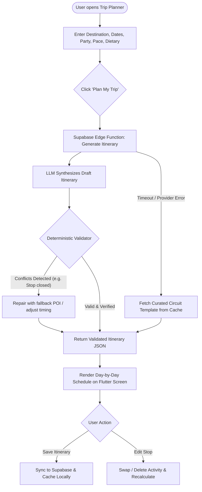
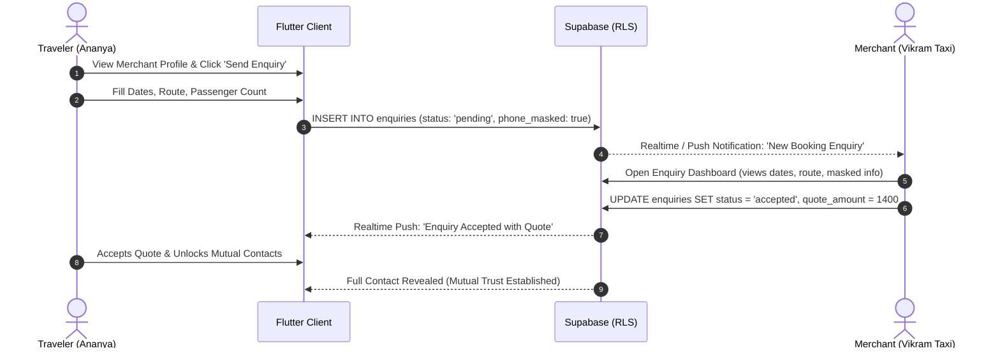
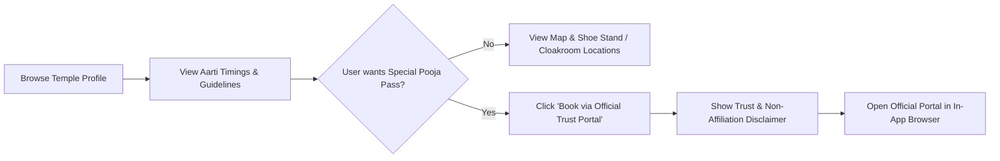

# User Flows & Decision Trees

- **Status:** Approved
- **Owner:** Information Architect / Interaction Designer
- **Last Updated:** 2026-10-29
- **Related Documents:** [`user-journeys.md`](user-journeys.md), [`information-architecture.md`](information-architecture.md)

---

## 1. Flow 1: AI Itinerary Generation & Validation Loop

---

## 2. Flow 2: Local Merchant Lead & Enquiry Flow

---

## 3. Flow 3: Temple Detail & Official Redirection Flow

