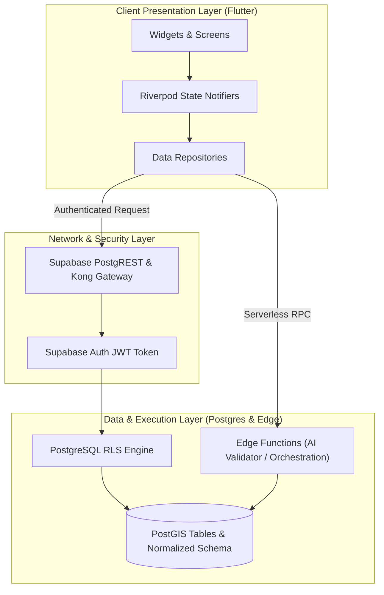

# Architecture Overview & Engineering Blueprint

- **Status:** Approved
- **Owner:** Lead Enterprise Architect
- **Last Updated:** 2026-10-29
- **Related Documents:** [`system-context.md`](system-context.md), [`frontend-architecture.md`](frontend-architecture.md), [`backend-architecture.md`](backend-architecture.md)

---

## 1. High-Level Architectural Pattern

Bharat Yatra follows a **Clean, Modular, Service-Backed Architecture**:
* **Frontend**: Multi-platform Flutter client organized by **feature-first modules** (`lib/features/*`), driven by **Riverpod** state management, and adhering strictly to decoupled repository patterns.
* **Backend**: Managed **Supabase** ecosystem anchored on PostgreSQL with PostGIS, enforcing Row-Level Security (RLS) across 100% of non-public tables.
* **Orchestration**: Stateless **Deno Edge Functions** executing privileged business operations (AI synthesis, validation pipelines, push alerts).

---

## 2. Core Architectural Invariants

1. **Defense-in-Depth**: Client checks provide immediate UX feedback; server-side database RLS provides absolute security.
2. **Deterministic Grounding**: AI outputs are never directly stored or displayed without deterministic validation against opening hours, routes, and physical constraints.
3. **Graceful Degradation**: Offline-first local storage (Hive/SQLite) caches critical destinations, emergency contacts, and saved itineraries.
4. **Zero Single-State Hardcoding**: The geographic model natively handles interstate borders, multi-lingual variants, and multi-day circuits across India.
