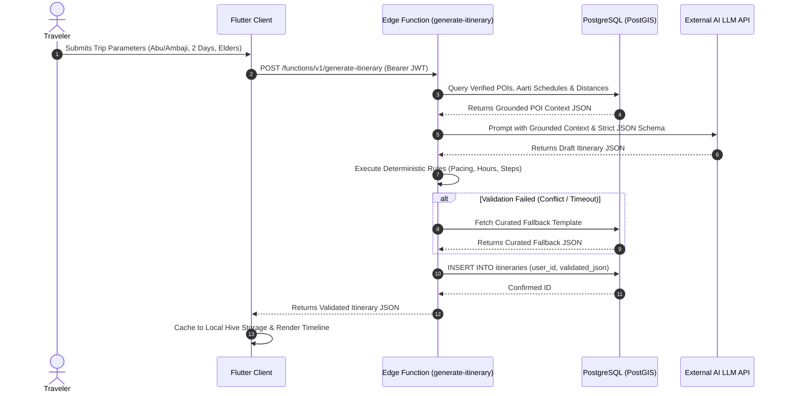
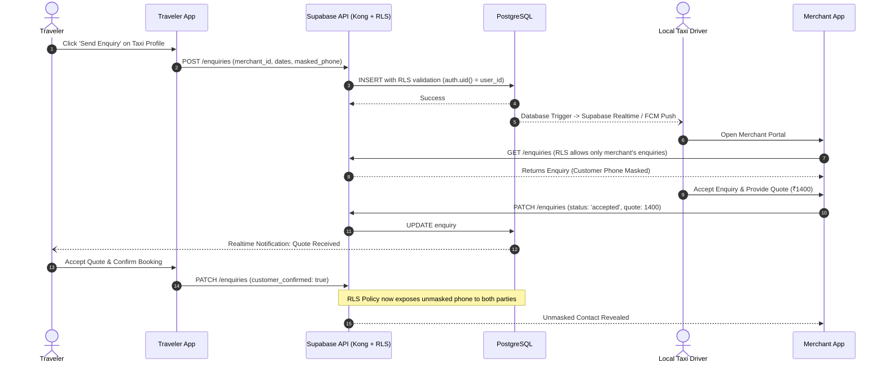

# End-to-End Data Flow Architecture

- **Status:** Approved
- **Owner:** Data Architect / Integration Engineer
- **Last Updated:** 2026-10-29
- **Related Documents:** [`backend-architecture.md`](backend-architecture.md), [`../08-ai-and-data/itinerary-generation.md`](../08-ai-and-data/itinerary-generation.md)

---

## 1. Flow 1: AI Itinerary Synthesis & Validation Data Flow

---

## 2. Flow 2: Enquiry Lifecycle & Contact Masking Data Flow

