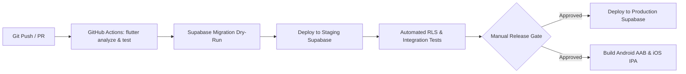

# Deployment Architecture & Environment Strategy

- **Status:** Approved
- **Owner:** DevOps Engineer / Cloud Architect
- **Last Updated:** 2026-10-29
- **Related Documents:** [`backend-architecture.md`](backend-architecture.md), [`../11-devops-and-operations/environment-strategy.md`](../11-devops-and-operations/environment-strategy.md)

---

## 1. Environment Topology

The platform operates across 3 isolated environments with dedicated Supabase projects and independent databases:

```text
Local Dev (CLI)           Staging / QA (Supabase Cloud)         Production (Supabase Cloud)
└── Dockerized Postgres   └── Dedicated QA project             └── High-Availability Multi-AZ
└── Local Edge Functions  └── Automated CI/CD deployment        └── Managed Automated Backups
└── Synthetic Test Data   └── Staging Seed Data (Mount Abu)    └── Verified Production Data
```

---

## 2. CI/CD & Deployment Pipeline



---

## 3. Secret Management & Isolation

* **Developer Local**: `.env.local` ignored by Git. Local Supabase CLI keys only.
* **CI/CD Pipelines**: GitHub Secrets for deployment access tokens.
* **Cloud Environments**: Supabase Dashboard Secrets for LLM API keys and private notification credentials.
