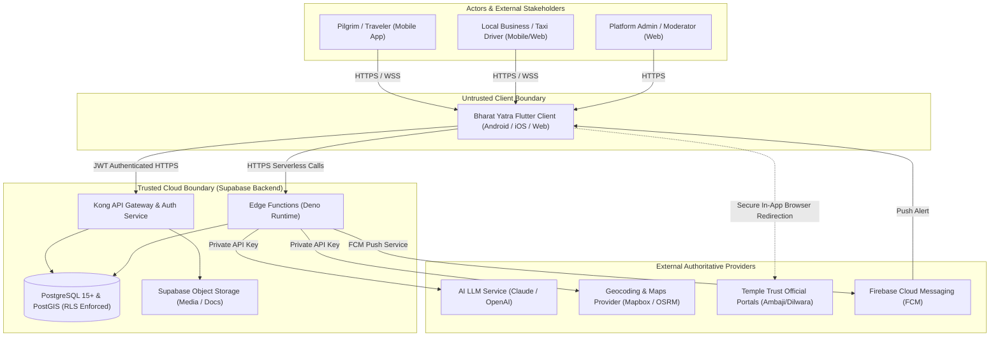

# System Context & Trust Boundaries

- **Status:** Approved
- **Owner:** Lead Enterprise Architect / Security Architect
- **Last Updated:** 2026-10-29
- **Related Documents:** [`architecture-overview.md`](architecture-overview.md), [`../07-security-privacy/trust-boundaries.md`](../07-security-privacy/trust-boundaries.md)

---

## 1. System Context Diagram (C4 Level 1)

The **Bharat Yatra** platform connects end users (travellers and pilgrims), verified local businesses, and operations staff with secure backend cloud services and external authoritative APIs:

---

## 2. Trust Boundaries & Invariants

1. **Untrusted Boundary (Client Applications)**:
   * The Flutter mobile and web client code is considered an **untrusted environment**.
   * It runs on user-controlled hardware. **Zero** database service-role secrets, AI provider keys, or administrative tokens are ever packaged into the client.
2. **First Line of Defense (PostgreSQL RLS)**:
   * All requests passing through Kong API Gateway carry the user's Supabase Auth JWT.
   * PostgreSQL Row-Level Security (RLS) acts as the ultimate gatekeeper. Even if a malicious client sends a crafted SQL or PostgREST query, RLS policies prevent unauthorized access.
3. **Privileged Boundary (Edge Functions)**:
   * Server-side Deno Edge Functions hold privileged provider credentials (LLM keys, SMS/FCM credentials) and run administrative validation logic before committing data.
