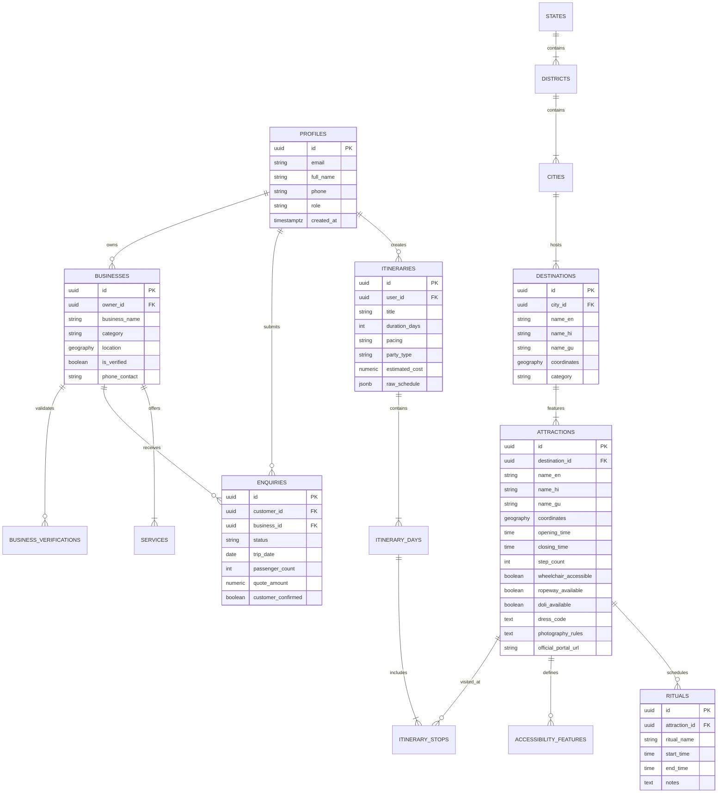

# Entity Relationship Diagram (ERD)

- **Status:** Approved
- **Owner:** Database Architect
- **Last Updated:** 2026-10-29
- **Related Documents:** [`database-architecture.md`](database-architecture.md), [`data-dictionary.md`](data-dictionary.md)

---

## 1. Master Relational ERD (Mermaid)

