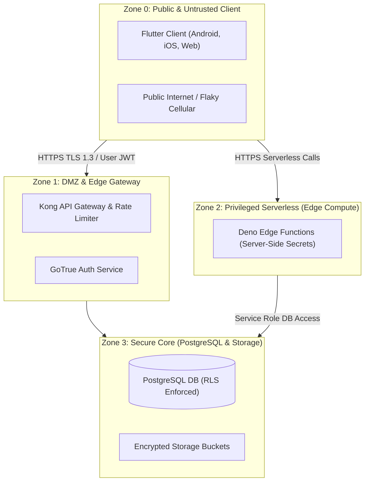

# Trust Boundaries & Data Flow Isolation

- **Status:** Approved
- **Owner:** Security Architect / Cloud Architect
- **Last Updated:** 2026-10-29
- **Related Documents:** [`../04-architecture/system-context.md`](../04-architecture/system-context.md), [`security-policy.md`](security-policy.md)

---

## 1. Trust Zone Architecture

The platform separates execution into 4 distinct trust boundaries:

---

## 2. Invariants Governing Boundary Crossings

1. **Boundary 0 $\to$ 1 (Client to Gateway)**: Must carry valid TLS 1.3 encryption. Queries pass user JWT; no direct database connection pools exposed to the open web.
2. **Boundary 2 $\to$ 3 (Edge to Database)**: Edge Functions access PostgreSQL using parameterized queries or scoped service-role clients strictly within serverless execution boundaries.
3. **Boundary 3 Isolation (Database RLS)**: Even if Zone 1 is compromised, PostgreSQL RLS operates independently at the kernel/process level.
