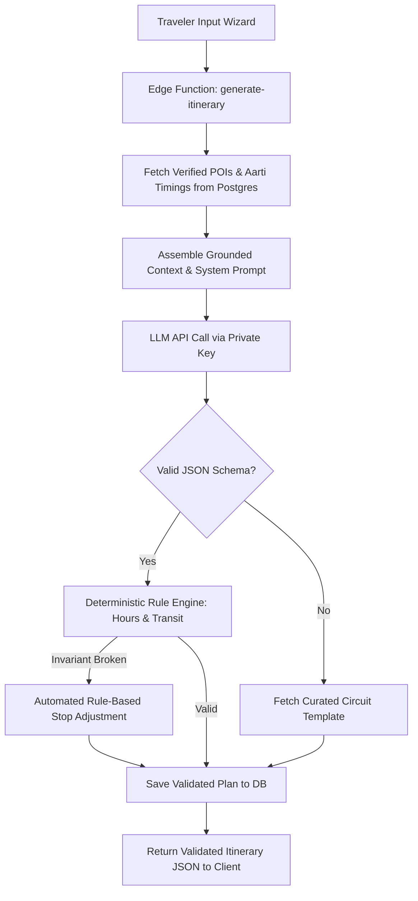

# AI System Design & Architecture Overview

- **Status:** Approved
- **Owner:** AI / ML Architect / Lead Systems Engineer
- **Last Updated:** 2026-10-29
- **Related Documents:** [`../04-architecture/backend-architecture.md`](../04-architecture/backend-architecture.md), [`itinerary-generation.md`](itinerary-generation.md)

---

## 1. AI System Philosophy: Grounded & Deterministic

The AI Trip Planner in **Bharat Yatra** is designed as a **retrieval-grounded, schema-constrained synthesizer**, rather than an unconstrained conversational chatbot:

1. **Grounded by Design**: The LLM is never permitted to invent non-existent attractions, guess opening hours, or fabricate Aarti schedules. It is provided verified candidate destinations retrieved from PostgreSQL.
2. **Schema-Enforced Outputs**: Responses must strictly conform to typed JSON schemas (`response_format: { type: "json_object" }`). Markdown chatter, preambles, and conversational text are forbidden.
3. **Deterministic Business Rule Validation**: Before the generated itinerary is returned to the client, a deterministic validation engine in the Edge Function inspects stop sequences, checks opening hours, calculates transit buffers, and adjusts physical pacing.
4. **Resilient Non-AI Fallbacks**: If the AI provider experiences outages, timeouts ($\ge 4.5\text{s}$), or quota breaches, the system immediately returns a pre-compiled curated circuit itinerary.

---

## 2. High-Level AI Pipeline Flow

