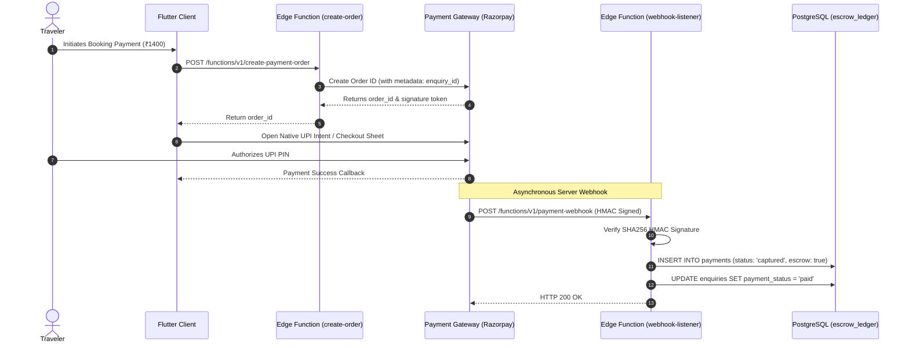

# Payment Gateway Integration Architecture (Phase 2 Commercial Prep)

- **Status:** Approved
- **Owner:** Payment Systems Architect / Compliance Officer
- **Last Updated:** 2026-10-29
- **Related Documents:** [`../00-governance/scope-and-non-goals.md`](../00-governance/scope-and-non-goals.md), [`../01-product/business-requirements.md`](../01-product/business-requirements.md)

---

## 1. Compliance Standard: PCI-DSS Zero-Footprint

In strict accordance with our core governance non-goals:
* **Zero Card Storage**: The Flutter client and PostgreSQL backend **never** collect, transmit, or store raw debit/credit card numbers or CVVs.
* **Hosted Payment Engine**: All monetary transactions use Level-1 PCI-DSS compliant payment gateways (Razorpay / Cashfree) using UPI Intent, NetBanking, and Tokenized Cards.

---

## 2. Server-to-Server Webhook Reconciliation Flow

