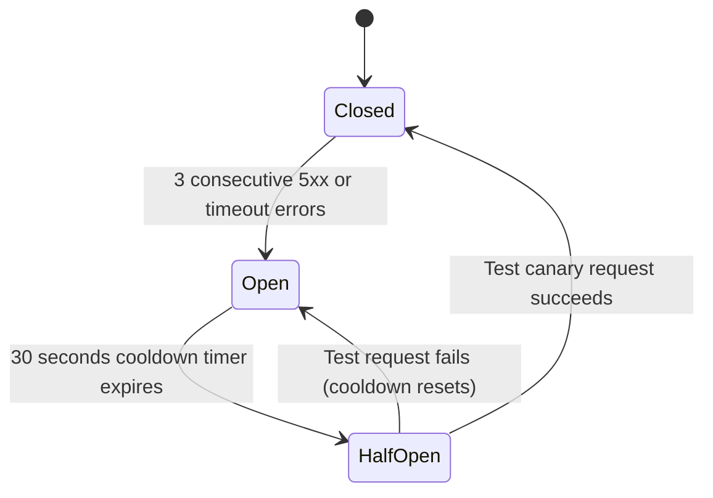

# Retry Policies, Circuit Breakers & Failure Handling

- **Status:** Approved
- **Owner:** Reliability Lead / Backend Architect
- **Last Updated:** 2026-10-29
- **Related Documents:** [`integration-register.md`](integration-register.md), [`../04-architecture/reliability-and-failure-modes.md`](../04-architecture/reliability-and-failure-modes.md)

---

## 1. Retry Strategy & Exponential Backoff

All server-side calls from Edge Functions to external providers (LLMs, SMS, Routing) must enforce standardized retry policies:

* **Max Retry Attempts**: **3 attempts**.
* **Backoff Multiplier**: Exponential backoff with full jitter:
  $$t_{\text{wait}} = \min(t_{\text{max}}, t_{\text{base}} \times 2^{\text{attempt}}) \pm \text{jitter}$$
  * Base delay: $500\text{ms}$, Max delay: $3,000\text{ms}$.
* **Idempotency**: All mutating requests (SMS sending, payment initialization) must pass a unique `Idempotency-Key` header based on transaction UUID.

---

## 2. Circuit Breaker Invariant

* **When Circuit is Open**: Requests do not wait for external network timeouts; they immediately return local cached fallback data (e.g. pre-computed road distances or curated circuit itineraries).
