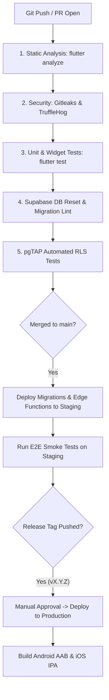

# CI/CD Pipeline & GitHub Actions Automation

- **Status:** Approved
- **Owner:** DevOps Engineer / Release Manager
- **Last Updated:** 2026-10-29
- **Related Documents:** [`environment-strategy.md`](environment-strategy.md), [`../10-quality-and-testing/release-quality-gates.md`](../10-quality-and-testing/release-quality-gates.md)

---

## 1. Automated Pipeline Architecture

The CI/CD pipeline is implemented via GitHub Actions workflows triggered on every pull request and push to `main`:



---

## 2. GitHub Actions Workflow Configuration (`.github/workflows/ci.yml`)

```yaml
name: Continuous Integration & Verification

on:
  push:
    branches: [main]
  pull_request:
    branches: [main]

jobs:
  verify:
    runs-on: ubuntu-latest
    steps:
      - uses: actions/checkout@v4
      - uses: subosito/flutter-action@v2
        with:
          flutter-version: '3.22.x'
          channel: 'stable'
      - name: Install dependencies
        run: flutter pub get
      - name: Verify static analysis
        run: flutter analyze --fatal-infos
      - name: Run unit & widget tests
        run: flutter test --coverage
      - name: Verify secret leakage
        uses: gitleaks/gitleaks-action@v2
```
