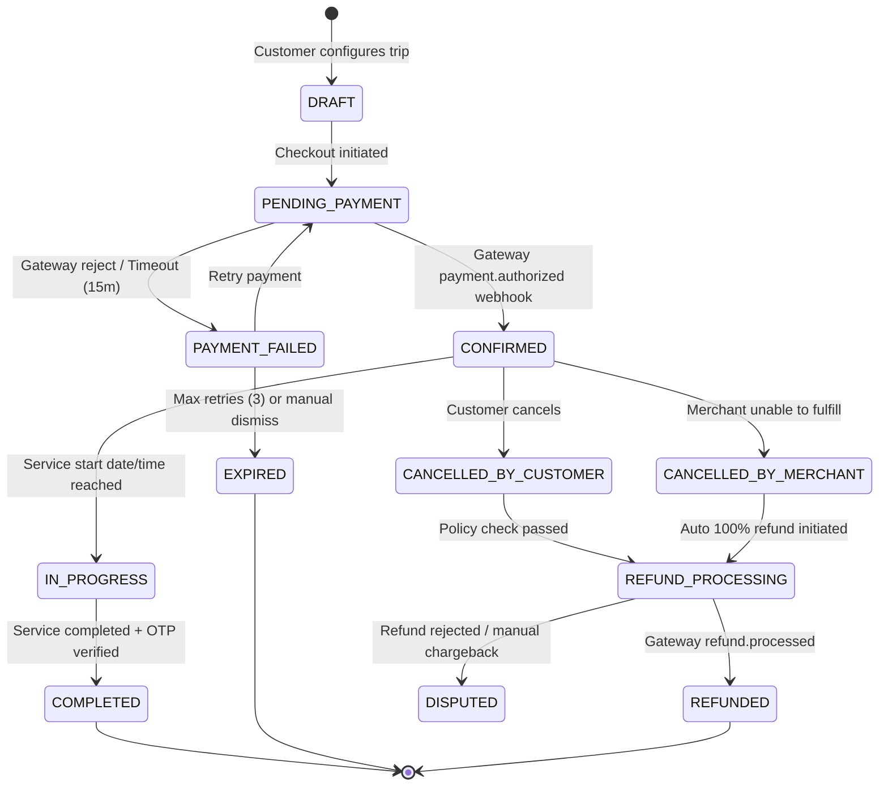

# Booking Lifecycle Specification

- **Status:** Approved
- **Owner:** Principal Systems Architect & Lead Product Operations
- **Last Updated:** 2026-10-29
- **Related Requirements / ADRs:** [`prd.md`](../01-product/prd.md), [`data-dictionary.md`](../06-backend-supabase/data-dictionary.md), [`payments.md`](../09-integrations/payments.md), [`event-contracts.md`](../12-api-and-data-contracts/event-contracts.md)

---

## 1. Executive Summary & Philosophy

In the **Bharat Yatra** platform ecosystem, commercial bookings (e.g. verified homestays, licensed local cab drivers, certified local spiritual tour guides) operate alongside official non-commercial pilgrimage darshans. 

To maintain utmost trust, consumer protection under Indian law, and operational clarity:
1. **Official Temple Trusts & Government Passports** (e.g., Ambaji Temple VIP Darshan, Dilwara ASI entry, RTDC facilities) are **never direct commercial bookings** of Bharat Yatra. The platform acts strictly as an information provider and redirects to authoritative government portals.
2. **Commercial Services** (Local transport, verified guides, verified homestays) follow a strict, auditable, state-machine driven booking lifecycle with idempotent transactions, escrow-like status guarantees, and event notifications.

---

## 2. Booking State Machine

Every commercial booking record in the `bookings` table undergoes deterministic state transitions.



### State Definitions & Permissions

| State | Description | Allowed Initiators | Side Effects / Triggers |
| :--- | :--- | :--- | :--- |
| `DRAFT` | Temporary booking cart created by traveller. Holds slot temporarily. | Traveller, System | 15-minute lock on driver/guide calendar. |
| `PENDING_PAYMENT` | Checkout session created with Razorpay/payment gateway. | Traveller | Dispatches timer task; holds slot. |
| `PAYMENT_FAILED` | Gateway reported decline, insufficient balance, or UPI timeout. | System (Webhook) | User alerted via push notification with retry CTA. |
| `EXPIRED` | Payment window elapsed without successful transaction. | System cron | Calendar hold released; slot restored to inventory. |
| `CONFIRMED` | Gateway webhook `payment.captured` received and verified. | System (Webhook) | Emits `booking.confirmed` event; SMS/WhatsApp confirmation; vendor unmasked contact details shared. |
| `IN_PROGRESS` | Day of travel/service reached, service check-in validated via 4-digit start OTP. | Traveller & Merchant | Driver/Guide location telemetry enabled for traveller safety. |
| `COMPLETED` | Service successfully rendered, verified by customer digital completion OTP. | Traveller | Unlocks merchant payout ledger; triggers review invitation. |
| `CANCELLED_BY_CUSTOMER` | Traveller requests cancellation before start time. | Traveller | Triggers automated cancellation penalty/refund rule engine. |
| `CANCELLED_BY_MERCHANT` | Merchant fails to fulfill or rejects booking. | Merchant, Support | Flags merchant reliability rating; 100% auto refund; emergency reallocation alert. |
| `REFUND_PROCESSING` | Gateway refund API invoked with calculated eligible refund amount. | Edge Function | Razorpay refund request queued. |
| `REFUNDED` | Gateway confirms fund transfer back to original payment instrument. | System (Webhook) | Emits `booking.refunded` event; customer SMS notification. |
| `DISPUTED` | Customer or merchant flags fraudulent fulfillment, no-show, or overcharge. | Customer, Support | Freezes merchant disbursement; assigns ticket to Dispute Resolution desk. |

---

## 3. Booking Creation & Concurrency Control

To prevent double-booking of regional taxi drivers, registered temple tour guides, or homestay rooms:

```sql
-- PostgreSQL Atomic Booking Reservation
CREATE OR REPLACE FUNCTION reserve_service_booking(
    p_customer_id UUID,
    p_business_id UUID,
    p_service_date DATE,
    p_slot_time TIME,
    p_total_amount NUMERIC(10,2)
) RETURNS UUID AS $$
DECLARE
    v_booking_id UUID;
    v_conflict_count INT;
BEGIN
    -- Check for overlapping active bookings for the same merchant
    SELECT COUNT(*) INTO v_conflict_count
    FROM bookings
    WHERE business_id = p_business_id
      AND service_date = p_service_date
      AND status IN ('CONFIRMED', 'IN_PROGRESS', 'PENDING_PAYMENT')
      AND slot_time = p_slot_time;

    IF v_conflict_count > 0 THEN
        RAISE EXCEPTION 'SLOT_UNAVAILABLE' USING ERRCODE = 'P0001';
    END IF;

    INSERT INTO bookings (
        customer_id,
        business_id,
        service_date,
        slot_time,
        total_amount,
        status,
        expires_at
    ) VALUES (
        p_customer_id,
        p_business_id,
        p_service_date,
        p_slot_time,
        p_total_amount,
        'PENDING_PAYMENT',
        NOW() + INTERVAL '15 minutes'
    ) RETURNING id INTO v_booking_id;

    RETURN v_booking_id;
END;
$$ LANGUAGE plpgsql SECURITY DEFINER;
```

---

## 4. Fulfillment & Start/Completion OTP Protocol

To protect both pilgrims and local micro-entrepreneurs:
1. **Service Start**: When a driver meets the pilgrim at Abu Road Railway Station or Mount Abu check-post, the pilgrim receives a secure 4-digit **Start OTP** on their mobile device. The driver inputs this OTP into their partner view to transition state to `IN_PROGRESS`.
2. **Emergency Protocol**: If an OTP cannot be transmitted due to 2G/zero connectivity in hilly regions (e.g., Mount Abu ghat or Gabbar foothills), an encrypted, time-windowed **offline QR token** is scanned by the partner app.
3. **Completion**: Upon reaching the final destination (e.g. Ambaji Shaktipeeth temple complex), a **Completion OTP** is provided by the customer to finalize service delivery.

---

## 5. Audit Logging & Record Keeping

Every state change must insert an immutable row into `booking_audit_logs`:

```sql
CREATE TABLE booking_audit_logs (
    id UUID PRIMARY KEY DEFAULT gen_random_uuid(),
    booking_id UUID NOT NULL REFERENCES bookings(id) ON DELETE CASCADE,
    previous_status TEXT NOT NULL,
    new_status TEXT NOT NULL,
    changed_by UUID REFERENCES profiles(id),
    change_reason TEXT,
    ip_address INET,
    metadata JSONB DEFAULT '{}'::jsonb,
    created_at TIMESTAMPTZ NOT NULL DEFAULT NOW()
);
```
