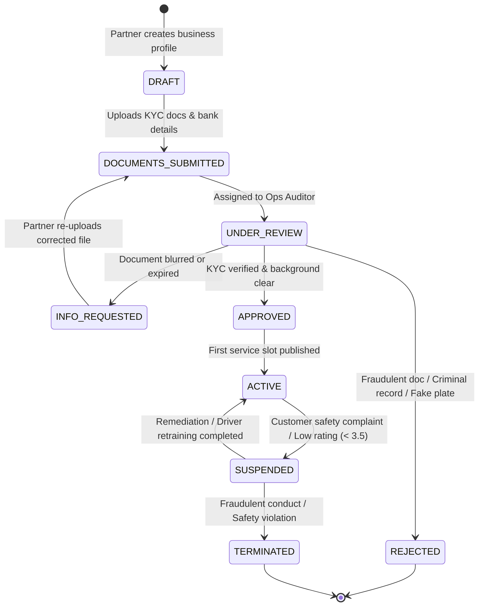

# Business Verification & Merchant Onboarding Workflow

- **Status:** Approved
- **Owner:** Trust & Safety Operations Manager
- **Last Updated:** 2026-10-29
- **Related Requirements / ADRs:** [`data-dictionary.md`](../06-backend-supabase/data-dictionary.md), [`upload-security.md`](../07-security-privacy/upload-security.md), [`compliance-assessment.md`](../16-compliance-and-governance/compliance-assessment.md)

---

## 1. Objectives & Compliance Rationale

To safeguard pilgrims visiting remote hill stations and sacred shrines, Bharat Yatra requires rigorous verification of all commercial participants.

No driver, guide, or accommodation provider is permitted to receive customer leads or collect platform payments without earning the **Verified Merchant Seal**.

---

## 2. Tiered Onboarding & Documentation Requirements

| Vendor Category | Minimum Mandatory KYC Documents | Physical / Operational Verification |
| :--- | :--- | :--- |
| **Cab / Taxi Operators** | 1. Commercial Driving License with Hill-Road Endorsement. 2. Vehicle Registration Certificate (Commercial Yellow Plate). 3. Comprehensive Motor Insurance Policy. 4. Fitness Certificate & Pollution Certificate (PUC). 5. Police Verification Character Certificate. | In-person physical vehicle inspection at Abu Road depot or Mount Abu union office. |
| **Tour & Temple Guides** | 1. Government-issued Guide License (Rajasthan Tourism / Gujarat Tourism / Ministry of Tourism). 2. Aadhaar Card (masked). 3. Local residence proof. 4. Police verification report. | Telephonic knowledge audit on temple history, rituals, and etiquette. |
| **Homestays / Hotels** | 1. FSSAI License (for food preparation/dining). 2. Local Municipality Trade License / Sarpanch NOC. 3. Property Ownership Deed or Valid Commercial Lease. 4. GSTIN (if threshold exceeded). 5. Fire Safety Clearance (if applicable). | Geotagged photograph of property entrance and reception desk. |

---

## 3. Verification State Machine

---

## 4. Automated & Manual Review Controls

1. **OCR & Automated Sanity Checking**:
   - Uploaded documents pass through an OCR pipeline that extracts registration numbers, expiration dates, and names.
   - Name match algorithms verify that the bank account holder name matches the KYC document name with $\ge 90\%$ phonetic similarity (Jaro-Winkler metric).
2. **Periodic Expiration Monitor**:
   - A daily cron task audits all commercial vehicle insurance and fitness certificate expiry dates.
   - **T-30 Days Alert**: Partner receives notice to renew documents.
   - **T-0 Expiration**: If an insurance policy lapses, the partner's account is automatically shifted from `ACTIVE` to `SUSPENDED` with all active bookings reallocated.
3. **Storage Security**:
   - All KYC documents are stored in the private, non-public Supabase storage bucket `business-kyc-documents` protected by RLS and encrypted server-side with AES-256.
