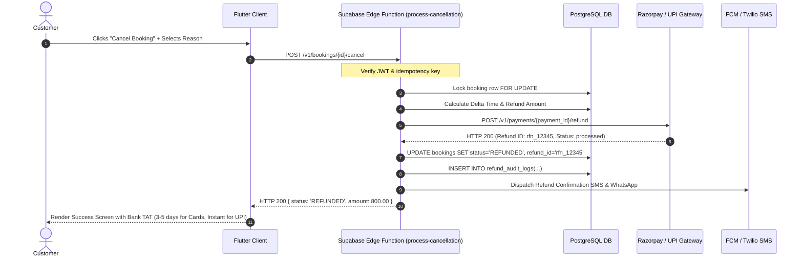

# Cancellation and Refunds Policy & Workflow

- **Status:** Approved
- **Owner:** Financial Operations & Legal Compliance Lead
- **Last Updated:** 2026-10-29
- **Related Requirements / ADRs:** [`booking-lifecycle.md`](booking-lifecycle.md), [`payments.md`](../09-integrations/payments.md), [`error-contracts.md`](../12-api-and-data-contracts/error-contracts.md), [`compliance-assessment.md`](../16-compliance-and-governance/compliance-assessment.md)

---

## 1. Governance Principles

Consumer protection under India's Consumer Protection (E-Commerce) Rules, 2020, requires transparency, clear penalty schedules, non-discriminatory cancellation terms, and automated refund timelines. 

Bharat Yatra balances customer fairness with economic security for regional micro-vendors (independent taxi drivers, local guides, and homestays who reserve fixed daily inventory).

---

## 2. Standard Cancellation Penalty Matrix

Cancellation fees are dynamically calculated based on the timestamp difference between the cancellation request ($\tau_{\text{cancel}}$) and the scheduled start time ($\tau_{\text{service}}$).

| Service Category | Notice Window ($\Delta \tau = \tau_{\text{service}} - \tau_{\text{cancel}}$) | Platform Fee Refund | Merchant Penalty Deduction | Customer Refund % |
| :--- | :--- | :---: | :---: | :---: |
| **Cab / Transport (Abu Road / Circuit)** | $\Delta \tau \ge 24\text{ hours}$ | 100% | 0% | **100%** |
| | $12\text{ hours} \le \Delta \tau < 24\text{ hours}$ | 100% | 20% (Driver compensation) | **80%** |
| | $2\text{ hours} \le \Delta \tau < 12\text{ hours}$ | 50% | 50% (Driver fuel/time lock) | **50%** |
| | $\Delta \tau < 2\text{ hours}$ or No-Show | 0% | 100% (Full payout to driver) | **0%** |
| **Heritage / Spiritual Guide** | $\Delta \tau \ge 12\text{ hours}$ | 100% | 0% | **100%** |
| | $3\text{ hours} \le \Delta \tau < 12\text{ hours}$ | 100% | 30% | **70%** |
| | $\Delta \tau < 3\text{ hours}$ | 0% | 100% | **0%** |
| **Homestay / Heritage Stay** | $\Delta \tau \ge 48\text{ hours}$ | 100% | 0% | **100%** |
| | $24\text{ hours} \le \Delta \tau < 48\text{ hours}$ | 100% | 50% (1st night rate) | **50%** |
| | $\Delta \tau < 24\text{ hours}$ | 0% | 100% | **0%** |

### Merchant Cancellation Exceptions
If a merchant cancels a confirmed service for any reason:
1. Customer receives an immediate **100% full refund** including all taxes and convenience fees.
2. The cancelling merchant is assessed an automated reliability strike and a ₹250 penalty deducted from their next disbursement cycle.
3. The platform initiates an automatic fallback broadcast to reallocate another verified driver/guide within 15 minutes.

### Force Majeure / Natural Weather Conditions
In the event of landslides on Mount Abu Ghat Road (State Highway 11), government road closures, heavy monsoon red alerts from IMD, or official temple closures decreed by the District Magistrate/Temple Trust:
- **100% unconditional refund** is provided to the customer without merchant penalty.

---

## 3. Automated Refund Processing Architecture

The following sequence illustrates the non-repudiable refund execution via Supabase Edge Functions and the Payment Gateway:

---

## 4. Refund SLA & Payment Rails

Per Reserve Bank of India (RBI) turnover guidelines:
- **UPI (Instant)**: Processed via UPI Instant Refund rail within 2 to 4 hours.
- **Credit / Debit Cards**: Routed via acquirer bank networks; reflected in customer account within 3 to 5 business days.
- **Net Banking**: 2 to 7 business days depending on customer's issuing bank.
- **Customer Reference Number (ARN/RRN)**: Emitted to user via SMS within 10 minutes of refund processing to allow bank tracing.
