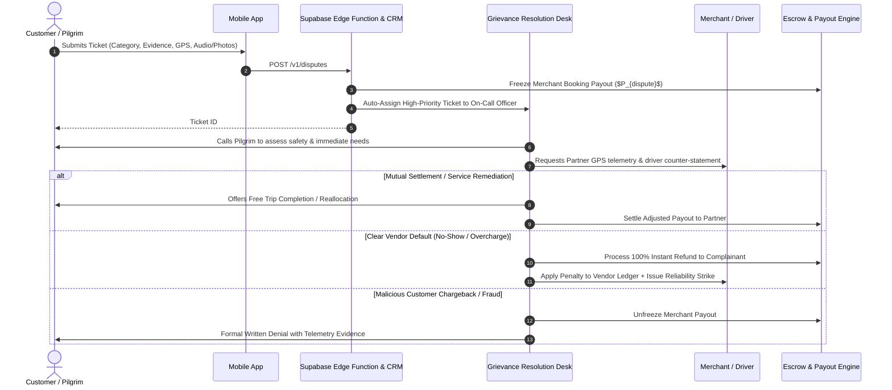

# Dispute Resolution & Escalation Management Workflow

- **Status:** Approved
- **Owner:** Customer Experience & Legal Operations Director
- **Last Updated:** 2026-10-29
- **Related Requirements / ADRs:** [`booking-lifecycle.md`](booking-lifecycle.md), [`cancellation-and-refunds.md`](cancellation-and-refunds.md), [`compliance-assessment.md`](../16-compliance-and-governance/compliance-assessment.md)

---

## 1. Principles & Statutory Alignment

Under India's Consumer Protection (E-Commerce) Rules, 2020, every digital commerce entity operating in India must designate a **Grievance Officer**, acknowledge consumer complaints within 48 hours, and resolve disputes within 30 days of receipt.

Bharat Yatra targets an internal standard far superior to statutory minimums: **acknowledgment within 15 minutes** and **first-contact resolution within 6 hours** for on-trip safety or transport emergencies.

---

## 2. Dispute Classification & Service Level Agreements (SLA)

| Severity Tier | Trigger Scenarios | Initial Acknowledgment | Target Resolution | Financial Action |
| :--- | :--- | :---: | :---: | :--- |
| **Tier 1: Emergency & Safety** | Stranded passenger in ghat section, driver intoxication, harassment, vehicle breakdown with no replacement. | $< 5\text{ minutes}$ | Immediate ($< 30\text{ min}$) | Instant alternative cab dispatch; full fare refund; partner suspension. |
| **Tier 2: Major Service Failure** | Driver no-show, unannounced vehicle downgrade (Non-AC provided instead of AC SUV), guide absent. | $< 15\text{ minutes}$ | $< 2\text{ hours}$ | Immediate compensation or 100% refund. |
| **Tier 3: Billing & Pricing Disagreements** | Unsolicited toll demands, unauthorized hill luggage charges, incorrect cancellation penalty deduction. | $< 2\text{ hours}$ | $< 24\text{ hours}$ | Merchant disbursement hold; chargeback adjustment. |
| **Tier 4: Experience & Cleanliness** | Cab AC underperforming, vehicle seat hygiene poor, minor schedule delays. | $< 6\text{ hours}$ | $< 48\text{ hours}$ | Platform travel voucher (₹200 - ₹500) credit. |

---

## 3. Dispute Resolution Lifecycle

---

## 4. Evidence Repository & Investigation Standard

The Grievance Desk adjudicates disputes based on verifiable digital artifacts:
1. **Telematics & GPS Logs**: Real-time vehicle location versus scheduled pick-up point and destination route.
2. **OTP Verification Logs**: Timestamp of Start OTP and End OTP entry.
3. **In-App Communication Logs**: Chat records and masked voice call attempt logs.
4. **Photographic Evidence**: Uploaded receipts, vehicle condition photos, or toll vouchers.

---

## 5. Grievance Officer Statutory Details

In compliance with Rule 5(9) of the Consumer Protection (E-Commerce) Rules:

- **Designation:** Grievance Officer, Bharat Yatra Consumer Grievance Cell
- **Email:** `grievance-officer@bharatyatra.in`
- **Toll-Free Helpline:** 1800-XXX-XXXX (Available 06:00 to 22:00 IST daily)
- **Physical Address:** Nivida Project Operations Desk, Ahmedabad, Gujarat, India.
