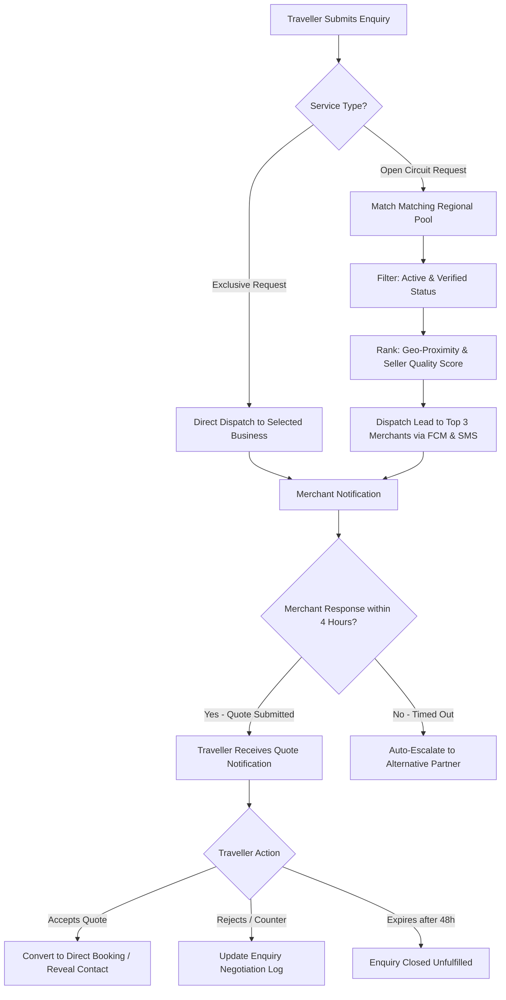

# Enquiry Lifecycle & Lead Management Workflow

- **Status:** Approved
- **Owner:** Growth & Merchant Relations Team
- **Last Updated:** 2026-10-29
- **Related Requirements / ADRs:** [`prd.md`](../01-product/prd.md), [`data-dictionary.md`](../06-backend-supabase/data-dictionary.md), [`notifications.md`](../09-integrations/notifications.md), [`privacy-and-retention.md`](../07-security-privacy/privacy-and-retention.md)

---

## 1. Overview & Objective

Not all travel services in regional pilgrimage circuits (Mount Abu, Ambaji) lend themselves to instant fixed-price checkout. Custom excursions, multi-day family temple tours, tempo traveller rentals, and specialized Jain meal catering require **interactive quote enquiries**.

The **Enquiry Workflow** bridges pilgrims and local registered vendors while preventing spam, off-platform disintermediation, and user harassment.

---

## 2. Lead Distribution Engine

When a traveller requests a custom itinerary quotation:

---

## 3. Contact Masking & Privacy Rules

To comply with privacy standards and protect women and elderly pilgrims from unsolicited calls:
1. **Initial Stage (`PENDING`, `QUOTED`)**: 
   - No direct personal phone numbers or email addresses are visible to either party.
   - Communications are strictly mediated through the Bharat Yatra in-app messaging channel.
   - Any raw phone numbers or email addresses typed into chat text are masked by regular expression filters (`r'\b\d{10}\b'`).
2. **Post-Confirmation Stage (`ACCEPTED`, `CONFIRMED`)**:
   - Once the pilgrim accepts the quote and pays the commitment deposit, customer and driver/guide phone numbers are securely unmasked via virtual caller ID / Twilio proxy masking.

---

## 4. Enquiry Status Lifecycle

| Status | Meaning | Actor Trigger | Timeout SLA |
| :--- | :--- | :--- | :--- |
| `PENDING` | Enquiry created by pilgrim; awaiting merchant review. | Traveller | 4 hours (daytime: 08:00 - 20:00) |
| `QUOTED` | Merchant has submitted price quote, inclusions, and terms. | Merchant | 48 hours for customer review |
| `ACCEPTED` | Traveller accepts quoted price; creates reservation intent. | Traveller | 15 minutes to complete payment |
| `DECLINED` | Merchant cannot accommodate (e.g. vehicle under repair). | Merchant | Terminal state; re-routed |
| `EXPIRED` | Neither party completed negotiation within SLA window. | Cron Worker | Terminal state |
| `CONVERTED` | Deposit paid; transitioned to `bookings` lifecycle. | Payment Gateway | Links to `bookings.id` |

---

## 5. Anti-Spam & Rate Limiting

To prevent bad actors from overwhelming local service providers:
- **Maximum Active Enquiries**: A pilgrim may have at most **3 active enquiries** simultaneously.
- **Enquiry Creation Throttle**: Maximum of **5 enquiries per 24-hour period** per phone number.
- **Verification Gate**: Phone number OTP verification is mandatory before a user can submit their first enquiry.
