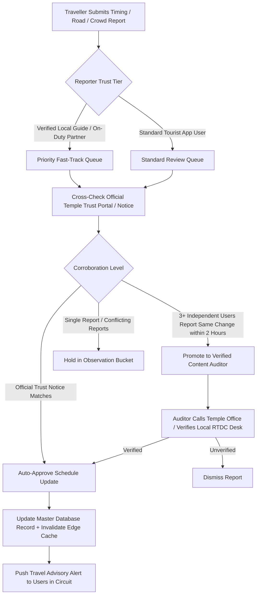

# Crowd, Timings & Content Report Verification Workflow

- **Status:** Approved
- **Owner:** Regional Content & Destination Operations Lead
- **Last Updated:** 2026-10-29
- **Related Requirements / ADRs:** [`official-information-sources.md`](../09-integrations/official-information-sources.md), [`data-quality-and-freshness.md`](../08-ai-and-data/data-quality-and-freshness.md)

---

## 1. Problem Statement & Background

Temple timings, VIP darshan passes, aarti schedules, and accessibility conditions (such as Gabbar Hill ropeway maintenance at Ambaji or Nakki Lake boating hours in Mount Abu) change periodically due to festivals, lunar calendars, or VIP security movements.

Travellers frequently submit crowdsourced updates, reports, and error flags. Bharat Yatra treats crowdsourced data as **signals**, never unquestioned facts, to prevent misleading thousands of pilgrims.

---

## 2. Ingestion & Triage Pipeline

---

## 3. Crowd Level Telemetry & Classification

Pilgrims often want to know if Ambaji Temple or Dilwara has excessive wait times. We classify crowd reports using strict thresholds:

| Status Label | Wait Time Range | Minimum Confirmations Required | UI Visual Indicator |
| :--- | :--- | :---: | :--- |
| **Low / Peaceful** | $< 15\text{ minutes}$ | 2 independent geotagged reports | Green badge (`#15803D`) |
| **Moderate** | $15 - 45\text{ minutes}$ | 3 independent geotagged reports | Yellow/Amber badge (`#D97706`) |
| **High / Heavy Queues** | $45 - 90\text{ minutes}$ | 5 independent geotagged reports | Orange badge (`#EA580C`) |
| **Extreme / Festival Rush** | $> 90\text{ minutes}$ | 5 reports + Admin verification | Red banner (`#DC2626`) with advisory |

### Geofence Enforcement
A user can only submit crowd status reports if their device GPS coordinates are within a **500-meter bounding radius** of the attraction's verified PostGIS polygon. Remote submissions are rejected.

---

## 4. Inaccurate Content Penalty & Contributor Karma

1. **Reputation Score**: Users accumulate "Yatra Karma" points for verified reports that get confirmed by official administrators.
2. **Abuse Mitigation**: If a user submits fabricated reports (e.g., claiming a temple is closed when it is open), their reporting privileges are permanently revoked, preventing malicious denial-of-service against sacred shrines.
