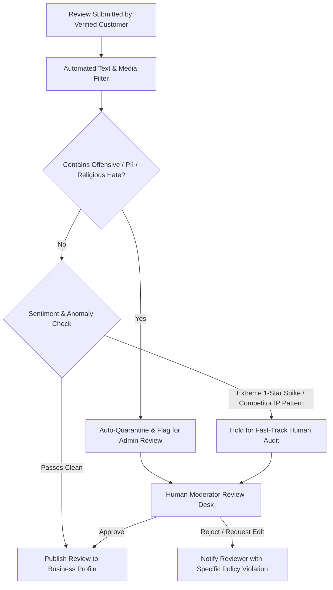

# User Review Moderation & Quality Control

- **Status:** Approved
- **Owner:** Trust & Safety Product Operations Lead
- **Last Updated:** 2026-10-29
- **Related Requirements / ADRs:** [`prd.md`](../01-product/prd.md), [`security-policy.md`](../07-security-privacy/security-policy.md), [`compliance-assessment.md`](../16-compliance-and-governance/compliance-assessment.md)

---

## 1. Governance & Principles

Customer feedback is critical for pilgrims deciding which tour guides or drivers to trust. However, unverified reviews, malicious competitor sabotage, and extortion threats against small local businesses degrade community trust.

Bharat Yatra enforces a **Verified Transaction Review Policy** with automated NLP safety scanning and human moderation oversight.

---

## 2. Review Eligibility Gate

1. **Closed-Loop Verification Only**:
   - Only travellers with a completed booking (`status = 'COMPLETED'`) or verified physical GPS presence via QR check-in may submit ratings and written reviews.
   - Review invitation link expires **14 days** post-service completion.
   - A customer may only review a specific booking or provider once per transaction.
2. **Double-Blind Review Model**:
   - Both customer and merchant are invited to review each other.
   - Reviews remain hidden from the public profile until **both parties have submitted their ratings** or **14 days have passed**, whichever occurs first. This eliminates retaliation bias.

---

## 3. Automated Moderation & Risk Scoring Pipeline

---

## 4. Content Violation Taxonomy

Content violating the following categories is strictly prohibited under Rule 3(1)(b) of the Information Technology (Intermediary Guidelines and Digital Media Ethics Code) Rules, 2021:

| Category | Description | Enforcement Action |
| :--- | :--- | :--- |
| **Profanity & Hate Speech** | Abuse directed at caste, religion, gender, or regional identity. | Auto-rejected; reviewer account flagged. |
| **PII Leakage** | Publishing private phone numbers, home addresses, or driver personal details. | Text automatically redacted or suppressed. |
| **Commercial Solicitation** | Spamming alternative links, travel agencies, or off-platform taxi bookings. | Auto-deleted; reviewer banned from reviewing. |
| **Extortion / Blackmail** | Threatening negative reviews to force merchant cash discounts. | Escalated to Legal/Trust desk; review purged. |
| **Irrelevant Content** | Complaining about weather, state highway toll rates, or temple trust ritual rules in a driver review. | Filtered during dispute review. |

---

## 5. Merchant Right of Reply

- Every verified merchant has the right to post **one single, professional public response** to any review on their profile.
- Merchant replies must comply with all civility guidelines and must not disclose confidential passenger details.
- Once published, merchant replies are permanently attached to the user review.
