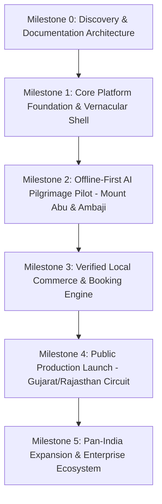

# Master Milestone Plan & Delivery Roadmap

- **Status:** Approved
- **Owner:** Program Director & VP Engineering
- **Last Updated:** 2026-10-29
- **Related Requirements / ADRs:** [`product-roadmap.md`](../01-product/product-roadmap.md), [`operational-readiness.md`](../11-devops-and-operations/operational-readiness.md), [`release-quality-gates.md`](../10-quality-and-testing/release-quality-gates.md)

---

## 1. Program Timeline & Milestone Horizons

The **Bharat Yatra** platform roadmap progresses through distinct, quality-gated delivery horizons:

---

## 2. Milestone Deliverables & Exit Criteria

### Milestone 0: Documentation & Governance Baseline (Completed)
- **Scope**: Full specification suites across Product, Architecture, Flutter, Supabase, Security, Integrations, and Quality.
- **Exit Criteria**: 100% of architectural baselines approved; zero undocumented external integration dependencies.

### Milestone 1: Platform Foundation & Core Services (Sprint 1 - 2)
- **Scope**:
  - Supabase staging and production database instances provisioned.
  - Supabase Auth phone OTP workflow operational on real Indian phone numbers.
  - Flutter application shell running on Android and iOS with clean feature-first structure.
  - Multi-language localization engine supporting English, Hindi, and Gujarati with dynamic switching.
- **Exit Criteria**: Automated CI pipeline building Signed Android APK/AAB and iOS builds on commit.

### Milestone 2: Mount Abu & Ambaji Pilgrimage Pilot (Sprint 3 - 4)
- **Scope**:
  - Complete master POI directory for Mount Abu (Nakki Lake, Dilwara, Guru Shikhar) and Ambaji (Shaktipeeth, Gabbar Hill, Koteshwar).
  - AI Itinerary Generation Engine with deterministic sacred validation (temple darshan hours, prasad timings, elder accessibility filters).
  - Offline-first SQLite local synchronization and cached vector map tiles.
- **Exit Criteria**: 95% evaluation pass rate on Golden Test Dataset (50 pilgrimage edge scenarios).

### Milestone 3: Verified Commercial Services Pilot (Sprint 5 - 6)
- **Scope**:
  - Merchant onboarding portal with KYC document uploads (commercial driving licenses, RTDC guide badges).
  - Commercial booking state machine with atomic concurrency reservations.
  - Razorpay payment gateway integration supporting UPI Auto-pay and cards.
  - Customer dispute intake desk and emergency escalation alerts.
- **Exit Criteria**: Successful simulated test transactions with real bank UPI settlement and automated refund loop.

### Milestone 4: Public Production Launch (Sprint 7)
- **Scope**:
  - Passing all 8 Release Quality Gates (`QG-1` through `QG-8`).
  - Formal Operational Readiness Review (ORR) sign-off.
  - Google Play Store and Apple App Store production listing approval.
  - Active monitoring with Sentry, Prometheus, and 24/7 on-call PagerDuty alerts.
- **Exit Criteria**: Zero P0/P1 defects; crash-free user sessions $\ge 99.5\%$.
