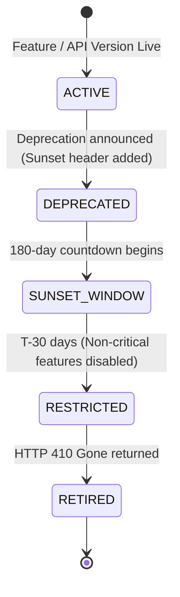

# API, Client & Feature Deprecation Policy

- **Status:** Approved
- **Owner:** Principal Architect & API Governance Board
- **Last Updated:** 2026-10-29
- **Related Requirements / ADRs:** [`versioning.md`](../12-api-and-data-contracts/versioning.md), [`ci-cd.md`](../11-devops-and-operations/ci-cd.md)

---

## 1. Governance Principles

Because travellers in rural or mountainous areas frequently run older application versions without immediate Play Store updates:
1. **No Breaking Changes without Grace Period**: Backwards-incompatible changes to APIs or payload contracts are prohibited on active minor versions.
2. **Predictable Sunset Timeline**: Deprecation follows a transparent, multi-stage lifecycle with a **minimum 180-day grace period** before retirement.
3. **Mandatory Force-Update Mechanism**: Mobile clients contain a cryptographically verified `MinAppVersion` kill-switch for critical security emergencies.

---

## 2. API Deprecation Lifecycle



### Protocol for Deprecated Endpoints:
When an endpoint is marked for deprecation:
1. The backend appends standard RFC 8594 headers to every HTTP response:
   ```http
   Deprecation: @1793404800
   Sunset: Wed, 28 Apr 2027 00:00:00 GMT
   Link: <https://api.bharatyatra.in/deprecation/v1-migration>; rel="sunset"
   ```
2. Telemetry monitors the volume of inbound requests on the deprecated path.
3. Email alerts are transmitted to any registered API consumers.

---

## 3. Mobile App Minimum Version Policy

To maintain security and database compatibility:

```json
{
  "min_supported_version": "1.0.0",
  "latest_version": "1.2.0",
  "update_priority": "flexible",
  "force_update_title": {
    "en": "Important Update Required",
    "hi": "महत्वपूर्ण अपडेट आवश्यक है",
    "gu": "મહત્વપૂર્ણ અપડેટ જરૂરી છે"
  },
  "force_update_message": {
    "en": "Please update Bharat Yatra to ensure secure pilgrimage bookings and offline maps.",
    "hi": "तीर्थयात्रा बुकिंग और ऑफलाइन मैप्स सुरक्षित रखने के लिए कृपया ऐप अपडेट करें।",
    "gu": "યાત્રા બુકિંગ અને ઑફલાઇન નકશા સુનિશ્ચિત કરવા માટે કૃપા કરીને એપ અપડેટ કરો."
  }
}
```

### Update Tiers:
- **Flexible Update (Minor / Patch)**: App suggests an update via a dismissible snackbar or in-app dialog. Travellers may continue using the app uninterrupted.
- **Immediate / Force Update (Critical / Security)**: If `installed_version < min_supported_version`, the app displays a non-dismissible modal locking core workflows and directing the user directly to the Google Play Store or Apple App Store.
