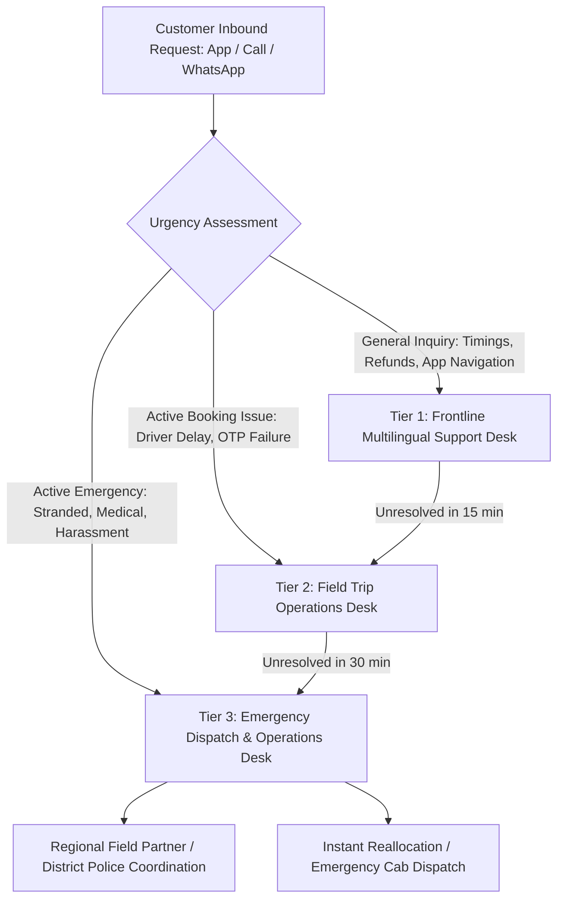

# Customer Support & Escalation Procedures

- **Status:** Approved
- **Owner:** Customer Experience & Field Support Lead
- **Last Updated:** 2026-10-29
- **Related Requirements / ADRs:** [`dispute-resolution.md`](../13-business-workflows/dispute-resolution.md), [`incident-runbooks.md`](../11-devops-and-operations/incident-runbooks.md)

---

## 1. Support Philosophy & Multilingual Commitment

Pilgrims navigating hill roads and remote shrines require immediate, empathetic, vernacular assistance. Support is provided across **English, Hindi, and Gujarati** via multiple omnichannel touchpoints:
- **In-App Live Chat**: Integrated with our customer ticketing desk.
- **Toll-Free Telephonic Helpline**: Dedicated regional line for urgent trip assistance.
- **WhatsApp Support Bot & Human Desk**: For users with limited cellular data bandwidth.

---

## 2. Support Tier Architecture & Escalation Matrix

---

## 3. Support Response SLAs

| Ticket Priority | Response Time Target (First Touch) | Target Resolution Time | Supported Channels |
| :--- | :---: | :---: | :--- |
| **P0: Emergency / Safety** | $< 3\text{ minutes}$ | Immediate ($< 20\text{ min}$) | Phone Helpline, In-App SOS Button, WhatsApp |
| **P1: Active Trip Blocker** | $< 10\text{ minutes}$ | $< 45\text{ minutes}$ | Phone Helpline, In-App Live Chat |
| **P2: Billing & Refund Inquiry** | $< 2\text{ hours}$ | $< 24\text{ hours}$ | Email, In-App Helpdesk Ticket |
| **P3: General Inquiry / Feedback**| $< 6\text{ hours}$ | $< 48\text{ hours}$ | In-App Feedback, Email |

---

## 4. Emergency On-Trip SOS Protocol

When a traveller triggers the in-app **SOS / Emergency Assistance** feature:
1. App automatically transmits the user's latest GPS coordinates and battery level to the Tier 3 Operations Desk.
2. In-app UI reveals direct tap-to-call buttons for:
   - **Police Emergency**: `112`
   - **Rajasthan / Gujarat State Highway Police**: Local hill precinct numbers.
   - **Ambulance**: `108`
   - **Bharat Yatra 24x7 Safety Command Center**.
3. Operations representative initiates an immediate callback to both the passenger and the registered commercial vehicle operator.
