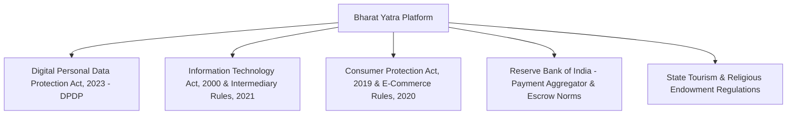

# Statutory & Regulatory Compliance Assessment

- **Status:** Approved
- **Owner:** Chief Legal Counsel & Data Protection Officer (DPO)
- **Last Updated:** 2026-10-29
- **Related Requirements / ADRs:** [`privacy-and-retention.md`](../07-security-privacy/privacy-and-retention.md), [`security-policy.md`](../07-security-privacy/security-policy.md), [`booking-lifecycle.md`](../13-business-workflows/booking-lifecycle.md)

---

## 1. Regulatory Landscape & Scope

**Bharat Yatra** operates as a pilgrimage and regional tourism platform in the Republic of India. The platform is subject to federal and state statutory frameworks governing digital privacy, intermediary liabilities, consumer protection, and electronic payments.

---

## 2. Statutory Assessment Matrix

| Statutory Act / Regulation | Regulatory Authority | Applicable Scope | Compliance Obligation | Architecture & System Control Ref |
| :--- | :--- | :--- | :--- | :--- |
| **Digital Personal Data Protection Act (DPDP), 2023** | Data Protection Board of India (DPBI) | All traveller, pilgrim, and merchant personal identifiers collected digitally. | • Itemized consent notices in English, Hindi & Gujarati. • Right to access, correction, and data erasure. • Data fiduciary accountability with zero unencrypted PII. | [`privacy-and-retention.md`](../07-security-privacy/privacy-and-retention.md), [`consent-requirements.md`](consent-requirements.md) |
| **Information Technology (Intermediary Guidelines) Rules, 2021** | MeitY (Govt. of India) | User-generated reviews, community crowd reports, and merchant profiles. | • Rule 3(1)(b) content prohibition. • Grievance Officer appointment with 48h acknowledgment and 30-day disposal. • 180-day audit log retention. | [`review-moderation.md`](../13-business-workflows/review-moderation.md), [`dispute-resolution.md`](../13-business-workflows/dispute-resolution.md) |
| **Consumer Protection (E-Commerce) Rules, 2020** | CCPA / Ministry of Consumer Affairs | Commercial bookings of local taxis, homestays, and tour guides. | • Mandatory country of origin. • Transparent pricing breakdown with zero hidden fees. • Non-discriminatory cancellation and automated refund policy. | [`cancellation-and-refunds.md`](../13-business-workflows/cancellation-and-refunds.md), [`booking-lifecycle.md`](../13-business-workflows/booking-lifecycle.md) |
| **RBI Payment Guidelines (PA/PG Guidelines, 2020)** | Reserve Bank of India (RBI) | Online payments, UPI Autopay, customer refunds, and merchant payouts. | • Zero card data storage on platform servers (tokenization only). • Escrow settlement timeline within $T+2$ business days. • UPI Instant Refund integration. | [`payments.md`](../09-integrations/payments.md) |
| **National Geospatial Policy, 2022** | Survey of India / DST | Maps, route calculation, PostGIS boundary calculations. | • No unauthorized high-precision scanning of restricted military zones. • Accurate representation of Indian external international boundaries. | [`maps-and-routing.md`](../09-integrations/maps-and-routing.md) |
| **State Religious Trusts & ASI Heritage Acts** | Rajasthan Devasthan Dept / Gujarat Pavitra Yatradham / ASI | Mount Abu Dilwara Temples, Ambaji Shaktipeeth, ASI monuments. | • Prohibition on unauthorized middleman commercial markups. • Strict redirection to official government trust portals for VIP darshan passes. | [`official-information-sources.md`](../09-integrations/official-information-sources.md) |

---

## 3. Statutory Grievance Redressal Officer

Per Rule 3(2) of the Information Technology Intermediary Rules, 2021:
- **Designation:** Resident Grievance Redressal Officer
- **Jurisdiction:** Republic of India
- **Email:** `grievance@bharatyatra.in`
- **Response TAT:** Acknowledgment within **24 hours**; Resolution within **15 days**.
