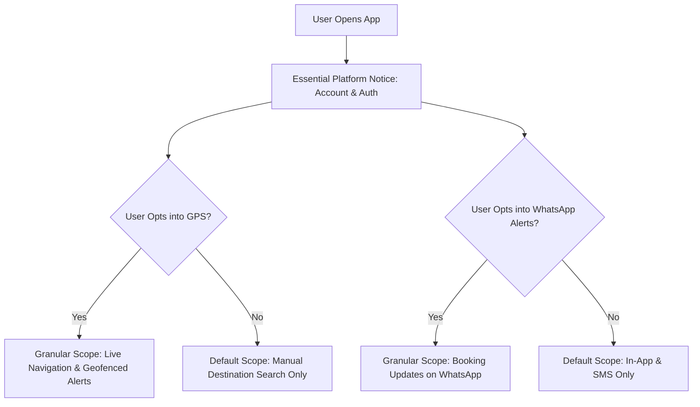

# User Consent Architecture & Notice Requirements

- **Status:** Approved
- **Owner:** Data Protection Officer (DPO) & Lead UX Designer
- **Last Updated:** 2026-10-29
- **Related Requirements / ADRs:** [`compliance-assessment.md`](compliance-assessment.md), [`consent-and-location-sharing.md`](../07-security-privacy/consent-and-location-sharing.md), [`localization.md`](../05-frontend-flutter/localization.md)

---

## 1. Statutory Mandate (DPDP Act, 2023)

Under Section 5 & Section 6 of the Indian **Digital Personal Data Protection Act, 2023**:
1. Every request for personal data must be accompanied or preceded by an **itemized, accessible notice** clearly stating the exact personal data to be collected and the specific purpose.
2. Consent must be **free, specific, informed, unconditional, and unambiguous**, requiring clear affirmative action. Pre-ticked checkboxes or forced bundled consent are legally invalid.
3. Notices must be available in **English and the 22 languages specified in the Eighth Schedule of the Constitution of India** (with our MVP prioritizing English, Hindi, and Gujarati).
4. Users have the statutory right to **withdraw consent as easily as it was given**.

---

## 2. Consent Matrix & Granular Scopes



| Scope Identifier | Data Collected | Justified Purpose | Default State | User Revocation Mechanism |
| :--- | :--- | :--- | :---: | :--- |
| `SCOPE_ACCOUNT_ESSENTIAL` | Mobile Number, Profile Name | Required to maintain authenticated session, security, and booking ledger. | Required | Account Deletion Request |
| `SCOPE_LOCATION_LIVE` | Continuous GPS Coordinates | Live road navigation, hill turn warnings, and geofenced crowd reporting. | Opt-In (Off) | In-app Settings Toggle / Device OS Settings |
| `SCOPE_NOTIF_WHATSAPP` | Phone Number, Booking State | Dispatching real-time driver ETA, booking vouchers, and ticket links. | Opt-In (Off) | In-app Notification Preferences |
| `SCOPE_ANALYTICS_ANON` | Screen view flows, UI latencies | App optimization, identifying dropped frames, and network error tracking. | Opt-In (Off) | In-app Privacy Settings |

---

## 3. Multilingual Consent Copy Standards

Consent banners must display clear, non-legalese copy:

```json
{
  "consent_location_title": {
    "en": "Allow Live Location for Pilgrimage Guidance?",
    "hi": "क्या आप तीर्थयात्रा मार्गदर्शन के लिए लाइव लोकेशन की अनुमति देते हैं?",
    "gu": "શું તમે યાત્રા માર્ગદર્શન માટે લાઈવ લોકેશનની મંજૂરી આપો છો?"
  },
  "consent_location_body": {
    "en": "We use your location only while the app is active to alert you to sharp ghat road curves, nearby temple amenities, and verified crowd wait times. You can turn this off anytime in Settings.",
    "hi": "हम केवल ऐप सक्रिय होने के दौरान ही आपकी लोकेशन का उपयोग घाट के मोड़ों, मंदिर सुविधाओं और प्रतीक्षा समय की सूचना देने के लिए करते हैं। इसे आप कभी भी सेटिंग्स में बंद कर सकते हैं।",
    "gu": "અમે ફક્ત એપ ચાલુ હોય ત્યારે જ ઘાટના વળાંકો, મંદિરની સુવિધાઓ અને લાઈનનો સમય જણાવવા લોકેશન વાપરીએ છીએ. તમે સેટિંગ્સમાં આ ગમે ત્યારે બંધ કરી શકો છો."
  }
}
```
