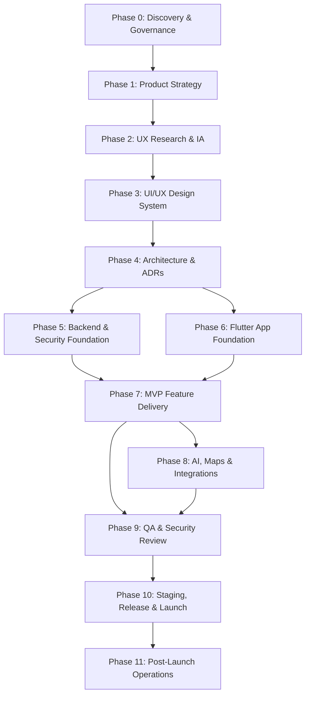

# Bharat Yatra / Trip Planner — Phase Status & Roadmap Information

> **File:** `docs/phases/phases_info.md`  
> **Authority:** Derived from Section 8 of [`Project_overview&prompt.md`](../../Project_overview&prompt.md), [`rules.md`](../../rules.md), and [`milestone-plan.md`](../14-project-management/milestone-plan.md).  
> **Last Updated:** 2026-11-02  
> **Current Status:** Milestone 0 (Documentation & Architecture Foundation) Complete. Milestone 1 (Platform Foundation) Pending.

---

## 1. Executive Summary

The project is governed strictly under enterprise engineering principles requiring complete architecture, security, design, and product specifications before code implementation begins.

- **Completed**: Milestone 0 is **100% complete**. All 184 specification documents across 16 taxonomies under `docs/` have been drafted, vetted, and approved.
- **Remains**: Application codebase implementation across Flutter (Frontend), Supabase/PostgreSQL (Backend, Migrations, RLS), AI Edge Functions, external integrations (Maps, Payments), and automated test suites.

---

## 2. Phase-by-Phase Breakdown

---

### Phase 0 — Repository and Project Discovery
- **Directory**: [`docs/phases/phase-00-discovery/`](./phase-00-discovery/)
- **Associated Docs**: [`docs/00-governance/`](../00-governance/)
- **Status**: ✅ **COMPLETED**
- **What is Completed**:
  - Full codebase inspection and tooling environment discovery.
  - Project charter, team roles, governance definitions, and risk register.
  - Definition of Done ([`definition-of-done.md`](../00-governance/definition-of-done.md)) and engineering constitution ([`rules.md`](../../rules.md)).
- **What Remains**:
  - Ongoing maintenance of the risk register and decision logs as implementation progresses.

---

### Phase 1 — Product Strategy and Business Analysis
- **Directory**: [`docs/phases/phase-01-product-strategy/`](./phase-01-product-strategy/)
- **Associated Docs**: [`docs/01-product/`](../01-product/)
- **Status**: ✅ **COMPLETED** (Planning & Strategy)
- **What is Completed**:
  - Product Requirements Document ([`prd.md`](../01-product/prd.md)) covering pan-India scope with Mount Abu & Ambaji pilot.
  - User personas, functional & non-functional requirements, and user stories.
  - Requirements Traceability Matrix ([`requirements-traceability.md`](../01-product/requirements-traceability.md)).
  - Product Roadmap ([`product-roadmap.md`](../01-product/product-roadmap.md)) and MoSCoW feature prioritization.
- **What Remains**:
  - None for planning phase. Live telemetry tracking and feature metric adjustments upon launch.

---

### Phase 2 — UX Research and Information Architecture
- **Directory**: [`docs/phases/phase-02-ux-research/`](./phase-02-ux-research/)
- **Associated Docs**: [`docs/02-ux-research/`](../02-ux-research/)
- **Status**: ✅ **COMPLETED** (Research & IA)
- **What is Completed**:
  - Information Architecture ([`information-architecture.md`](../02-ux-research/information-architecture.md)) and master sitemap.
  - User journeys, core user flows (pilgrimage, booking, discovery), and usability testing plan.
  - Multi-language localization research and accessibility requirements.
- **What Remains**:
  - In-person user testing sessions in pilot destinations (Mount Abu & Ambaji) during Beta release.

---

### Phase 3 — UI/UX Design and Design System
- **Directory**: [`docs/phases/phase-03-ui-ux-design/`](./phase-03-ui-ux-design/)
- **Associated Docs**: [`docs/03-ui-ux/`](../03-ui-ux/)
- **Status**: ✅ **COMPLETED** (Specifications & Design Tokens)
- **What is Completed**:
  - Color palette, typography scales, spacing tokens, and visual direction.
  - Component specifications and interaction patterns.
  - Explicit UI state handling guidelines: Loading, Content, Empty, Error, and Offline/Retry states.
  - Full screen layout specifications for core screens.
- **What Remains**:
  - Translating design tokens and reusable widget specifications into Flutter widget code in `lib/core/components/`.

---

### Phase 4 — Architecture and Technical Decisions
- **Directory**: [`docs/phases/phase-04-architecture/`](./phase-04-architecture/)
- **Associated Docs**: [`docs/04-architecture/`](../04-architecture/), [`docs/12-api-and-data-contracts/`](../12-api-and-data-contracts/)
- **Status**: ✅ **COMPLETED** (Architectural Blueprints)
- **What is Completed**:
  - System context, data flow diagrams, and integration architecture.
  - Frontend (Flutter/Riverpod) and Backend (Supabase/PostgreSQL/PostGIS) architectures.
  - Architecture Decision Records (ADRs) template and foundation records.
  - API & Data contracts: REST conventions, RFC 7807 error contracts, and CloudEvents specifications.
- **What Remains**:
  - Validating real-world latency, cache invalidation, and connection pooling under load.

---

### Phase 5 — Database, Backend and Security Foundation
- **Directory**: [`docs/phases/phase-05-backend-supabase-security/`](./phase-05-backend-supabase-security/)
- **Associated Docs**: [`docs/06-backend-supabase/`](../06-backend-supabase/), [`docs/07-security-privacy/`](../07-security-privacy/)
- **Status**: 📝 **SPECS COMPLETED** | ⏳ **IMPLEMENTATION PENDING**
- **What is Completed**:
  - Complete relational schema specifications, ERD, and Data Dictionary.
  - Row-Level Security (RLS) policy matrix covering all roles and tables.
  - Threat modeling, auth security standards, and DPDP Act compliance model.
- **What Remains (Implementation)**:
  - [ ] Initialize Supabase project CLI and config.
  - [ ] Write versioned PostgreSQL migration scripts (`supabase/migrations/`).
  - [ ] Implement PostGIS extensions and spatial tables/indexes.
  - [ ] Implement RLS policies and automated pgTAP test harness.
  - [ ] Implement Phone Auth OTP edge handlers with rate limiting.

---

### Phase 6 — Flutter Application Foundation
- **Directory**: [`docs/phases/phase-06-frontend-flutter/`](./phase-06-frontend-flutter/)
- **Associated Docs**: [`docs/05-frontend-flutter/`](../05-frontend-flutter/)
- **Status**: 📝 **SPECS COMPLETED** | ⏳ **IMPLEMENTATION PENDING**
- **What is Completed**:
  - Modular feature-first project structure design (`lib/features/...`, `lib/core/...`).
  - State management strategy (Riverpod) and routing rules (GoRouter).
  - Trilingual localization architecture (English, Hindi, Gujarati).
  - Offline-first synchronization design and local caching strategy.
- **What Remains (Implementation)**:
  - [ ] Scaffold Flutter 3.x project with strict analysis options.
  - [ ] Implement core theme, typography, color palette, and design tokens.
  - [ ] Set up GoRouter with route guards and auth redirect listeners.
  - [ ] Implement network client, local SQLite database, and repository layers.
  - [ ] Build shared UI widgets with full state handling (Loading/Empty/Error/Offline).

---

### Phase 7 — MVP Feature Delivery
- **Directory**: [`docs/phases/phase-07-mvp-feature-delivery/`](./phase-07-mvp-feature-delivery/)
- **Associated Docs**: [`docs/13-business-workflows/`](../13-business-workflows/), [`docs/14-project-management/`](../14-project-management/)
- **Status**: 📝 **SPECS COMPLETED** | ⏳ **IMPLEMENTATION PENDING**
- **What is Completed**:
  - Detailed business workflows: Booking lifecycle state machine, KYC verification, cancellations, refund engine, and dispute resolution.
  - Product backlog ([`backlog.md`](../14-project-management/backlog.md)) with MoSCoW prioritization and sprint plans.
- **What Remains (Implementation)**:
  - [ ] Implement Destination & Attraction discovery screens with category filters.
  - [ ] Implement Mount Abu & Ambaji POI dataset seeding.
  - [ ] Build Traveller Account profile & saved itineraries features.
  - [ ] Build Local Business directory and enquiry/lead forms.
  - [ ] Implement commercial booking state machine with atomic reservation locks.

---

### Phase 8 — AI, Maps and External Integrations
- **Directory**: [`docs/phases/phase-08-ai-maps-integrations/`](./phase-08-ai-maps-integrations/)
- **Associated Docs**: [`docs/08-ai-and-data/`](../08-ai-and-data/), [`docs/09-integrations/`](../09-integrations/)
- **Status**: 📝 **SPECS COMPLETED** | ⏳ **IMPLEMENTATION PENDING**
- **What is Completed**:
  - AI prompt management, output JSON schemas, and anti-hallucination guardrails.
  - Rule-based deterministic fallback itinerary templates.
  - Integration contracts for Maps/Routing, Geocoding, Razorpay Payments, and Push Notifications.
- **What Remains (Implementation)**:
  - [ ] Implement Supabase Edge Function AI itinerary proxy with JSON schema validation.
  - [ ] Build sacred ritual timing validator and transit feasibility checks.
  - [ ] Integrate map rendering and offline tile cache.
  - [ ] Integrate Razorpay mobile SDK & server-side webhook signature verification.

---

### Phase 9 — Quality Assurance and Security Review
- **Directory**: [`docs/phases/phase-09-qa-security-review/`](./phase-09-qa-security-review/)
- **Associated Docs**: [`docs/10-quality-and-testing/`](../10-quality-and-testing/)
- **Status**: 📝 **SPECS COMPLETED** | ⏳ **IMPLEMENTATION PENDING**
- **What is Completed**:
  - Master Test Plan, automated testing pyramid strategy, and test cases catalog.
  - 8 Release Quality Gates (`QG-1` through `QG-8`).
  - Unit, Widget, Integration (Patrol/Maestro), and Security test guidelines.
- **What Remains (Implementation)**:
  - [ ] Write unit tests for Riverpod providers and domain repositories ($\ge 80\%$ coverage).
  - [ ] Write Golden widget tests for design system components.
  - [ ] Implement pgTAP test suite for database RLS policies.
  - [ ] Conduct automated static security analysis and OWASP mobile review.

---

### Phase 10 — Staging, Release and Launch
- **Directory**: [`docs/phases/phase-10-staging-release-launch/`](./phase-10-staging-release-launch/)
- **Associated Docs**: [`docs/11-devops-and-operations/`](../11-devops-and-operations/), [`docs/15-release-and-maintenance/`](../15-release-and-maintenance/)
- **Status**: 📝 **SPECS COMPLETED** | ⏳ **IMPLEMENTATION PENDING**
- **What is Completed**:
  - Multi-stage environment topology (Dev, Staging, Prod).
  - CI/CD workflow designs, release checklists, and rollback runbooks.
  - Operational Readiness Review (ORR) audit criteria and SLA frameworks.
- **What Remains (Implementation)**:
  - [ ] Configure GitHub Actions CI workflow (linting, tests, build).
  - [ ] Set up staging Supabase project and secret provisioning.
  - [ ] Configure Android Keystore and iOS certificates for signed builds.
  - [ ] Set up Sentry error reporting and BetterUptime health probes.

---

### Phase 11 — Post-Launch Operations and Growth
- **Directory**: [`docs/phases/phase-11-post-launch-operations/`](./phase-11-post-launch-operations/)
- **Associated Docs**: [`docs/16-compliance-and-governance/`](../16-compliance-and-governance/)
- **Status**: 📝 **SPECS COMPLETED** | ⏳ **POST-LAUNCH PENDING**
- **What is Completed**:
  - Statutory compliance assessments (DPDP Act 2023, IT Rules, Consumer Protection).
  - Record of Processing Activities (RoPA) and consent requirements.
  - Deprecation policy and maintenance schedules.
- **What Remains (Post-Launch)**:
  - [ ] Production telemetry and analytics monitoring.
  - [ ] Merchant support operations and grievance resolution SLA tracking.
  - [ ] Pan-India geographic expansion iterations (Milestone 5).

---

## 3. High-Level Summary Table

| Phase | Description | Architecture / Docs | Codebase Implementation | Next Immediate Focus |
| :---: | :--- | :---: | :---: | :--- |
| **0** | Discovery & Governance | ✅ 100% Complete | ✅ N/A | Ongoing audit |
| **1** | Product Strategy | ✅ 100% Complete | ✅ N/A | Scope tracking |
| **2** | UX Research & IA | ✅ 100% Complete | ✅ N/A | Field testing |
| **3** | UI/UX Design System | ✅ 100% Complete | ⏳ Pending | Widget tokens implementation |
| **4** | Technical Architecture | ✅ 100% Complete | ✅ N/A | ADR maintenance |
| **5** | Supabase & Security | ✅ 100% Complete | ⏳ Pending | **Sprint 1: Schema & Migrations** |
| **6** | Flutter App Foundation | ✅ 100% Complete | ⏳ Pending | **Sprint 1: App Shell Scaffolding** |
| **7** | MVP Feature Delivery | ✅ 100% Complete | ⏳ Pending | Sprints 2–6: Discovery & Booking |
| **8** | AI & Integrations | ✅ 100% Complete | ⏳ Pending | Sprints 3–6: Edge Functions & Maps |
| **9** | QA & Security Review | ✅ 100% Complete | ⏳ Pending | Automated test suites & CI gates |
| **10** | Staging, Release & CI/CD| ✅ 100% Complete | ⏳ Pending | GitHub Actions & Store builds |
| **11** | Post-Launch Operations | ✅ 100% Complete | ⏳ Pending | Post-release monitoring |
