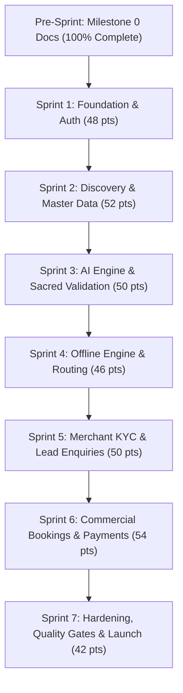

# Bharat Yatra / Trip Planner — Master Sprint Information & Tracking

> **File:** `docs/sprints/sprints_info.md`  
> **Authority:** Derived from [`docs/14-project-management/sprint-plan.md`](../14-project-management/sprint-plan.md), [`backlog.md`](../14-project-management/backlog.md), and [`milestone-plan.md`](../14-project-management/milestone-plan.md).  
> **Cadence:** Two-week fixed sprints.  
> **Squad Capacity:** 6 Engineers (~45 to 55 story points per sprint).  
> **Current Sprint:** Sprint 1 (Ready to Begin).

---

## 1. Executive Summary

While all 184 architectural, product, and technical specifications (Milestone 0) are 100% complete, application codebase execution proceeds across **7 targeted sprints** from foundational platform setup to public production launch.

---

## 2. Sprint Roadmap & Status Matrix

| Sprint | Code / Name | Target Milestone | Planned Points | Status | Primary Focus |
| :---: | :--- | :---: | :---: | :---: | :--- |
| **Sprint 1** | Foundation & Auth | M1 | 48 | ⏳ **Next Up** | Scaffolding Flutter app, Supabase migrations, Phone OTP auth, trilingual localization. |
| **Sprint 2** | Discovery & Master Data | M1 | 52 | ⏳ Queued | Mount Abu / Ambaji POI seeds, PostGIS queries, Flutter discovery cards, CI/CD pipeline. |
| **Sprint 3** | AI Generation & Rules | M2 | 50 | ⏳ Queued | LLM Edge Function proxy, JSON schema validation, sacred conflict engine, fallback templates. |
| **Sprint 4** | Offline Engine & Routing | M2 | 46 | ⏳ Queued | Drift/SQLite offline caching, vector map tiles, WCAG AA accessibility audits. |
| **Sprint 5** | Merchant KYC & Enquiries | M3 | 50 | ⏳ Queued | Vendor onboarding, private storage bucket, lead enquiry forms, crowd reporting. |
| **Sprint 6** | Bookings & Payments | M3 | 54 | ⏳ Queued | Booking state machine, concurrency lock, Razorpay checkout & webhook reconciliation. |
| **Sprint 7** | Hardening & Store Launch| M4 | 42 | ⏳ Queued | E2E Patrol/Maestro tests, DAST security review, ORR sign-off, Play/App Store submission. |

---

## 3. Sprint Directory Organization

Each sprint has a dedicated subdirectory under `docs/sprints/` containing a `sprint_tasks.md` breakdown detailing exact story points, tasks, implementation steps, and acceptance criteria:

- [`sprint-01-foundation-auth/sprint_tasks.md`](./sprint-01-foundation-auth/sprint_tasks.md)
- [`sprint-02-discovery-master-data/sprint_tasks.md`](./sprint-02-discovery-master-data/sprint_tasks.md)
- [`sprint-03-ai-engine-rules/sprint_tasks.md`](./sprint-03-ai-engine-rules/sprint_tasks.md)
- [`sprint-04-offline-routing/sprint_tasks.md`](./sprint-04-offline-routing/sprint_tasks.md)
- [`sprint-05-merchant-kyc-discovery/sprint_tasks.md`](./sprint-05-merchant-kyc-discovery/sprint_tasks.md)
- [`sprint-06-bookings-payments/sprint_tasks.md`](./sprint-06-bookings-payments/sprint_tasks.md)
- [`sprint-07-hardening-launch/sprint_tasks.md`](./sprint-07-hardening-launch/sprint_tasks.md)
